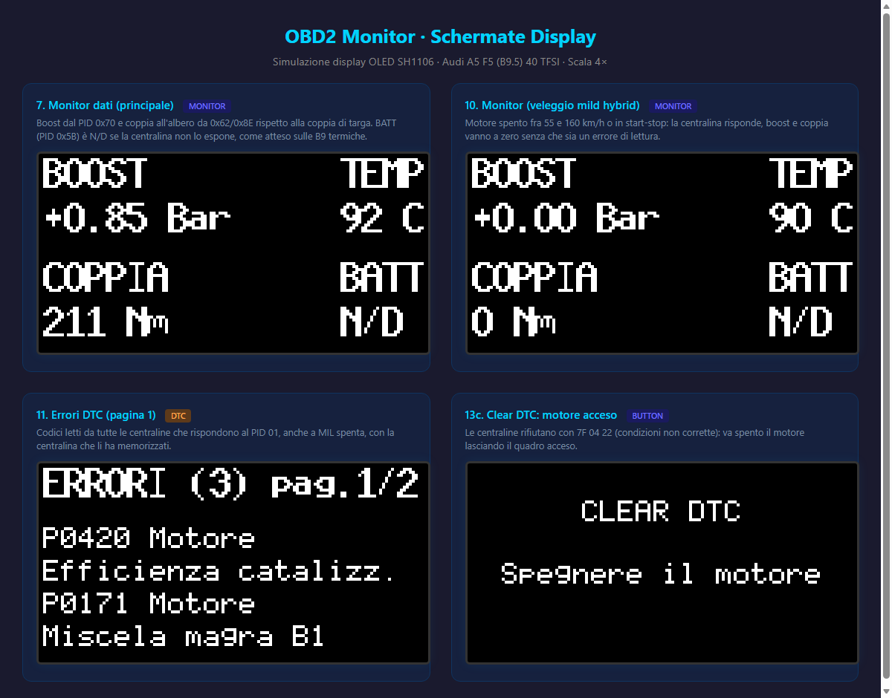
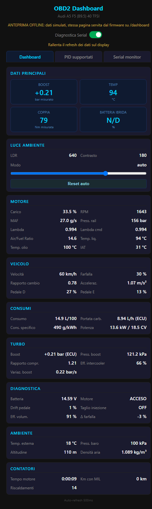

# OBD2 Car Dashboard OLED

Dashboard motore in tempo reale per **Audi A5 F5 (B9.5) 40 TFSI 150 kW mild hybrid S-tronic**, basata su ESP8266 e display OLED SH1106 1.3" (128×64). Il progetto offre **due sketch alternativi** che condividono dashboard, modelli fisici e web server, e si differenziano solo per il transport verso l'ECU.

> ℹ️ **Stato**: firmware e anteprime sono allineati alla A5 F5 40 TFSI. Il profilo vettura in [`obd_live.h`](obd_live.h) è quello iniziale, ricavato da catture di altre B9: va sostituito con il profilo suggerito dalla prima scansione completa eseguita sull'auto (§5.1, §5.5).

> 🖥️ **Anteprime interattive** nel browser, senza clonare la repo: [display OLED](https://raw.githack.com/alesimattia/OBD2-car_dashboard-OLED/main/ui_preview.html) (§3.1) e [dashboard web](https://raw.githack.com/alesimattia/OBD2-car_dashboard-OLED/main/monitor_preview.html) (§11.5).

---

## 📋 Indice

1. [Panoramica](#1-panoramica)
2. [Le due varianti a confronto](#2-le-due-varianti-a-confronto)
3. [Architettura](#3-architettura)
   - [3.1 Anteprima del display OLED](#31-anteprima-del-display-oled)
4. [Hardware e cablaggio](#4-hardware-e-cablaggio)
   - [4.1 Componenti comuni](#41-componenti-comuni)
   - [4.2 Variante CANbus_conn](#42-variante-canbus_conn)
   - [4.3 Variante WIFI_conn](#43-variante-wifi_conn)
5. [Veicolo target](#5-veicolo-target)
   - [5.1 Scansione completa (OBD2 e UDS)](#51-scansione-completa-obd2-e-uds)
   - [5.2 PID letti dal firmware e formule](#52-pid-letti-dal-firmware-e-formule)
   - [5.3 Parametri monitorabili in più](#53-parametri-monitorabili-in-più)
   - [5.4 Riferimento Mode OBD2 e UDS](#54-riferimento-mode-obd2-e-uds)
   - [5.5 Scan da PC con tools/pid_scan.ps1](#55-scan-da-pc-con-toolspid_scanps1)
6. [Software e build](#6-software-e-build)
7. [Configurazione](#7-configurazione)
8. [Lettura live multi-PID](#8-lettura-live-multi-pid)
9. [Modelli fisici e calcoli derivati](#9-modelli-fisici-e-calcoli-derivati)
10. [Pulsante fisico](#10-pulsante-fisico)
11. [Interfaccia web /dashboard](#11-interfaccia-web-dashboard)
12. [Auto-brightness OLED](#12-auto-brightness-oled)
13. [DTC, codici di errore](#13-dtc-codici-di-errore)
14. [Note operative e limiti](#14-note-operative-e-limiti)
15. [Licenza](#15-licenza)
   - [15.1 Fonti e licenze](#151-fonti-e-licenze)

---

## 1. Panoramica

Entrambi gli sketch:

- Al boot vanno subito al monitor con il **profilo vettura** di [`obd_live.h`](obd_live.h), senza interrogare la vettura per scoprirne le centraline; dal web si avvia la **scansione completa** in sola lettura di tutte le centraline OBD2 e UDS, con report su Serial, riepilogo nella pagina `/scan` e profilo suggerito da incollare nel firmware (§5.1).
- Mostrano sull'OLED 4 metriche live (**BOOST**, **TEMP**, **COPPIA**, **BATT**) con aggiornamento parziale del framebuffer; boost e coppia vengono dalla centralina o, in sua assenza, dai modelli fisici (§8).
- Leggono i valori principali con **una richiesta multi-PID per ciclo** (fino a 6 PID), con ripiego automatico a un PID per ciclo.
- Espongono via SoftAP un **web dashboard** (`/dashboard`) con diagnostica completa e refresh JSON ogni 500 ms.
- Leggono e cancellano i **DTC di tutte le centraline OBD** che rispondono (Mode 03 / Mode 04), mostrandoli paginati sul display con la centralina di provenienza.
- Supportano **OTA** firmware via browser su `http://192.168.4.1`.
- Sono pilotabili da un **pulsante fisico** per ciclare le schermate e cancellare i DTC.
- Regolano automaticamente la **luminosità dell'OLED** in base alla luce ambientale (LDR su ADC, opzionale), con override manuale dal web dashboard; senza LDR il contrasto resta al 50%.

---

## 2. Le due varianti a confronto

| Caratteristica | [`CANbus_conn/`](CANbus_conn/) | [`WIFI_conn/`](WIFI_conn/) |
|---|---|---|
| **Transport ECU** | CAN nativo via MCP2515/TJA1050 (SPI) | TCP via adattatore ELM327 WiFi |
| **Hardware extra** | Modulo MCP2515 + TJA1050 (8 o 16 MHz) | Adattatore ELM327 WiFi commerciale |
| **Refresh OBD** | **~25-50 cicli/s** stimati, tutti i valori principali per ciclo | ~5-8 cicli/s stimati |
| **Latenza tipica per richiesta** | ~10-25 ms (multi-frame compreso) | ~120-200 ms |
| **Distinzione delle centraline** | ID CAN di ogni frame | header CAN attivi (`ATH1`); senza, una sola centralina |
| **Cablaggio** | SPI + I²C + OBD2 connector | Solo I²C + alimentazione |
| **Costo aggiuntivo** | ~5 € (MCP2515) | ~10-15 € (ELM327 WiFi) |
| **Affidabilità segnale** | Alta (CAN nativo) | Dipende da qualità ELM327 |
| **WiFi mode** | `WIFI_AP` (solo SoftAP per OTA/dashboard) | `WIFI_AP_STA` (STA verso ELM327 + AP per OTA/dashboard) |
| **Endpoint OTA** | `/update` | `/ota` |
| **Compatibile ESP-01** | ❌ No (mancano pin SPI) | ✅ Sì, senza LDR (§4.3) |

**Quale scegliere?** Per uso quotidiano con refresh elevato e affidabilità: **CANbus_conn**. Per un setup veloce senza saldature, riusando un ELM327 esistente: **WIFI_conn**.

---

## 3. Architettura

```
                   ┌──────────────────────────────────┐
                   │         ESP8266 D1 Mini          │
                   │                                  │
   CAN 500 kbps    │  ┌────────────┐   ┌───────────┐  │  I²C 400 kHz
   (OBD2 pin 6/14)─┼──┤  MCP2515   │   │   U8g2    ├──┼─────► OLED SH1106 128×64
                   │  └────┬───────┘   └─────┬─────┘  │
                   │       │ SPI             │        │
                   │  ┌────▼─────────────────▼─────┐  │
                   │  │  Lettura live multi-PID    │  │
                   │  │ (boost o MAP, carico, RPM, │  │
                   │  │  MAF, coppia + 1 lento)    │  │
                   │  └────┬──────────────────┬────┘  │
                   │       │ cache PID        │       │
                   │  ┌────▼─────┐  ┌─────────▼────┐  │
                   │  │ Boost:   │  │ Coppia:      │  │
                   │  │ 0x70 o   │  │ 0x62 o       │  │
                   │  │ modello  │  │ modello      │  │
                   │  └──────────┘  └──────────────┘  │
                   │                                  │
                   │  ┌─── HTTP server (port 80) ───┐ │
                   │  │ /dashboard /data /scan      │ │
                   │  │ /scan-data /probe /debug    │ │
                   │  │ /probe-status /serial-data  │ │
                   │  │ /clear-dtc /brightness      │ │
                   │  │ /update (CAN) /ota (WiFi)   │ │
                   │  └──────────────────────────────┘ │
                   └──────────────────────────────────┘
                              ▲ SoftAP "OBD2_UPDATE"
                              ▼
                          smartphone
```

Nello sketch **WIFI_conn** il blocco MCP2515 è sostituito da un `WiFiClient` TCP verso `192.168.0.10:35000` (porta dell'ELM327); l'ESP8266 lavora in `WIFI_AP_STA` (STA verso l'ELM327 + AP per l'OTA/dashboard).

Il codice OBD è condiviso dalle due varianti in quattro header della root:

| File | Ruolo |
|---|---|
| [`obd_proto.h`](obd_proto.h) | primitive di protocollo senza dipendenze da Arduino: ID a 11 e 29 bit, bitmap dei PID, riassemblaggio ISO-TP, righe ELM327 con header, decodifica di DTC, risposte negative, multi-PID, boost `0x70`, OBFCM, interprete dei segnali OBDb, Mode 06 con la scala UASID, conteggio DTC UDS (`59 01`), date BCD |
| [`obd_scan.h`](obd_scan.h) | scansione completa (§5.1): macchina a stati, regole failsafe, elenco ODIS delle centraline VAG con i nomi italiani, report Serial, JSON di `/scan-data` e profilo suggerito; dichiara il contratto del trasporto |
| [`obd_live.h`](obd_live.h) | blocco "Profilo vettura", lettura live, DTC e istantanea diagnostica |
| [`obdb_signals.h`](obdb_signals.h) | tabelle PROGMEM dei segnali OBDb interpretabili (comandi, segnali, scale, limiti, unità, testi) lette dalla scansione completa; è generato, non si modifica a mano |

[`tools/obdb_select.ps1`](tools/obdb_select.ps1) è il generatore: applica ai signalset OBDb, copiati in [`tools/obdb/`](tools/obdb/) a commit fissati, le regole di interpretabilità e l'anno modello (`-ModelYear`, 2022 di default, l'unico punto in cui vive l'anno) e produce `obdb_signals.h`, `tools/obdb/selection.json` (la selezione per `pid_scan.ps1`, così i due scan usano gli stessi segnali), `tools/obdb/selection.txt` (elenco incluso/escluso con il motivo).

Ogni sketch fornisce solo il trasporto, cioè `obdTransact()`, `obdTransportDiscoveryBurst()` e `obdTransportRestore()`. Su CAN nativo invia la richiesta, a 29 bit quando l'ID lo richiede, e riassembla i frame inviando il flow control alla centralina (risposta − 8 in OBD, ID di richiesta per le coppie UDS VAG, con STmin 5 ms); fa anche la raffica della discovery UDS. Sull'ELM327 imposta header (`ATSH`, più `ATCP` a 29 bit), protocollo (`ATSP6` o `ATSP7`), filtri di ricezione (`ATCF`/`ATCM`) e flow control verso l'ID di richiesta (`ATFCSH`, `ATFCSM1`) secondo il modo di ricezione, legge le righe con gli header CAN attivi e a fine scansione reinizializza l'adattatore; la raffica non è disponibile e la discovery procede in sequenza.

### 3.1 Anteprima del display OLED

[`ui_preview.html`](ui_preview.html) mostra nel browser, senza ESP, le 20 schermate del display con valori realistici: avvio e connessione (1-6), monitor (7-10), DTC (11-12), cancellazione dei DTC (13a-13c), scansione completa (14), errori di rete (15-16), "Motore non risponde" (17) e riconnessione (18). L'immagine riporta le schermate 7, 10, 11 e 13c; cliccandola si apre la versione live.

<p align="center">
  <a href="https://raw.githack.com/alesimattia/OBD2-car_dashboard-OLED/main/ui_preview.html">
    
  </a>
</p>

---

## 4. Hardware e cablaggio

### 4.1 Componenti comuni

| Componente | Note |
|---|---|
| ESP8266 **D1 Mini** (clone) | 4 MB flash, partizione `4M (no FS)` |
| **OLED SH1106 1.3" I²C** | 128×64 monocromo, indirizzo `0x3C` |
| Pulsante NA verso GND | Debounce software 50 ms |
| Fotoresistore GL5528 + 10 kΩ pull-down (opzionale, solo D1 Mini) | Voltage divider su `A0` per auto-brightness; senza, contrasto fisso al 50% (§12) |

### 4.2 Variante `CANbus_conn`

Componenti aggiuntivi:
- Modulo **MCP2515 + TJA1050** con cristallo 8 MHz (configurabile a 16 MHz via `#define MCP2515_CRYSTAL`)
- Cavo OBD2 con accesso a CAN-H (pin 6) / CAN-L (pin 14) / GND (pin 4 o 5)

Cablaggio:

| Segnale | ESP8266 | MCP2515 / OLED / OBD2 |
|---|---|---|
| MCP2515 VCC | 5 V | VCC |
| MCP2515 GND | GND | GND |
| MCP2515 CS  | **D8** (GPIO15) | CS |
| MCP2515 SO  | **D6** (GPIO12) | SO  *(MISO)* |
| MCP2515 SI  | **D7** (GPIO13) | SI  *(MOSI)* |
| MCP2515 SCK | **D5** (GPIO14) | SCK |
| MCP2515 INT | **D0** (GPIO16) | INT (non usato in polling) |
| OLED VCC | 3.3 V | VCC |
| OLED GND | GND | GND |
| OLED SCL | **D1** (GPIO5) | SCL |
| OLED SDA | **D2** (GPIO4) | SDA |
| OBD2 CAN-H | — | MCP2515 CANH ↔ pin 6 OBD2 |
| OBD2 CAN-L | — | MCP2515 CANL ↔ pin 14 OBD2 |
| GND OBD2 | GND | pin 4/5 OBD2 |
| Pulsante | **D3** (GPIO0) | altro lato → GND |
| LDR (lato luce) | 3.3 V | LDR |
| LDR (giunzione) | **A0** | LDR ↔ resistore 10 kΩ ↔ GND |

> ⚠️ Il pin **D3 (GPIO0)** è anche pin di boot dell'ESP8266: il pulsante deve restare *aperto* al power-on, altrimenti l'ESP entra in flash mode. Lo schema NA + `INPUT_PULLUP` è già conforme.

### 4.3 Variante `WIFI_conn`

Componenti aggiuntivi:
- Adattatore **ELM327 WiFi** generico (rete `WiFi_OBDII` aperta, IP `192.168.0.10:35000`)

Lo sketch gira su **LOLIN D1 Mini** o su **ESP-01** e sceglie il profilo dalla board selezionata nell'IDE: "Generic ESP8266 Module" attiva il profilo ESP-01, ogni altra board quello del D1 Mini. L'OLED usa GPIO0/GPIO2 su entrambe, gli unici pin liberi dell'ESP-01 oltre a RX e TX.

Cablaggio su D1 Mini (display + pulsante + LDR, niente CAN):

| Segnale | D1 Mini | Periferica |
|---|---|---|
| OLED VCC | 3.3 V | VCC |
| OLED GND | GND | GND |
| OLED SDA | **GPIO0** (D3) | SDA |
| OLED SCL | **GPIO2** (D4) | SCL |
| Pulsante | **D5** (GPIO14) | altro lato → GND |
| LDR (lato luce) | 3.3 V | LDR |
| LDR (giunzione) | **A0** | LDR ↔ resistore 10 kΩ ↔ GND |

> ⚠️ Il pulsante è su **D5 (GPIO14)**: D3/D4 sono l'I²C dell'OLED, D0 non ha pull-up interno, D8 deve restare basso all'avvio e RX/TX sono del convertitore USB. D1, D2, D6 e D7 sarebbero equivalenti.

Cablaggio su ESP-01 (display + pulsante, niente LDR):

| Segnale | ESP-01 | Periferica |
|---|---|---|
| OLED VCC | 3.3 V | VCC |
| OLED GND | GND | GND |
| OLED SDA | **GPIO0** | SDA |
| OLED SCL | **GPIO2** | SCL |
| Pulsante | **GPIO3 (RX)** tramite 1 kΩ in serie | altro lato → GND |
| CH_PD (EN) | 3.3 V | abilitazione del chip |

> ⚠️ Sull'ESP-01 il pulsante usa RX, quindi la seriale lavora in sola trasmissione e i log restano su TX. La resistenza da 1 kΩ in serie protegge l'uscita TX dell'adattatore USB-seriale se il pulsante viene premuto mentre si carica il firmware; GPIO3 non decide la modalità di avvio, quindi premerlo all'accensione non ha effetti.

> L'ESP-01 non porta fuori l'ingresso analogico: il profilo ESP-01 disattiva l'LDR (`LDR_ENABLED` = 0) e il contrasto resta a `defaultBrightness`, regolabile dallo slider della dashboard (§12).

---

## 5. Veicolo target

| Parametro | Valore |
|---|---|
| Modello | Audi A5 F5 (B9.5, restyling), produzione da 07/2020 |
| Motore | **DMSA**, 2.0 TFSI 4 cilindri in linea benzina della famiglia EA888, montato longitudinalmente |
| Cilindrata / alesaggio × corsa / compressione | 1984 cm³ / 82.5 × 92.8 mm / **12.2:1** |
| Distribuzione | bilancieri a rullo, variazione continua della fasatura su aspirazione e scarico, punterie idrauliche, 4 valvole per cilindro |
| Alimentazione | iniezione diretta, regolazione lambda, controllo detonazione, turbocompressore con intercooler; benzina 95 ottani EN 228 |
| Potenza / Coppia | **150 kW (204 CV)** a 4475-6000 rpm / **320 Nm** a 1450-4475 rpm |
| Cambio | **S-tronic 7 rapporti** DL382, codice `0CK`: doppia frizione in bagno d'olio a comando idraulico, rapporti nella tabella più sotto |
| Trazione | anteriore |
| Ibridazione | **Mild hybrid 12 V**: belt alternator starter (BAS) collegato all'albero motore, recupero in rilascio fino a 5 kW, batteria agli ioni di litio 12 V 10 Ah separata nella zona posteriore |
| Impianto elettrico | 12 V, potenza elettrica massima 3.1 kW |
| Post-trattamento | catalizzatore, sonda lambda, filtro antiparticolato benzina (GPF) |
| Emissioni | Euro 6d o Euro 6e secondo l'anno di produzione (la scheda Audi 06/2024 riporta Euro 6e) |
| Prestazioni | 210 km/h autolimitata, 0-100 km/h in 7.2 s |
| Pneumatici di serie | 225/50 R17 su cerchio 7.5J × 17 |
| Capacità | olio motore 5.2 L con filtro, circuito di raffreddamento 8 L, serbatoio 54 L |
| Massa | 1515 kg a vuoto senza conducente, 2085 kg complessiva |
| Manutenzione | tagliando ogni 30000 km o 2 anni |
| Bus diagnostica | **CAN 11 bit a 500 kbps** (ISO 15765-4) |

> ℹ️ I dati vengono dalla scheda tecnica Audi (eTD) della A5 Sportback 40 TFSI S-tronic 150 kW MHEV a trazione anteriore. Su Coupè e Cabriolet cambiano masse e prestazioni: per la Coupè ADAC riporta 1560 kg e 0-100 km/h in 7.1 s. Le costanti che il firmware usa per questo motore sono in [`EngineConstants.h`](EngineConstants.h).

> ⚠️ VAG espone solo i PID Mode 01 richiesti per le emissioni: su un benzina Euro 6d compaiono tipicamente correzioni carburante, sonda lambda a valle del catalizzatore e temperatura catalizzatore. L'elenco effettivo va rilevato con la scansione completa (§5.1).

#### Rapporti del cambio S-tronic `0CK`

Coppia finale **4.234**, retromarcia 2.750. Le velocità sono calcolate con la circonferenza di rotolamento di 2.00 m del pneumatico di serie (`TYRE_ROLLING_CIRCUMFERENCE_M`), quindi sono indicative: con cerchi diversi o pneumatici usurati variano di qualche punto percentuale.

| Marcia | Rapporto cambio | Rapporto totale | km/h ogni 1000 rpm | rpm a 100 km/h | km/h a 6000 rpm |
|---|---|---|---|---|---|
| 1ª | 3.188 | 13.50 | 8.9 | fuori giri | 53 |
| 2ª | 2.190 | 9.27 | 12.9 | fuori giri | 78 |
| 3ª | 1.517 | 6.42 | 18.7 | 5350 | 112 |
| 4ª | 1.057 | 4.48 | 26.8 | 3730 | 161 |
| 5ª | 0.738 | 3.12 | 38.4 | 2600 | 230 |
| 6ª | 0.557 | 2.36 | 50.9 | 1970 | 305 |
| 7ª | 0.433 | 1.83 | 65.5 | 1530 | 393 |

La gamma complessiva dei rapporti è 7.36. La velocità massima di 210 km/h è autolimitata e in 7ª corrisponde a circa 3200 rpm, ben sotto il regime di potenza massima. Il campo `gearRatio` della dashboard calcola il rapporto del solo cambio, al netto della coppia finale: a marcia innestata e frizione chiusa coincide con la colonna "Rapporto cambio", quindi permette di riconoscere la marcia senza leggere la centralina del cambio; durante i cambi marcia o con frizione aperta non corrisponde a nessun rapporto.

#### Logiche mild hybrid viste dall'OBD

Il belt alternator starter sostituisce alternatore e motorino nelle ripartenze, recupera energia in rilascio e la accumula nella batteria agli ioni di litio. Sono due le logiche che si vedono nei dati OBD:

- **Veleggio a motore spento** fra 55 e 160 km/h quando si rilascia l'acceleratore: il cambio apre le frizioni, il motore si spegne e l'impianto resta alimentato dalla batteria agli ioni di litio.
- **Start-stop esteso**: il motore si spegne già sotto i 22 km/h in fase di arresto.

In entrambi i casi la centralina motore resta raggiungibile sul CAN e riporta RPM, carico e MAF a zero con il quadro acceso, mentre il MAP si porta alla pressione barometrica: boost, coppia e potenza valgono zero e i calcoli che dividono per RPM o potenza mostrano `N/D`, senza che si tratti di un errore di lettura. Il BAS e la batteria agli ioni di litio non hanno PID standard: il sistema si osserva solo indirettamente da queste condizioni.

#### Convenzione ECU ID OBD2

Sul bus CAN 11-bit le richieste OBD2 vengono inviate al **broadcast** `0x7DF`; ogni controllore presente risponde con il proprio **ID di risposta** nell'intervallo `0x7E8`-`0x7EF`. Sull'A5 F5 i moduli rilevanti sono:

| Response ID | Modulo | Ruolo |
|---|---|---|
| `0x7E8` | **ECU motore** (J623, 2.0 TFSI) | espone i PID standard Mode 01 di motore, emissioni, turbo, sonde lambda e catalizzatore |
| `0x7E9` | **ECU cambio** (J217, meccatronica S-tronic DL382) | sulle B9 catturate risponde con pochi PID: `01 04 05 0C 0D 41 42 49` |
| `0x7EC` | centralina di funzione non identificata (richiesta su `0x7E4`, assente dall'elenco ODIS) | sulle B9 catturate risponde con `01 04 05 0C 0D 41 42 46 49`; presente anche su vetture senza mild hybrid. La scansione completa ne stampa il nome di sistema UDS `F197`, se lo espone |
| altri `0x7EA`-`0x7EF` | nessuna sulle B9 termiche catturate | `0x7ED`-`0x7EF` compaiono solo sulle ibride plug-in (batteria ad alta tensione, motori elettrici) |

Nelle tabelle che seguono ogni PID è etichettato con l'ECU di provenienza. Le centraline e i PID di `0x7E9` e `0x7EC` vengono da catture reali di Audi A4/A5/Q5 B9 2019-2024 raccolte dal progetto OBDb (stessa piattaforma, nessuna con certezza motore DMSA): sulle stesse vetture la centralina motore espone fra l'altro `0x5C` olio, `0x61`/`0x62`/`0x63` coppia (`0x63` = 320 Nm sulle 40 TFSI), `0x8E` attrito, `0x70` boost (sensore A assoluto), `0x2F`, `0x5E`, `0x9D`, `0x9E` e `0xA6`, mentre `0x5B`, `0x9A`, `0xA4` e `0x7A`-`0x7C` non compaiono mai. La scansione completa (§5.1) dice quali centraline e PID sono attivi sulla vettura specifica.

### 5.1 Scansione completa (OBD2 e UDS)

Al boot non c'è nessuna scansione nè discovery: la variante CAN va al monitor subito dopo `canInit()`, quella WiFi subito dopo connessione e inizializzazione dell'ELM327 (`executeConnectMode()`). PID del motore e modo di lettura vengono dal blocco "Profilo vettura" in testa a [`obd_live.h`](obd_live.h), cioè `OBD_ENGINE_PIDS` e `OBD_ENGINE_MULTI_PID`. Il profilo iniziale contiene i PID di lettura live e diagnostica (§8) tranne `0x5B` e `0x24`, mai visti sulle B9 termiche, e va sostituito con il profilo suggerito stampato a fine scansione completa.

La **scansione completa** è identica nelle due varianti ([`obd_scan.h`](obd_scan.h)) e parte solo dal web, con il pulsante "Avvia scansione completa" della tab "PID supportati" o della pagina `/scan`, a quadro acceso e auto ferma; viene rifiutata se è già in corso o se l'adattatore non è ancora connesso. Interroga in sola lettura, nella default session, le centraline OBD2 e UDS e legge solo dati realmente interpretabili (vedi più sotto). Una macchina a stati esegue un'azione per giro di loop (una richiesta, un comando AT o la raffica della discovery), così il web server resta servito; nel frattempo il monitor è sospeso, il display mostra fase e percentuale (schermata 14 di §3.1) e la dashboard non interroga il bus. Per rilevare centraline e PID da un PC, senza ESP, vedi §5.5.

| Fase (nome su display e pagina) | Richieste |
|---|---|
| Centraline OBD | `0100` funzionale su `0x7DF` due volte, poi `0100` fisico a `0x7E0`-`0x7E7`; fino a 8 centraline `0x7E8`-`0x7EF` |
| PID supportati | catene delle bitmap dei Mode `01`, `02` (frame `00`), `06` e `09`: una richiesta funzionale per range, in fisico alle centraline che rispondono solo così; una catena si ferma quando nessuna centralina dichiara il range successivo. Poi `014F` e `0150` dove dichiarati |
| PID Mode 01 | i 205 PID SAE della selezione OBDb, ciascuno in funzionale per tutte le centraline, dichiarato o no; in fisico i soli PID dichiarati alle centraline che non rispondono in funzionale. Poi prova sul motore di una richiesta con 2 e di una con 6 dei PID di lettura live e diagnostica che dichiara |
| Freeze frame | `020200`, il DTC che ha generato il freeze frame: con `0000` la centralina non ne ha e si passa oltre, altrimenti `02xx00` sui PID dichiarati in Mode 02 e selezionati |
| Monitor Mode 06 | i MID dichiarati che lo standard nomina |
| Info veicolo | Mode 09 `04`, `08`, `0A`, `0B` e `17`, se dichiarate |
| DTC OBD | `03`, `07` e `0A` in funzionale, in fisico alle centraline che rispondono solo così: una risposta negativa vale "servizio non supportato", l'assenza di risposta lascia i DTC "non letti", distinti da "nessuno" |
| Ricerca centraline UDS | `0100` a 29 bit su `18DB33F1`, solo per contare chi risponde; `3E 00` alle richieste VAG `0x700`-`0x773` e `0x7E0`-`0x7E7` (124 ID); `3E 00` a `17FC0000`-`17FC00FF` con risposte `17FE00xx`, saltata se l'adattatore rifiuta il 29 bit; conferma delle coppie trovate |
| Letture UDS | auto-test del flow control con `22 F187` al gateway `0x710`; per ogni centralina trovata identificazione, PID standard `F4xx`, `F600`/`F800`, DID VAG OBDb e conteggi DTC |
| Riepilogo | riepilogo per centralina, profilo suggerito, ripristino del trasporto per la lettura live |

La percentuale arriva al 40% con le fasi OBD, al 55% con la ricerca delle centraline UDS e al 95% con le letture UDS.

**Centraline e nomi**: una centralina OBD `0x7E8+n` e la UDS `0x7E0+n` sono la stessa e compaiono una volta, con i dati UDS sotto la scheda OBD; per lo stesso motivo la lettura `F4xx` si salta sulle centraline OBD, che hanno già risposto in Mode 01. I nomi vengono dall'elenco ODIS delle coppie di ID UDS VAG (88 coppie richiesta/risposta in `obd_scan.h`, con nomi italiani scritti per questo progetto, per esempio `0x710/0x77A` "Gateway" e `0x728/0x792` "Regolazione batteria 12 V"); fuori elenco vale il nome di sistema `F197`, altrimenti "Centralina senza nome N". Display e dashboard chiamano le centraline OBD fuori elenco, come `0x7EC`, "Centralina N".

**Ricerca delle centraline UDS**:
- sul CAN nativo una raffica, come fa il tool open source dtcsweep, invia `3E 00` a tutti i candidati ogni 10 ms e ascolta per 1 s, raccogliendo chi risponde con `7E 00`, `7F 3E` o un first frame. Ogni risposta si conferma con un secondo `3E 00` alla richiesta ricavata (risposta − 8 per `0x7E8`-`0x7EF`, − `0x6A` per le altre a 11 bit, `17FC00xx` a 29 bit); dopo una raffica a 11 bit riuscita gli ID ODIS che non hanno risposto ricevono una volta `22 F197`. Se un invio fallisce o il MCP2515 segnala un overflow di ricezione la raffica si ferma e la ricerca procede in sequenza;
- sull'ELM327 la ricerca è sempre in sequenza: `3E 00` a ogni candidato con attesa mirata sulla risposta ODIS, una volta `22 F197` agli ID ODIS muti a `3E 00`, conferma come sopra per le risposte da coppie fuori elenco. Valgono `7E 00`, `7F 3E`, `7F 22`, un first frame e `62 F1 97`.

**Letture UDS per centralina**, nell'ordine:
1. identificazione: 30 DID ISO 14229 (`F180`-`F182`, `F186` sessione attiva, `F187`-`F18C`, `F18E`, `F191`-`F19F`) e VAG confermati da dump reali (`F1A0`, `F1A2`, `F1A3`, `F1AA`), come testo o data BCD; un contenuto binario si scarta e il VIN `F190` non si legge mai;
2. PID standard via UDS (`22 F4xx`), solo sulle centraline che non sono anche OBD: con `F400` positivo la catena delle bitmap e i PID dichiarati e selezionati, altrimenti `F405`, `F40C`, `F40D`, `F41B`, `F442` e `F446`, l'insieme visto sulle centraline VAG non OBD;
3. `22 F600` e `22 F800`, solo per segnalare se la centralina dichiara monitor o InfoType OBD via UDS;
4. i DID VAG della selezione OBDb con la stessa coppia di ID;
5. conteggio dei DTC con `19 01` e maschere `08` (confermati), `04` (in attesa) e `01` (falliti al momento); il riepilogo del report mostra i tre conteggi, i falliti solo se letti, la pagina confermati e in attesa. I DTC UDS VAG non seguono la codifica SAE, perchè il codice che mostra VCDS viene da una tabella VW, quindi se ne riportano solo i conteggi.

**Dati interpretabili**: le decodifiche vengono dai signalset OBDb (`OBDb/SAEJ1979` e `OBDb/Audi-A5`, §15.1) selezionati da `tools/obdb_select.ps1` per l'anno modello 2022: 683 segnali SAE (più 410 bit di supporto) su 205 PID, che valgono anche per il freeze frame e per i DID `F4xx`, e 184 segnali VAG su 169 DID di sette centraline (gateway, freni, quadro strumenti, climatizzatore, telematica, motore e cambio). Un segnale entra nella selezione solo se ha un'unità fisica, una mappa di valori testuali o è booleano, se non è un valore grezzo e, per i DID VAG, se OBDb lo considera verificato per il 2022 e leggibile nella default session; l'elenco incluso/escluso con il motivo è in [`tools/obdb/selection.txt`](tools/obdb/selection.txt). In esecuzione un valore si mostra solo se il suo bit di supporto dice "supportato", un segnale oltre la fine della risposta non si decodifica e i PID la cui scala dipende da `0x4F`/`0x50` (λ e sonde, MAP, MAF) si escludono se questi dichiarano massimi diversi da quelli predefiniti. Per il Mode 06 si mostrano esito di ogni test e, per i TID standard `0x01`-`0x0C`, valore e limiti con la scala UASID; per il Mode 09 ID calibrazione come testo, contatori IPT con il nome SAE, nome della centralina e OBFCM.

**Regole failsafe**: una centralina che non risponde viene saltata senza bloccare nè rallentare il resto.
- Ogni richiesta ha una durata massima. Sul CAN nativo la finestra di ascolto è di 150 ms (100 ms nella ricerca UDS), estesa di 150 ms (N_Cr) a ogni consecutive frame; una risposta `7F xx 78` rinnova l'attesa di 5 s, mai oltre 10 s dall'invio (`OBD_RESPONSE_PENDING_CAP_MS`, che vale anche per la lettura live). Sull'ELM327 `elmCommand()` applica lo stesso tetto alle righe `78`; se l'adattatore chiude il comando dopo un `78` senza la risposta definitiva, la richiesta UDS si ripete una volta con `ATSTFF` (circa 1 s) e la pagina lo segnala.
- 3 richieste UDS di fila senza alcuna risposta marcano la centralina muta e ne saltano le letture restanti; NRC, multi-frame incompleto o interrotto e risposta positiva contano come risposta e azzerano il conteggio. Le fasi OBD non marcano centraline mute, perchè un PID non dichiarato tace per norma.
- Gli NRC `11`, `12`, `7E` e `7F` a un servizio (`22` o `19`) saltano il resto di quel servizio per la centralina; con `21` (centralina occupata) la richiesta si ripete una volta, poi l'identificatore si salta; gli altri NRC valgono per il singolo identificatore. Nella lettura `F4xx` 10 NRC uguali di fila la chiudono.
- Sono errori di trasporto `CAN ERROR`, `BUFFER FULL`, `?`, `STOPPED` non provocato, la caduta del TCP e l'invio CAN fallito; `NO DATA` è solo assenza di risposta, normale nella ricerca. 5 errori di trasporto di fila saltano la fase in corso, qualunque sia; su WiFi la caduta del TCP chiude la scansione con il riepilogo parziale.
- Un multi-frame rimasto al first frame, tipico del clone che non indirizza il flow control, o interrotto da un frame perso è riportato come "risposta non completata dall'adattatore" e mai decodificato. L'auto-test sul gateway dichiara nel report e nella pagina se il flow control verso le centraline UDS funziona, non funziona o non è verificabile; se la risposta resta al first frame il flow control è guasto e le letture UDS si limitano a quelle che stanno in un frame: nell'identificazione solo `F186`, i PID `F4xx` con al massimo 4 byte di dati e i DID VAG la cui decodifica sta in 4 byte.
- Ogni centralina UDS ha un budget di 60 s dalla prima lettura, poi le letture restanti si saltano con una nota nel report.

**Interruzione e durata**: "Interrompi" (`/probe?stop`) o un click del pulsante fisico fermano la scansione al passo successivo, che passa al riepilogo e al profilo con i dati raccolti e ripristina il trasporto. A fine scansione la pressione lunga (Mode 04) resta ignorata finchè il pulsante non viene rilasciato e per altri 5 s (§10). La durata stimata è di 1-2 minuti sul CAN nativo e 6-8 minuti con l'ELM327 WiFi, che non può usare la raffica e paga la latenza di ogni comando; il SoftAP non scade durante la scansione e a fine scansione la finestra OTA riparte da capo (§11.1).

**Adattatore ELM327**: sulla variante WiFi l'ELM327 lavora con gli header CAN attivi (`ATH1`), quindi ogni riga di risposta porta l'ID della centralina. A ogni connessione il firmware verifica cosa supporta il clone. Senza header le risposte funzionali non si distinguono per centralina: la scansione attribuisce al motore quelle funzionali, interroga solo in fisico le centraline che rispondono così e non può raggiungere le centraline UDS. Senza `ATSH` lavora solo in funzionale e non raggiunge le centraline UDS. Durante la scansione rileva anche il flow control verso l'ID di richiesta (`ATFCSH`, `ATFCSM1`), il CAN a 29 bit (`ATSP7`) e la gestione autonoma delle attese `78`; ogni limite è dichiarato nella pagina `/scan`.

**Report**: su Serial (USB o tab "Serial monitor" della dashboard) compare `=== SCANSIONE COMPLETA: OBD2 e UDS in sola lettura, solo dati interpretabili ===`, poi una riga per valore con la centralina, l'identificatore, il nome, il valore e l'unità, per esempio `[Motore 7E8] PID 05 Engine coolant temperature: 91 °C`: i nomi di PID e DID sono quelli inglesi di OBDb, quelli di identificazione UDS, monitor Mode 06 e InfoType sono in italiano; le righe dei DID VAG terminano con "(risposto nelle catture OBDb A5 2022)" oppure "(assente nelle catture OBDb A5 2022)". Seguono `=== RIEPILOGO SCANSIONE COMPLETA (N s) ===` con PID dichiarati e letti, DTC e decisioni failsafe per centralina, il profilo suggerito e `=== FINE SCANSIONE COMPLETA ===`. Il report non contiene mai byte grezzi nè il VIN. Per non perdere righe nel buffer da 4 KB del Serial monitor web, la scansione attende finchè un browser che ha letto `/serial-data` negli ultimi 3 s ha più di 2 KB di arretrato; durante la scansione la pagina legge il log anche fuori dalla tab Serial monitor e "Salva log" lo scarica come `obd_scan.txt`. Sull'ESP-01, senza seriale USB, il report si legge solo così. Il report eseguito sull'auto è il dump da conservare in [`DOCS/`](DOCS/); la tab "PID supportati" ne mostra il riepilogo per nome (§11.3).

**Profilo suggerito**: a fine report il firmware stampa il blocco da incollare al posto del "Profilo vettura" di `obd_live.h`:

```cpp
// Profilo suggerito dalla scansione completa: sostituire il blocco "Profilo vettura" di obd_live.h
static const uint8_t OBD_ENGINE_PIDS[] PROGMEM = {0x01, 0x04, 0x05, ...};
static constexpr bool OBD_ENGINE_MULTI_PID = true;
// Coppia di riferimento letta (PID 63): 320 Nm, confrontarla con TORQUE_MAX_NM di EngineConstants.h
```

`OBD_ENGINE_PIDS` contiene i PID di lettura live e diagnostica a cui il motore `0x7E8` ha risposto nella fase PID Mode 01; `OBD_ENGINE_MULTI_PID` vale `true` se la richiesta con 6 PID, quanti ne chiede la lettura live, ha avuto una risposta completa e ben formata; se il motore dichiara meno di 6 dei PID di lettura live e diagnostica vale l'esito della prova con 2 PID. La riga della coppia compare solo se il PID `0x63` è stato letto: il firmware non lo usa, perchè la coppia di riferimento resta `TORQUE_MAX_NM` (§8). Senza il motore il report scrive che il profilo non è disponibile.

**Consumo reale OBFCM** (Mode 09, InfoType `0x17`): le vetture omologate Euro 6d-ISC-FCM ed Euro 6e devono registrare a bordo il consumo reale (On-Board Fuel Consumption Monitoring, regolamento UE 2018/1832) e renderlo leggibile dalla presa OBD secondo SAE J1979-DA, con quattro contatori a 32 bit di distanza (0.1 km) e carburante (0.01 L), recenti e di vita; il valore `FFFFFFFF` significa non disponibile. La scansione completa legge `0917` dalle centraline che la dichiarano e, nel report e nella pagina `/scan`, mostra distanza e litri di vita e il consumo medio reale dall'immatricolazione, misurato dall'ECU e non stimato. VCDS legge "Mode 9, Type 17" su varie vetture del gruppo (Golf 8, Q5, A6), ma il layout dei byte viene da un'implementazione open source verificata su una sola vettura non VAG, perchè il testo SAE J1979-DA è a pagamento: per questo i contatori si mostrano solo se il consumo medio di vita cade fra 3 e 30 L/100 km, altrimenti il report scrive "layout non plausibile, non mostrato" e la pagina non riporta il riquadro.

### 5.2 PID letti dal firmware e formule

La lettura live e l'istantanea diagnostica interrogano solo i PID del profilo vettura (`OBD_ENGINE_PIDS`, §5.1). Le formule sono quelle della tabella SAE J1979 pubblica e non dipendono dal veicolo.

| PID | Descrizione | Formula | Unità | Uso |
|---|---|---|---|---|
| `0x01` | Stato MIL e numero DTC confermati | bit 7 di A = MIL, A & 0x7F = numero | — | DTC di tutte le centraline OBD, chiesto in funzionale (§13) |
| `0x04` | Carico motore calcolato | `A × 100 / 255` | % | lettura live, modelli |
| `0x05` | Temperatura liquido | `A − 40` | °C | casella TEMP |
| `0x0B` | Pressione assoluta collettore (MAP) | `A` | kPa | boost stimato, efficienza volumetrica |
| `0x0C` | Regime motore | `(256 × A + B) / 4` | rpm | lettura live |
| `0x0D` | Velocità | `A` | km/h | diagnostica |
| `0x0F` | Temperatura aria aspirata | `A − 40` | °C | modelli, diagnostica |
| `0x10` | Portata massa aria (MAF) | `(256 × A + B) / 100` | g/s | modelli, consumo stimato |
| `0x1F` / `0x21` / `0x30` | Tempo motore, km con MIL, riscaldamenti dal clear | `256 × A + B`, `A` | s, km, conteggio | diagnostica |
| `0x23` | Pressione rail (iniezione diretta) | `10 × (256 × A + B)` | kPa | diagnostica |
| `0x24` / `0x34` | Sonda lambda 1 wide range | `λ = (256 × A + B) / 32768`; `0x24`: `V = (256 × C + D) / 8192`; `0x34`: `I = (256 × C + D) / 256 − 128` mA | λ | diagnostica, AFR |
| `0x33` | Pressione barometrica | `A` | kPa | riferimento del boost |
| `0x42` | Tensione modulo | `(256 × A + B) / 1000` | V | diagnostica |
| `0x44` | Lambda comandata | `(256 × A + B) / 32768` | λ | diagnostica; confrontata con `0x24` mostra gli arricchimenti di protezione a pieno carico |
| `0x46` / `0x49` / `0x4A` / `0x4C` | Temperatura esterna, pedale D/E, farfalla comandata | `A − 40`, `A × 100 / 255` | °C, % | diagnostica |
| `0x5B` | Carica residua batteria ibrida | `A × 100 / 255` | % | casella BATT |
| `0x5C` | Temperatura olio motore | `A − 40` | °C | diagnostica; sul TFSI sovralimentato è il riferimento per decidere quando sfruttare tutta la coppia |
| `0x5E` | Portata carburante motore | `(256 × A + B) / 20` | L/h | consumo misurato, al posto della stima da MAF e lambda |
| `0x62` / `0x8E` | Coppia effettiva / di attrito | `A − 125` | % di `0x63` | casella COPPIA: `0x62` è la coppia indicata, comprensiva dell'attrito `0x8E` che viene sottratto |
| `0x63` | Coppia di riferimento | `256 × A + B` | Nm | letta solo dalla scansione completa, che la stampa per il confronto: come "100%" il firmware usa i 320 Nm di targa di `TORQUE_MAX_NM`, pari al `0x63` delle 40 TFSI |
| `0x70` | Boost pressure control, sensore A | presente se il bit 1 di A è 1; `(256 × D + E) / 32` | kPa assoluti | casella BOOST; il valore comandato contenuto nello stesso PID non viene usato |

Caratteristiche del 2.0 TFSI di cui tengono conto i calcoli:

- `0x2C` / `0x2D` (EGR) non vengono letti: l'EA888 realizza il ricircolo dei gas internamente con la fasatura variabile.
- `0x23` (rail) è la pressione dell'iniezione diretta benzina: 70-100 bar al minimo e fino a 350 bar.
- `0x24` (lambda) resta intorno a λ = 1 nel funzionamento stechiometrico, con arricchimenti sotto 1 a pieno carico. Sulle B9 catturate la sonda è esposta come `0x34`, che il firmware usa in alternativa: il profilo iniziale contiene solo `0x34`.
- `0x4C` (farfalla) è l'organo principale di regolazione dell'aria, non una farfalla di supporto all'EGR.
- `0x5B` è definito da SAE per le batterie di trazione ad alta tensione e sulle B9 termiche catturate non compare mai: il profilo iniziale lo esclude, quindi la casella BATT mostra `N/D` finchè un profilo suggerito non lo contiene.

### 5.3 Parametri monitorabili in più

Parametri che il firmware non legge e non calcola ancora. §5.3.1 elenca i PID standard SAE J1979 che un 2.0 TFSI Euro 6d può esporre: sono *potenziali*, e quali siano davvero supportati lo dice la scansione completa (§5.1), che li interroga tutti. §5.3.2 elenca le grandezze ricavabili dai PID già letti (§5.2) senza nuove richieste OBD; quelle già calcolate sono in §9.

#### 5.3.1 PID diretti potenziali

##### Motore, termici e lubrificazione

| ECU | PID | Parametro | Note |
|---|---|---|---|
| `0x7E8` motore | `0x3C` | Temperatura catalizzatore banco 1 sensore 1 | spesso calcolata dall'ECU; mostra il light-off dopo l'avviamento e il raffreddamento durante il veleggio a motore spento |
| `0x7E8` motore | `0x3E` | Temperatura catalizzatore banco 1 sensore 2 | a valle, utile insieme al GPF |
| `0x7E8` motore | `0x77` | Temperatura aria di sovralimentazione (CACT) | aria all'uscita dell'intercooler |
| `0x7E8` motore | `0x78` | Temperatura gas di scarico (EGT) banco 1 | se esposta |

##### Iniezione, accensione e miscela

| ECU | PID | Parametro | Note |
|---|---|---|---|
| `0x7E8` motore | `0x06` | Correzione carburante a breve termine banco 1 (STFT) | regolazione in anello chiuso istante per istante |
| `0x7E8` motore | `0x07` | Correzione carburante a lungo termine banco 1 (LTFT) | adattamento memorizzato: una deriva persistente indica infiltrazioni d'aria o iniettori fuori norma |
| `0x7E8` motore | `0x0E` | Anticipo di accensione | i ritardi sotto carico segnalano detonazione o carburante di qualità scarsa |
| `0x7E8` motore | `0x15` | Sonda banco 1 sensore 2, a valle del catalizzatore | tensione della sonda post-catalizzatore, base del controllo di efficienza |
| `0x7E8` motore | `0x59` | Pressione rail assoluta | alternativa a `0x23` |
| `0x7E8` motore | `0x2F` | Livello serbatoio % | presente sulle B9 catturate |
| `0x7E8` motore | `0x51` | Tipo di carburante | informazione statica |

##### Coppia e aspirazione

| ECU | PID | Parametro | Note |
|---|---|---|---|
| `0x7E8` motore | `0x61` | Coppia richiesta dal pilota % | confrontata con `0x62` (calcoli più sotto) |
| `0x7E8` motore | `0x11` | Posizione farfalla | sul benzina è l'organo principale di regolazione dell'aria |
| `0x7E8` motore | `0x45` | Posizione relativa farfalla | — |
| `0x7E8` motore | `0x47` / `0x48` | Posizione assoluta farfalla B/C | — |

##### Turbo e scarico

| ECU | PID | Parametro | Note |
|---|---|---|---|
| `0x7E8` motore | `0x74` | Regime turbocompressore | raro |
| `0x7E8` motore | `0x7A` / `0x7B` / `0x7C` | Pressione differenziale e temperatura del filtro antiparticolato | SAE li definisce per il DPF diesel e non compaiono sulle B9 catturate; da verificare se l'ECU li usa per il GPF |

##### Cambio S-tronic (esposti da `0x7E9` se risponde)

| ECU | PID | Parametro | Note |
|---|---|---|---|
| `0x7E9` cambio | `0xA4` | Marcia attuale | sul DL382 è una marcia reale da 1 a 7 e sostituisce la stima del rapporto; non compare sulle B9 catturate |

##### Contatori e diagnostica

| ECU | PID | Parametro | Note |
|---|---|---|---|
| `0x7E8` motore | `0x31` | Distanza percorsa dal clear DTC | odometro parziale dal reset, distinto da `0x21` (km con MIL) |
| `0x7E8` motore | `0x41` | Monitor status drive cycle | bitmap dei monitor di emissioni completati nel ciclo corrente, **utile in pre-revisione** per sapere se l'auto è "Ready" |
| `0x7E8` motore | `0x4D` | Tempo motore con MIL accesa | in ore; il firmware legge solo i km con MIL (`0x21`) |
| `0x7E8` motore | `0x4E` | Tempo dal clear DTC | — |
| `0x7E8` motore | `0x43` | Carico assoluto | carico % normalizzato sul massimo teorico, diverso da `0x04` |
| `0x7E8` motore | `0xA6` | Contachilometri | odometro totale, presente sulle B9 catturate |
| `0x7E8` motore | `0x13` | Sonde lambda presenti (2 banchi) | informazione statica (configurazione del veicolo) |
| `0x7E8` motore | `0x1C` | Standard OBD del veicolo | informazione statica (EOBD, OBD-II, ecc.) |
| `0x7E8` motore | `0x4F` | Massimi calibrazione (lambda, V/I sonda, MAP) | informazione statica, utile per validare le letture nel range |

##### Valori calcolabili con questi PID

| Calcolo | Formula | Beneficio |
|---|---|---|
| Δ coppia richiesta vs effettiva | `0x61 − 0x62` | mostra quando l'auto non riesce a soddisfare la domanda (limp mode, boost insufficiente, cut-off) |
| Correzione carburante totale | `0x06 + 0x07` | valori stabilmente oltre ±10% indicano infiltrazioni d'aria, pressione carburante o iniettori fuori norma |
| Attività della sonda a valle | ampiezza dell'oscillazione di `0x15` confrontata con `0x24` | una sonda a valle che oscilla come quella a monte indica un catalizzatore poco efficiente |
| Drift temperatura GPF | `d(0x7C)/dt` | evidenzia le fasi di rigenerazione |
| Contropressione GPF | `0x7A` nel tempo a parità di portata | indicatore di intasamento del filtro |
| Rapporto totale per marcia (`0x7E9` + `0x7E8`) | `RPM / velocità` registrato per ciascun valore di `0xA4` | un rapporto instabile a marcia fissa indica slittamento della frizione |

##### Considerazioni pratiche

- I PID `0x60-0x9F` sono estensioni delle revisioni più recenti di SAE J1979, **non garantite**.
- Alcuni PID (es. `0x70`, `0x7A`) sono "container": i byte di payload vanno decodificati in più sottocampi secondo il data layout SAE J1979.
- **Cambio S-tronic**: i dati ricchi (temperatura olio di frizioni e meccatronica, usura frizioni, adattamenti) vivono solo su Mode 22 UDS: la scansione completa legge quelli con decodifica pubblicata da OBDb (§5.1), gli altri richiedono i label file VAG.

#### 5.3.2 Calcoli dai PID già letti

Grandezze che il firmware può ricavare dai PID di §5.2, che sono già in cache (lettura live o istantanea diagnostica): manca solo il calcolo. Tutti i PID sono dell'ECU motore `0x7E8`.

##### Stile d'uso e percorrenze

| Calcolo | Formula | Beneficio |
|---|---|---|
| Km medi per warm-up | `0x31 / 0x30` | distingue uso urbano da lunga percorrenza; richiede anche `0x31` (§5.3.1) |
| % distanza con MIL on | `0x21 / 0x31 × 100` | frazione del totale percorso dal reset con guasto attivo; richiede anche `0x31` |
| Velocità media sessione | `(odometro accumulato) / 0x1F` | media dall'avviamento (richiede integrazione di `0x0D` nel tempo) |
| Carico medio sessione | media mobile di `0x04` | indicatore di stile guida (sportivo vs cruise) |
| Peak hold sessione | max(`boostBar`), max(`RPM`), max(coppia), max(`0x05`) | "watermark" della sessione corrente |

##### Diagnostica passiva

| Calcolo | Formula | Beneficio |
|---|---|---|
| Rampa riscaldamento liquido | `d(0x05)/dt` nei primi 5 min dopo avviamento | individua termostato bloccato aperto (rampa lenta < 2 °C/min) |
| Arricchimento di protezione | `0x44 < 1` con carico elevato | quantifica quanto l'ECU arricchisce per proteggere turbina e catalizzatore |
| Errore regolazione boost | pressione comandata − pressione reale, entrambe contenute in `0x70` | individua wastegate che non regola o perdite nel circuito di sovralimentazione |
| Veleggio a motore spento (MHEV) | `0x0C = 0` con `0x0D` fra 55 e 160 km/h | conta durata e chilometri percorsi a motore spento, e distingue il veleggio da uno spegnimento reale |
| Intervento start-stop | `0x0C = 0` con `0x0D` sotto 22 km/h o fermo | numero e durata delle soste a motore spento nella sessione |

### 5.4 Riferimento Mode OBD2 e UDS

Il **Mode** (o **Service ID**) è il "verbo" del protocollo diagnostico: dice all'ECU *cosa fare*. Il dato specifico (il "complemento oggetto") è un identificatore che si chiama **PID** sotto OBD2 standard e **DID** sotto UDS. Un frame CAN tipico:

```
OBD2:  [ length ] [ Mode ] [ PID ]              esempio: 02 01 0C        (leggi RPM)
UDS:   [ length ] [ Mode ] [ DID hi ] [ DID lo ] esempio: 03 22 11 40    (leggi DID 0x1140)
```

Risposta = `Mode + 0x40`. Errore = `0x7F <Mode> <NRC>` (Negative Response Code).

| Aspetto | OBD2 (Mode `0x01`-`0x0A`) | UDS (Mode `0x10`+) |
|---|---|---|
| **A chi parla** | broadcast `0x7DF`, *chiunque risponde* | indirizzato a *un* ECU specifico (es. `0x7E0` motore, `0x7E1` cambio) |
| **Dati esposti** | solo PID standard SAE J1979 (~150 PID, definizione pubblica) | qualsiasi DID il costruttore decide di esporre (16 bit = 65k, definizioni *segrete* fuori dai label files VCDS/ODIS) |
| **Scopo legale** | obbligo emissioni (revisione/MOT/EOBD) | diagnosi e manutenzione costruttore |
| **Cosa puoi fare** | leggere | leggere, scrivere, comandare attuatori, flashare, configurare |

Convenzione **Monitored**:
- ✅ **letto live**: interrogato dalla lettura live o dall'istantanea diagnostica, se il PID è nel profilo vettura
- 🔍 **scansione completa**: interrogato e decodificato solo dalla scansione completa avviata dal web (§5.1)
- ➖ **non interrogato**: il firmware non lo richiede

Convenzione **Standard**:
- ✅ **standard**: definito in SAE J1979 / ISO 14229, decodifica pubblica
- ⚠️ **reverse-engineering**: definito dal costruttore; la scansione completa legge solo quelli con decodifica pubblicata da OBDb, gli altri richiedono i label file VCDS o ODIS

#### 5.4.1 Mode OBD2 standard (SAE J1979 / ISO 15031-5)

| Mode | ECU | PID | Nome | Standard | Monitored |
|---|---|---|---|---|---|
| `0x01` | `0x7E8` motore | PID di §5.2 | Dati live del motore | ✅ SAE J1979 | ✅ letto live o nell'istantanea diagnostica, se nel profilo vettura; 🔍 anche nella scansione completa |
| `0x01` | tutte | `0x00` / `0x20` / `0x40` ... | Bitmask PID supportati | ✅ SAE J1979 | 🔍 scansione completa |
| `0x01` | `0x7E8` motore | `0x13`, `0x1C`, `0x31`, `0x41`, `0x4F` | PID statici e contatori (§5.3.1) | ✅ SAE J1979 | 🔍 scansione completa; `0x4F` e `0x50` decidono anche se mostrare λ, sonde, MAP e MAF |
| `0x01` | `0x7E8` motore | altri PID di §5.3.1 | PID potenziali | ✅ SAE J1979 | 🔍 scansione completa, se rispondono |
| `0x01` | tutte | `0x01` | Stato MIL + numero DTC | ✅ SAE J1979 | ✅ letto ogni 30 s in funzionale da tutte le centraline (`obdLiveCheckDtcs`) |
| `0x01` | `0x7E9` cambio, `0x7EC` | qualsiasi | PID Mode 01 delle altre centraline | ✅ SAE J1979 | 🔍 scansione completa, mai letti live |
| `0x02` | tutte | `0x02` + PID, frame `0x00` | Freeze frame: snapshot al momento del DTC | ✅ SAE J1979 | 🔍 scansione completa, solo se `020200` riporta un DTC |
| `0x03` | tutte | — | Lettura DTC confermati | ✅ SAE J1979 | ✅ letto da ogni centralina con DTC, anche a MIL spenta (`obdLiveCheckDtcs`, ogni 30 s); 🔍 anche nella scansione completa |
| `0x04` | tutte | — | Cancellazione DTC + reset readiness | ✅ SAE J1979 | ✅ usato in broadcast con esito per centralina (`obdLiveClearDtcs`, on-demand); mai dalla scansione completa |
| `0x05` | n/a | n/a CAN | O2 sensor monitoring (legacy non-CAN) | ✅ SAE J1979 | ➖ non applicabile (A5 è CAN) |
| `0x06` | tutte | MID + TID | Test results monitoring (catalizzatore, sonde lambda, GPF) | ✅ SAE J1979 per MID, scala UASID e TID `0x01`-`0x0C`; ⚠️ TID `0x80`-`0xFF` del costruttore | 🔍 scansione completa: MID con nome standard, esito di ogni test, valore e limiti dei soli TID standard |
| `0x07` | tutte | — | Pending DTC (in osservazione) | ✅ SAE J1979 | 🔍 scansione completa |
| `0x08` | `0x7E8` motore | TID | Control on-board (forza attuatori) | ⚠️ TID definiti dal costruttore | ➖ non interrogato (rischioso) |
| `0x09` | tutte | `0x00` / `0x20` | Bitmap InfoType supportate | ✅ SAE J1979 | 🔍 scansione completa |
| `0x09` | tutte | `0x02` | VIN del veicolo | ✅ SAE J1979 | ➖ non interrogato: il VIN non viene mai letto |
| `0x09` | tutte | `0x04` | Calibration ID | ✅ SAE J1979 | 🔍 scansione completa, come testo |
| `0x09` | tutte | `0x06` | CVN | ✅ SAE J1979 | ➖ non interrogato |
| `0x09` | tutte | `0x08` / `0x0B` | IPT, accensione comandata e compressione | ✅ SAE J1979 | 🔍 scansione completa, contatori con il nome SAE |
| `0x09` | tutte | `0x0A` | ECU Name | ✅ SAE J1979 | 🔍 scansione completa, nome della centralina in report e pagina `/scan` |
| `0x09` | chi la dichiara | `0x17` | OBFCM: distanza e carburante recenti e di vita | ✅ SAE J1979-DA (layout da verificare) | 🔍 scansione completa, mostrato solo se plausibile (§5.1) |
| `0x0A` | tutte | — | Permanent DTC (non cancellabili) | ✅ SAE J1979 | 🔍 scansione completa |

#### 5.4.2 Mode UDS (ISO 14229-1 / ISO 15765-3)

I servizi diagnostici "estesi" usati dai costruttori (VAG VCDS, BMW INPA, Mercedes XENTRY, ecc.). Richiedono comunicazione **indirizzata** verso ID specifici per ECU. Non c'è "PID" ma **DID** (16 bit) o **Sub-funzione** (8 bit) a seconda del Mode.

> ℹ️ Per moduli diversi da motore/cambio (freni ABS/ESP `0x713/0x77D`, elettronica centrale `0x70E/0x778`, quadro strumenti `0x714/0x77E`, ecc.) lo stesso schema si replica cambiando solo la coppia di ID: sulle VAG la risposta è la richiesta + `0x6A`, tranne `0x7E0`-`0x7E7` che rispondono a + 8. L'elenco completo delle coppie, estratto da ODIS, è in [`obd_scan.h`](obd_scan.h). La tabella usa motore (`0x7E0/0x7E8`) come riferimento; le righe che la scansione completa invia a tutte le centraline UDS trovate lo indicano nella colonna ECU.

| Mode | ECU (req → resp) | DID / Sub | Nome | Standard | Monitored |
|---|---|---|---|---|---|
| `0x10` | `0x7E0` → `0x7E8` motore | sub `0x01` | Default Diagnostic Session | ✅ ISO 14229 | ➖ non interrogato |
| `0x10` | `0x7E0` → `0x7E8` motore | sub `0x02` | Programming Session (per flash) | ✅ ISO 14229 | ➖ non interrogato |
| `0x10` | `0x7E0` → `0x7E8` motore | sub `0x03` | Extended Diagnostic Session | ✅ ISO 14229 | ➖ non interrogato |
| `0x10` | `0x7E1` → `0x7E9` cambio | sub `0x03` | Extended Session sul cambio S-tronic | ✅ ISO 14229 | ➖ non interrogato |
| `0x11` | `0x7E0` → `0x7E8` motore | sub `0x01` | ECU Reset hard | ✅ ISO 14229 | ➖ non interrogato |
| `0x11` | `0x7E0` → `0x7E8` motore | sub `0x03` | ECU Reset soft | ✅ ISO 14229 | ➖ non interrogato |
| `0x14` | `0x7E0` → `0x7E8` motore | DTC mask | Clear Diagnostic Information (selettivo) | ✅ ISO 14229 | ➖ non interrogato (usiamo Mode 04 OBD2) |
| `0x19` | tutte le UDS trovate | sub `0x01`, maschere `0x08` / `0x04` / `0x01` | Report number of DTC by status mask | ✅ ISO 14229 | 🔍 scansione completa, solo conteggi: i codici UDS VAG non seguono la codifica SAE |
| `0x19` | `0x7E0` → `0x7E8` motore | sub `0x02` | Read DTC by status mask | ✅ ISO 14229 | ➖ non interrogato (la lettura live usa Mode 03 OBD2) |
| `0x19` | `0x7E0` → `0x7E8` motore | sub `0x06` | Read DTC extended data record | ✅ ISO 14229 | ➖ non interrogato |
| `0x22` | `0x7E0` → `0x7E8` motore | DID `0xF190` | VIN via UDS | ✅ ISO 14229 (DID standard) | ➖ non interrogato: il VIN non viene mai letto |
| `0x22` | tutte le UDS trovate | DID `0xF18C` | ECU Serial Number | ✅ ISO 14229 (DID standard) | 🔍 scansione completa (identificazione) |
| `0x22` | tutte le UDS trovate | DID `0xF187` | ECU Part Number | ✅ ISO 14229 (DID standard) | 🔍 scansione completa (identificazione); al gateway `0x710` serve anche da auto-test del flow control |
| `0x22` | tutte le UDS trovate | gli altri 28 DID di identificazione di §5.1, fra cui `0xF197` nome di sistema | Identificazione: software, hardware, date, sessione attiva | ✅ ISO 14229; ⚠️ `0xF1A0`, `0xF1A2`, `0xF1A3`, `0xF1AA` VAG | 🔍 scansione completa, solo testo, date e sessione |
| `0x22` | UDS trovate che non sono anche OBD | DID `0xF400`-`0xF4FF` | PID SAE J1979 via UDS | ✅ SAE J1979 / ISO 14229 | 🔍 scansione completa |
| `0x22` | tutte le UDS trovate | DID `0xF600`, `0xF800` | Supportati Mode 06 e Mode 09 via UDS | ✅ SAE J1979 / ISO 14229 | 🔍 scansione completa, solo la presenza |
| `0x22` | centraline con DID in OBDb: gateway, freni, quadro, clima, telematica, motore, cambio | DID VAG | Read Data By Identifier, dati applicativi | ⚠️ decodifica OBDb (reverse engineering) | 🔍 scansione completa, solo i DID della selezione (§5.1) |
| `0x22` | `0x7E0` → `0x7E8` motore | altri DID | Read Data By Identifier (caso generico) | ⚠️ DID applicativi proprietari | ➖ non interrogato |
| `0x23` | `0x7E0` → `0x7E8` motore | indirizzo + lunghezza | Read Memory By Address (richiede `0x27`) | ✅ ISO 14229 | ➖ non interrogato |
| `0x24` | `0x7E0` → `0x7E8` motore | DID | Read Scaling Data (metadati DID) | ✅ ISO 14229 | ➖ non interrogato |
| `0x27` | `0x7E0` → `0x7E8` motore | sub `0x01` (req seed) | Security Access: request seed | ⚠️ algoritmo seed/key proprietario | ➖ non interrogato |
| `0x27` | `0x7E0` → `0x7E8` motore | sub `0x02` (send key) | Security Access: send key | ⚠️ algoritmo seed/key proprietario | ➖ non interrogato |
| `0x28` | `0x7E0` → `0x7E8` motore | sub `0x00`-`0x03` | Communication Control (silenzia rete) | ✅ ISO 14229 | ➖ non interrogato |
| `0x29` | `0x7E0` → `0x7E8` motore | sub vari | Authentication (UDS 2020+) | ✅ ISO 14229 | ➖ non interrogato (supporto sulla A5 F5 da verificare) |
| `0x2A` | `0x7E0` → `0x7E8` motore | DID + freq | Read Data By Periodic Identifier | ✅ ISO 14229 | ➖ non interrogato |
| `0x2C` | `0x7E0` → `0x7E8` motore | DID dinamico | Dynamically Define DID | ✅ ISO 14229 | ➖ non interrogato |
| `0x2E` | `0x7E0` → `0x7E8` motore | DID + payload | Write Data By Identifier (codifica) | ⚠️ DID applicativi proprietari | ➖ non interrogato |
| `0x2F` | `0x7E0` → `0x7E8` motore | DID + control | Input/Output Control (test attuatore) | ⚠️ DID applicativi proprietari | ➖ non interrogato |
| `0x31` | `0x7E0` → `0x7E8` motore | sub `0x01` + RID | Routine Control: rigenerazione GPF, reset adattamenti | ⚠️ RID proprietari | ➖ non interrogato |
| `0x34` | `0x7E0` → `0x7E8` motore | indirizzo + lunghezza | Request Download (rimappatura) | ✅ ISO 14229 | ➖ non interrogato |
| `0x35` | `0x7E0` → `0x7E8` motore | indirizzo + lunghezza | Request Upload (backup ECU) | ✅ ISO 14229 | ➖ non interrogato |
| `0x36` | `0x7E0` → `0x7E8` motore | counter + dati | Transfer Data (durante 0x34/0x35) | ✅ ISO 14229 | ➖ non interrogato |
| `0x37` | `0x7E0` → `0x7E8` motore | — | Request Transfer Exit | ✅ ISO 14229 | ➖ non interrogato |
| `0x38` | `0x7E0` → `0x7E8` motore | sub + filename | Request File Transfer (UDS 2013+) | ✅ ISO 14229 | ➖ non interrogato |
| `0x3D` | `0x7E0` → `0x7E8` motore | indirizzo + dati | Write Memory By Address (richiede `0x27`) | ✅ ISO 14229 | ➖ non interrogato |
| `0x3E` | richieste VAG `0x700`-`0x773`, `0x7E0`-`0x7E7`, `17FC0000`-`17FC00FF` | sub `0x00` | Tester Present (keep-alive sessione) | ✅ ISO 14229 | 🔍 scansione completa, per la ricerca delle centraline UDS |
| `0x83` | `0x7E0` → `0x7E8` motore | sub | Access Timing Parameter | ✅ ISO 14229 | ➖ non interrogato |
| `0x84` | `0x7E0` → `0x7E8` motore | sub | Secured Data Transmission | ✅ ISO 14229 | ➖ non interrogato (supporto sulla A5 F5 da verificare) |
| `0x85` | `0x7E0` → `0x7E8` motore | sub `0x01`/`0x02` | Control DTC Setting (on/off registrazione) | ✅ ISO 14229 | ➖ non interrogato |
| `0x86` | `0x7E0` → `0x7E8` motore | sub + DID | Response On Event (notifiche async) | ✅ ISO 14229 | ➖ non interrogato |
| `0x87` | `0x7E0` → `0x7E8` motore | sub | Link Control (cambio velocità bus) | ✅ ISO 14229 | ➖ non interrogato |

> ℹ️ La scansione completa resta nella default session e usa solo `0x3E`, `0x22` e `0x19`: non invia mai `0x10`, `0x11`, `0x14`, `0x27`, `0x28`, `0x2E`, `0x2F`, `0x31` nè `0x85`.

> ℹ️ Risposta a un Mode UDS = `Mode + 0x40` (es. `0x22` → `0x62`). Errore = frame `0x7F <Mode> <NRC>` con NRC notevoli: `0x11` Service Not Supported, `0x12` Sub-function Not Supported, `0x22` Conditions Not Correct, `0x31` Request Out Of Range, `0x33` Security Access Denied, `0x78` Response Pending (l'ECU sta lavorando, da non considerare timeout: il firmware attende al massimo 10 s dall'invio), `0x7E`/`0x7F` Sub-function/Service Not Supported In Active Session. Le regole con cui la scansione reagisce a ciascun NRC sono in §5.1.

> ℹ️ **DID UDS sull'A5**: `0xF190` (VIN), `0xF18C` (Serial), `0xF187` (Part Number) sono **standard ISO 14229** e affidabili; il VIN non viene mai letto. I DID applicativi VAG, per esempio carico di particolato del GPF o temperatura olio del cambio S-tronic, sono **non standard**: si ricavano da reverse engineering e vanno verificati per la specifica ECU. La scansione completa legge solo quelli con decodifica pubblicata da OBDb e confermata dalle catture di A5 2022, come capacità e temperatura della batteria 12 V dal gateway o temperatura della centralina del cambio; per gli altri restano necessari i label file Ross-Tech o ODIS.

### 5.5 Scan da PC con `tools/pid_scan.ps1`

[`tools/pid_scan.ps1`](tools/pid_scan.ps1) esegue da un PC Windows, senza ESP, la stessa scansione completa del firmware (§5.1) tramite un adattatore ELM327 USB su porta COM, come il Vgate vLinker FS USB (bridge FTDI, 115200 baud di fabbrica): stesse fasi nello stesso ordine, stessi servizi in sola lettura (OBD `01 02 03 06 07 09 0A`, UDS `22`, `19 01` e `3E 00` nella default session) e stesse regole failsafe. Non invia mai Mode `04`/`08` nè i servizi UDS che scrivono o cambiano sessione, e non legge il VIN: un controllo prima di ogni invio blocca qualunque altra richiesta. Gira con Windows PowerShell 5.1, senza dipendenze.

Le tabelle restano allineate al firmware perchè lo script le legge all'avvio dagli header: elenco ODIS, DID di identificazione, nomi dei TID e contatori IPT da `obd_scan.h`, scale UASID e lunghezze dei PID da `obd_proto.h`, PID candidati del profilo da `obd_live.h`. I segnali vengono da `tools/obdb/selection.json`, la stessa selezione di `obdb_signals.h` (§6, "Tabelle OBDb"); i nomi italiani di PID e DTC vengono da `pid_descriptions.h` e `dtc_descriptions.h`. Se manca un header obbligatorio lo script si ferma prima di aprire la porta.

Si lancia a quadro acceso, auto ferma e con FORScan e VCDS chiusi, perchè la porta COM è esclusiva:

```powershell
.\tools\pid_scan.ps1 -Port COM5                    # porta del vLinker in Gestione dispositivi
.\tools\pid_scan.ps1                               # se c'è una sola porta COM
.\tools\pid_scan.ps1 -Port COM5 -BaudRate 115200   # baud fisso invece della ricerca
.\tools\pid_scan.ps1 -Port COM5 -Verbose           # anche il traffico TX/RX a console
```

Se la policy di esecuzione blocca gli script locali: `powershell -ExecutionPolicy Bypass -File .\tools\pid_scan.ps1 -Port COM5`.

Senza `-BaudRate` lo script prova 115200, 38400, 230400 e 500000 finchè `ATI` risponde ELM327; senza `-Port` usa l'unica porta presente e, se ce ne sono più di una, si ferma elencandole. L'adattatore lavora con spazi e header CAN attivi (`ATS1`, `ATH1`): la prima `0100` con il protocollo automatico (`ATSP0`), ripetuta fino a tre volte, trova il protocollo, che poi viene fissato; lo script si ferma se il veicolo non usa il CAN 11 bit (protocolli 6 e 8) o se le righe non portano l'header. Rispetto alla variante WiFi cambiano solo i dettagli dell'ELM327:
- `ATAT0` per le richieste funzionali, che devono attendere tutte le centraline, `ATAT1` per quelle fisiche;
- le fasi a 29 bit usano il gemello del protocollo trovato (`ATSP7` per il 6, `ATSP9` per l'8) con `ATCP` e `ATSH`, e la prima richiesta a 11 bit successiva torna al protocollo trovato;
- ogni riga `7F xx 78` sposta la scadenza di 5 s, mai oltre 10 s dall'invio; allo scadere lo script scarta per 1 s e interrompe l'adattatore con uno spazio, senza contarlo come errore di trasporto. Se l'adattatore chiude dopo un `78` senza risposta definitiva, la richiesta UDS si ripete una volta con `ATSTFF`;
- nei modi UDS il flow control va all'ID di richiesta (`ATFCSD300005`, `ATFCSH`, `ATFCSM1`); se l'adattatore risponde a `STI`, dall'auto-test del flow control in poi registra anche la coppia richiesta/risposta con `STCFCPA` o, se rifiutato, `STCAFCP`, perchè gli STN inviano il flow control solo alle coppie registrate;
- la ricerca delle centraline UDS è in sequenza, come su ogni ELM327; a fine scansione `ATZ` riporta l'adattatore ai valori iniziali.

Il report `pid_scan_<data>_<ora>.txt` si scrive nella cartella dello script anche dopo un errore o un Ctrl+C, con riepilogo e profilo costruiti sui dati raccolti fin lì e marcati "interrotta". Dopo adattatore, protocollo e tensione contiene le stesse righe del report del firmware (§5.1): nomi, valori e unità, DID VAG con l'etichetta delle catture OBDb, identificazione UDS, DTC UDS solo come conteggi e le decisioni failsafe. Il riepilogo elenca le centraline OBD per ID, con i PID letti, dichiarati e non letti o letti senza essere dichiarati, per nome italiano, e sotto ciascuna la stessa centralina vista in UDS (`0x7E0/0x7E8` compare una volta). Seguono le centraline UDS per nome e coppia di ID, le capacità rilevate dell'adattatore e il profilo suggerito nello stesso formato del firmware. Il corpo non contiene byte grezzi nè il VIN; la traccia TX/RX completa è in coda. La durata stimata con il vLinker FS è di 4-5 minuti. Come il report del firmware, va conservato in [`DOCS/`](DOCS/).

> ℹ️ Le unità vLinker FS prodotte prima del 7/2/2025 hanno problemi su alcune porte USB 3.0 e vanno collegate tramite un hub USB 2.0. L'interfaccia Ross-Tech HEX-V2 di VCDS non è utilizzabile: si presenta come dispositivo HID, senza porta COM nè comandi ELM327.

---

## 6. Software e build

### Librerie Arduino

Comuni a entrambi gli sketch:
- `ESP8266WiFi` (core ESP8266 ≥ 3.1.2)
- `ESP8266WebServer`
- `ESP8266HTTPUpdateServer`
- `U8g2` (di olikraus): driver OLED
- `Wire` (core)

Solo per `CANbus_conn`:
- `mcp_can` (di coryjfowler): driver MCP2515
- `SPI` (core)

### Toolchain

- **Arduino CLI** + core `esp8266:esp8266 @ 3.1.2`
- VSCode + estensione **Arduino Community Edition** (`vscode-arduino.vscode-arduino-community`)
- FQBN: `esp8266:esp8266:d1_mini_clone` per il D1 Mini; per l'ESP-01 (solo `WIFI_conn`) `esp8266:esp8266:generic` con Flash size "1MB (FS:none OTA:~502KB)" (`eesz=1M`) e Flash mode DOUT (`FlashMode=dout`)

### Build & flash

Il progetto è strutturato come **due sketch fratelli** in sottocartelle, con header condivisi nella root del repo. Ogni sketch trova gli `.h` condivisi grazie al flag `-I<root del progetto>` passato in `build.extra_flags` (`arduino.json` in `.vscode/`); anche `BoostModel.h` e `TorqueModel.h` includono `EngineConstants.h` per nome secco, quindi la build non dipende dal sistema operativo. Su Windows [`build.ps1`](build.ps1) passa lo stesso flag e verifica solo che il codice compili, senza esportare binari nè caricarli sulla board.

Comando indicativo con `arduino-cli`, lanciato dalla root del repo (variante CAN):

```bash
arduino-cli compile \
  --fqbn esp8266:esp8266:d1_mini_clone \
  --build-property "build.extra_flags=-I$PWD" \
  CANbus_conn

arduino-cli upload -p /dev/cu.usbserial-XXXX \
  --fqbn esp8266:esp8266:d1_mini_clone \
  CANbus_conn
```

Sostituire `CANbus_conn` con `WIFI_conn` per l'altra variante.

> ⚠️ Il budget IRAM è quasi esaurito: evitare di aggiungere funzioni `IRAM_ATTR`.

#### Dimensione del binario ESP-01

Con la flash da 1 MB l'aggiornamento OTA richiede che il firmware in esecuzione e quello nuovo stiano entrambi sotto `FS_start`, che il core 3.1.2 pone a `0xFB000`; l'Updater arrotonda le due dimensioni a 4 KB, quindi il binario di `WIFI_conn` deve restare entro **512.000 byte**, poco meno dei 502 KB (514.048 byte, metà di `0xFB000`) indicati dal menu "Flash size". Compilato per `generic` con `eesz=1M` e le librerie stub usate per le prove di compilazione, misura 477.472 byte; la U8g2 reale aggiunge una quota stimata di 15-30 KB, quindi resta sotto il limite. Con le stesse stub le build D1 Mini, che ha 4 MB di flash, misurano 472.192 byte (`CANbus_conn`) e 478.096 byte (`WIFI_conn`).

#### Tabelle OBDb

[`obdb_signals.h`](obdb_signals.h) non si modifica a mano: si rigenera con `powershell -ExecutionPolicy Bypass -File .\tools\obdb_select.ps1`, che rilegge i file già scaricati in `tools\obdb\` e riapplica le regole, oppure con `-Download` quando cambiano i commit OBDb fissati nello script; `-ModelYear` seleziona un altro anno modello. Una guida breve è in [`tools/obdb_select.md`](tools/obdb_select.md).

---

## 7. Configurazione

Tutte le costanti modificabili sono in cima a ciascuno sketch.

### `CANbus_conn/CANbus_conn.ino`

| `#define` | Default | Significato |
|---|---|---|
| `MCP2515_CRYSTAL` | `MCP_8MHZ` | `MCP_8MHZ` o `MCP_16MHZ`, dipende dal modulo |
| `CAN_CS_PIN` | `15` | D8 |
| `CAN_SPEED` | `CAN_500KBPS` | velocità bus OBD2 |
| `ISOTP_CONSECUTIVE_TIMEOUT_MS` | `150` | attesa massima fra due consecutive frame (N_Cr di ISO 15765-4) |
| `RESPONSE_PENDING_TIMEOUT_MS` | `5000` | attesa estesa dopo una risposta `7F xx 78` (P2*CAN), rinnovata al massimo fino a 10 s dall'invio |
| `SILENT_CYCLES_BEFORE_RECOVERY` | `10` | cicli senza risposta dal motore prima del ripristino: re-init del MCP2515 se in bus-off, altrimenti schermata "Motore non risponde" |
| `ENGINE_SILENT_RETRY_MS` | `10000` | attesa dopo "Motore non risponde" prima di tornare a interrogare il motore |
| `OTA_SSID` / `OTA_PASS` | `OBD2_UPDATE` / `alesimattia` | SoftAP per OTA |
| `OTA_WINDOW_MS` | `180000` | finestra OTA: 3 min dal boot (estesa se un client si connette) |
| `DIAG_PRINT_INTERVAL_MS` | `5000` | intervallo minimo fra due stampe della diagnostica seriale |
| `DTC_PER_PAGE` | `2` | DTC per pagina display |

ID OBD, finestre di ascolto (150 ms nella scansione completa e nella lettura DTC, 100 ms a regime e nella ricerca UDS), tetto delle attese `78` (`OBD_RESPONSE_PENDING_CAP_MS` = 10 s), numero massimo di DTC (`OBD_MAX_DTC` = 12) e limiti della scansione (60 s per centralina UDS, 3 silenzi, 5 errori di trasporto, 10 NRC `F4xx` uguali) sono costanti condivise in [`obd_proto.h`](obd_proto.h), [`obd_scan.h`](obd_scan.h) e [`obd_live.h`](obd_live.h).

### `WIFI_conn/WIFI_conn.ino`

| `#define` | Default | Significato |
|---|---|---|
| `ELM327_SSID` / `ELM327_PASS` | `WiFi_OBDII` / `""` | rete dell'adattatore |
| `ELM327_IP` | `192.168.0.10` | IP TCP dell'ELM327 |
| `ELM327_PORT` | `35000` | porta TCP dell'ELM327 |
| `ELM327_TIMEOUT` | `2000` | timeout di lettura della risposta (ms); l'adattatore risponde `NO DATA` dopo circa 200 ms |
| `ELM327_FIRST_TIMEOUT` | `5000` | timeout sulla prima richiesta OBD dopo l'inizializzazione |
| `ELM327_PROTOCOL` | `ATSP6` | CAN 11 bit 500 kbps (gruppo VAG); usare `ATSP0` per auto |
| `SILENT_CYCLES_BEFORE_RECOVERY` | `10` | cicli senza risposta dal motore prima della schermata "Motore non risponde" e della riconnessione all'ELM327 |
| `ENGINE_SILENT_RETRY_MS` | `10000` | attesa dopo "Motore non risponde" prima della riconnessione all'ELM327 |
| `DIAG_PRINT_INTERVAL_MS` | `5000` | intervallo minimo fra due stampe della diagnostica seriale |
| `OTA_SSID` / `OTA_PASS` | `OBD2_UPDATE` / `alesimattia` | SoftAP per OTA |
| `BUTTON_PIN` | `D5` (D1 Mini), `3` (ESP-01) | pin del pulsante, scelto dal profilo della board (§4.3) |
| `LDR_ENABLED` | `0` solo su ESP-01 | lettura dell'LDR, disattivata dove manca l'ingresso analogico (§12) |

---

## 8. Lettura live multi-PID

SAE J1979 impone alle centraline di accettare fino a 6 PID in una sola richiesta Mode 01, con un'unica risposta che contiene solo i PID supportati. A ogni ciclo del monitor il firmware ([`obd_live.h`](obd_live.h), `obdLiveStep()`) invia quindi una sola richiesta al motore con:

| Gruppo | PID | Frequenza |
|---|---|---|
| Veloce | boost `0x70` (oppure MAP `0x0B` se `0x70` manca), carico `0x04`, RPM `0x0C`, MAF `0x10`, coppia `0x62` | a ogni ciclo |
| Lento | liquido `0x05`, IAT `0x0F`, BARO `0x33`, rail `0x23`, tensione `0x42`, batteria ibrida `0x5B`, attrito `0x8E`, MAP `0x0B` se il boost viene da `0x70` | un PID per ciclo, a rotazione |

Entrano solo i PID del profilo vettura (`OBD_ENGINE_PIDS` in testa a [`obd_live.h`](obd_live.h), §5.1); la richiesta va al motore `0x7E0` in fisico, oppure in funzionale attendendo la sola risposta di `0x7E8` se l'adattatore non accetta `ATSH`. La risposta, tipicamente di 3-4 frame, viene separata con le lunghezze SAE di ogni PID (`obdPidDataLen()` in [`obd_proto.h`](obd_proto.h)).

Il modo di lettura parte da `OBD_ENGINE_MULTI_PID` del profilo. A regime conta come anomalia di una richiesta multi-PID il silenzio, una risposta negativa, una malformata o una con meno PID di quelli chiesti: dopo 3 anomalie di fila il firmware chiede da solo il primo PID rimasto senza risposta e, se il motore risponde, passa a un PID per ciclo con la stessa priorità (gruppo veloce tre volte, gruppo lento una) fino alla successiva configurazione della lettura live, cioè al riavvio o, su WiFi, alla riconnessione all'ELM327. Un motore spento o un PID non supportato tacciono anche da soli e non cambiano il modo di lettura.

Dopo ogni ciclo `obdLiveRecalc()` aggiorna i valori mostrati, con l'indicazione "misurato" o "stimato" in dashboard:

- **Boost**: `(pressione 0x70 − BARO) / 100` bar, misurato prima della farfalla e senza la saturazione del MAP; senza BARO fa da riferimento il MAP letto a motore fermo. Senza `0x70` resta la stima di `BoostModel` (§9).
- **Coppia**: `(0x62 − 0x8E) / 100 × TORQUE_MAX_NM` Nm all'albero, con i 320 Nm di targa pari al `0x63` delle 40 TFSI; senza `0x8E` solo `0x62`, a motore fermo zero. Il `0x63` della vettura lo legge solo la scansione completa, che lo stampa per il confronto con `TORQUE_MAX_NM`. Senza `0x62` resta la stima di `TorqueModel` (§9), e se mancano i suoi ingressi la casella mostra `N/D`.

**Stale detection**: dopo 3 letture fallite consecutive dello stesso PID il valore in cache torna `NAN` o non disponibile, così display e dashboard mostrano `N/D` invece di un valore congelato. Dopo `SILENT_CYCLES_BEFORE_RECOVERY` (10) cicli senza alcuna risposta dal motore: sul ramo CAN il MCP2515 viene reinizializzato se l'`EFLG` segnala bus-off, altrimenti il display mostra "Motore non risponde" e la lettura riprende dopo `ENGINE_SILENT_RETRY_MS` (10 s); sul ramo WiFi compare la stessa schermata, la connessione TCP all'ELM327 viene chiusa e dopo 10 s riparte la connessione con una nuova inizializzazione dell'adattatore. In nessun caso si ripete una scansione.

---

## 9. Modelli fisici e calcoli derivati

Tutti i parametri specifici del motore vivono in [`EngineConstants.h`](EngineConstants.h) sotto il namespace `Audi40TFSI150kW`: per adattare il firmware a un motore differente si modifica solo lì.

| Costante | Valore | Origine |
|---|---|---|
| `ENGINE_DISPLACEMENT_M3` | 0.001984 | cilindrata 1984 cm³ |
| `TORQUE_MAX_NM` / `POWER_MAX_KW` | 320 / 150 | dati di targa Audi |
| `TORQUE_PLATEAU_START_RPM` / `_END_RPM` | 1450 / 4475 | intervallo di coppia massima Audi |
| `K_AIR_GPS_PER_KW` | 1.02 | BSFC benzina di circa 250 g/kWh × 14.7 / 3600 |
| `IDLE_MIN_RPM` | 550 | soglia sotto il minimo del motore caldo |
| `MAX_VALID_RPM` | 6500 | potenza massima fino a 6000 rpm, più margine |
| `FUEL_STOICHIOMETRIC_AFR` / `FUEL_DENSITY_G_PER_L` | 14.7 / 745 | benzina EN 228 |
| `FINAL_DRIVE_RATIO` / `TYRE_ROLLING_CIRCUMFERENCE_M` | 4.234 / 2.00 | S-tronic `0CK`, pneumatico 225/50 R17 |

I modelli intervengono solo quando la centralina non espone boost (`0x70`) o coppia (`0x62`), §8. `BoostModel.h` e `TorqueModel.h` sono forniti e mantenuti dall'autore dei modelli fisici, quindi la ritaratura delle formule va fatta lì.

> ⚠️ Le costanti contengono i valori della DMSA, ma alcune formule dei modelli non sono ancora adeguate al benzina:
>
> | Punto | Dove | Effetto sul benzina |
> |---|---|---|
> | Correzione rail del modello di coppia | `railPressureCorrection()` in [`TorqueModel.h`](TorqueModel.h) | si aspetta almeno 250-950 bar secondo il carico: con il rail benzina il correttore resta al minimo 0.88 e la coppia stimata risulta circa il 12% più bassa |
> | Correzione VE del modello di coppia | `veCorrection()` in [`TorqueModel.h`](TorqueModel.h) | correttore limitato a 0.85-1.05 attorno a un'efficienza volumetrica di riferimento di 0.90, non verificata sul 2.0 TFSI |
> | Modello di boost | [`BoostModel.h`](BoostModel.h) | perdita di carico fra compressore e collettore con coefficienti non verificati sul circuito aria del 2.0 TFSI |

### `BoostModel.h`: stima pressione turbo

Output: pressione turbo **relativa in bar** (può essere negativa = depressione).

```
boost = (MAP - BARO) + ΔP_charge_path
```

dove `ΔP_charge_path` stima la perdita di carico fra compressore e collettore in funzione di `MAF`, `RPM`, `IAT`, `LOAD` e dell'efficienza volumetrica apparente. Filtro EMA opzionale su MAP/BARO/MAF/LOAD (`BOOST_EMA_ALPHA_*`). Quando il motore è in vera depressione a basso carico, la perdita di carico aggiunta viene proporzionalmente ridotta per non falsare il segno.

### `TorqueModel.h`: stima coppia motore

Output: **coppia in Nm** (clamp `0..420`).

```
T = T_nom(rpm) · loadFactor · cMAF · cVE · cRail · cVolts · cBARO
```

- `T_nom(rpm)` è costruita dalle costanti: smoothstep da 550 rpm al plateau, plateau pieno (320 Nm) fra 1450 e 4475 rpm, sopra il plateau limite imposto dalla potenza (`9550 · 150 / rpm`, circa 239 Nm a 6000 rpm).
- `loadFactor = LOAD/100`, clampato leggermente sopra 1 per non perdere transitori.
- `cMAF`, `cVE` sono correzioni vere derivate da MAF/MAP/IAT con clamp stretti per evitare overshoot.
- `cRail`, `cVolts`, `cBARO` sono correzioni *deboli* opzionali (NAN ⇒ `1.0`) usate solo per non sovrastimare in undervoltage o in alta quota.

Filtro EMA opzionale su LOAD/MAF/MAP. Quando viene chiamato dalla lettura live il filtro è disattivato (`useFilter=false`) perchè lo smoothing è già implicito nella cache dei PID.

### Calcoli derivati

Calcolati una sola volta da `obdDiagCompute()` in [`obd_live.h`](obd_live.h) e usati sia dalla dashboard (oggetto `diag` di `/data`, §11.4) sia dalla diagnostica seriale. Ogni grandezza vale `null` quando mancano i PID sorgente.

| Grandezza | Formula | Campo `diag` |
|---|---|---|
| Potenza | `coppia × RPM / 9549`, con la coppia letta quando disponibile (§8); i CV li calcola la pagina | `powerKw` |
| Rapporto aria/carburante | `λ × 14.7` | `afr` |
| Portata carburante | `0x5E`, altrimenti `MAF / (14.7 × λ)` convertita con 745 g/L | `fuelLh`, fonte in `fuelSrc` |
| Consumo | `portata L/h × 100 / velocità`, sopra 3 km/h | `fuelL100` |
| Consumo specifico (BSFC) | `portata g/s × 3600 / potenza kW` | `bsfc` |
| Altitudine ISA | `44330 × (1 − (BARO / 101.325)^0.1903)` | `altitude` |
| Densità dell'aria nel collettore | `MAP × 1000 / (R_aria × (IAT + 273.15))` | `airDensity` |
| Rapporto di compressione | `p / BARO`, con `p` dal sensore boost `0x70` o in sua assenza dal MAP | `pressureRatio` |
| Efficienza intercooler | `(T_teorica − IAT) / (T_teorica − T_esterna)`, con `T_teorica` della compressione isoentropica dell'aria esterna al rapporto di compressione | `intercoolerEff` |
| Efficienza volumetrica | `MAF × 12000 / (cilindrata_L × RPM × ρ_aria)` | `volEff` |
| Drift pedale D/E | `abs(0x49 − 0x4A)` | `driftPedal` |
| Δ farfalla-pedale | `0x4C − 0x49` | `deltaThrottlePedal` |
| Taglio iniezione (DFCO) | `0x04 < 1 %` a motore acceso | `dfco` |
| Motore fermo (veleggio o start-stop) | `0x0C < 1` rpm | `engineStopped` |
| Rapporto cambio | `RPM × 60 × 2.00 / (velocità × 1000 × 4.234)`, sopra 5 km/h; riconosce la marcia con la tabella di §5 | `gearRatio` |
| Accelerazione, variazione boost | differenza fra due letture valide | `accel`, `boostRate` |

> ℹ️ AFR e, senza `0x5E`, il consumo usano `FUEL_STOICHIOMETRIC_AFR` = 14.7 e `FUEL_DENSITY_G_PER_L` = 745. Con la benzina E5 distribuita in Italia lo stechiometrico reale è circa 14.4, quindi il consumo stimato risulta inferiore al reale di circa il 2%.

---

## 10. Pulsante fisico

Pulsante NA verso GND (pin in §4), gestito con `INPUT_PULLUP` e debounce software 50 ms ([`button_handler.h`](button_handler.h)). Nessuna ISR, nessun `delay()`. La macchina a stati genera tre eventi: `BTN_NONE`, `BTN_SHORT`, `BTN_LONG`.

| Azione | Effetto |
|---|---|
| **Click breve** | Scorre ciclicamente le schermate del display: Monitor → DTC pag.1 → DTC pag.2 → … → Monitor. Avanza manualmente la pagina e posticipa l'auto-cycle dei 5 s. Durante la scansione completa la interrompe (§5.1). |
| **Pressione lunga** (≥ 2.5 s) | 🛠️ **Cancella i codici di errore DTC** di tutte le centraline con Mode 04 (§13) e mostra l'esito sul display per 1.2 s. Durante la scansione completa la interrompe come il click breve. |

`BTN_LONG` scatta con il pulsante ancora premuto: chi lo tiene premuto per fermare la scansione cancellerebbe i DTC appena il monitor riprende. Per questo a fine scansione, anche interrotta, la pressione lunga resta ignorata finchè il pulsante non viene rilasciato e per altri 5 s (`buttonBlockLongPress()`).

---

## 11. Interfaccia web `/dashboard`

Tutta la logica HTTP vive in [`web_dashboard.h`](web_dashboard.h), abilitata via `#define OBD_CONN_CAN` o `#define OBD_CONN_WIFI` nello sketch (entrambi i casi sono già configurati).

### 11.1 SoftAP e accesso

Entrambi gli sketch aprono il SoftAP `OTA_SSID` con la password `OTA_PASS` (§7); la dashboard è su `http://192.168.4.1/dashboard`. L'AP resta attivo per `OTA_WINDOW_MS` (3 min) dal boot: se un client si collega il timeout viene **sospeso** e alla disconnessione riparte da capo. Durante la scansione completa la finestra non scade, e a fine scansione riparte da capo così il riepilogo resta leggibile. Scaduta la finestra il server HTTP viene fermato e, su `CANbus_conn`, la radio WiFi viene spenta per risparmiare circa 75 mA; per aggiornare di nuovo il firmware serve un power cycle, scelta deliberata per non tenere la radio accesa durante la guida.

### 11.2 Endpoint HTTP

| Path | Metodo | Risposta | Note |
|---|---|---|---|
| `/dashboard` | GET | HTML | dashboard mobile-first, polling `/data` ogni 500 ms, ogni 2 s durante la scansione completa |
| `/scan` | GET | HTML | la stessa pagina della dashboard, aperta sulla tab "PID supportati" |
| `/data` | GET | JSON | valori principali + DTC + LDR; con `debug=true` anche l'istantanea diagnostica (§11.4) |
| `/debug` | GET | `{"debug":bool}` | toggle runtime modalità debug, query `?on` / `?off` |
| `/brightness` | GET | `{"ldr":N\|null,"contrast":N,"mode":"auto\|manual\|fading\|fixed","ldrAtOverride":N}` | stato luminosità; `?set=N` (0-255) attiva override manuale, `?auto` rientra in automatico con fade; finchè la presenza dell'LDR non è provata `ldr` vale `null` e il modo automatico è `fixed` |
| `/clear-dtc` | GET | `{"ok":bool,"msg":"..."}` | Mode 04 a tutte le centraline con esito leggibile; rifiutata durante la scansione completa e, su WiFi, durante la connessione all'ELM327 |
| `/serial-data` | GET | `text/plain` | byte da `?since=N` (cursor del client) fino al più recente nel buffer circolare di `WebSerial`, al massimo 1 KB per chiamata; header `X-Seq:<n>` (nuovo cursor) e `X-Dropped:0\|1` (overflow). La pagina lo legge ogni 250 ms dalla tab "Serial monitor" e, durante la scansione completa, da qualsiasi tab. Ogni lettura aggiorna `obdSerialServedSeq` e `obdSerialServedMs`: la scansione attende se il browser che legge ha più di 2 KB di arretrato (§5.1) |
| `/scan-data` | GET | JSON | riepilogo della scansione completa in chunked encoding, schema più sotto; nomi e testi per descrizione, senza indirizzi esadecimali |
| `/probe` | GET | JSON | `?start` avvia la scansione completa, rifiutata se è già in corso o se l'adattatore non è connesso; `?stop` la interrompe al passo successivo. Risponde `{started, status}`, con `status` come `/probe-status` |
| `/probe-status` | GET | JSON | `{state:"idle\|running\|done", percent, seconds, stopped, phase}`: `phase` è il nome della fase mostrato anche dal display |
| `/update` (CAN) `/ota` (WiFi) | GET / POST | upload firmware | servito da `ESP8266HTTPUpdateServer` |

> ⚠️ Nessuna autenticazione, CORS o rate limiting: il modello di minaccia è la sola rete locale del SoftAP / dell'ELM327.

**Schema di `/scan-data`**:

```
{probe:{state, percent, seconds, stopped, phase},
 adapter:{headers, physical, flowControl, pending78, can29},
 engine:{multiPid, refTorque},
 obfcm:{km, liters, avg},
 ecus:[{name, detail, physical, dtcRead, pids[], undoc, silent[], extra[], dtc:[{code, kind, desc}]}],
 uds:[{name, system, obd, dtcConfirmed, dtcPending, stdPids, vagDids, silent}]}
```

- `adapter`: capacità dell'adattatore, cioè header CAN nelle risposte, indirizzamento fisico (`ATSH`), flow control verso le centraline UDS (falso anche se l'auto-test sul gateway lo trova guasto), gestione autonoma delle attese `78` e CAN a 29 bit; i limiti riguardano l'ELM327, sul CAN nativo può risultare falso solo `flowControl` per l'esito dell'auto-test.
- `engine`: presente solo a scansione finita e con il motore `0x7E8` trovato; `multiPid` è il valore di `OBD_ENGINE_MULTI_PID` del profilo suggerito, `refTorque` il PID `0x63` letto in Nm, -1 se non letto.
- `obfcm`: presente solo se i contatori OBFCM sono plausibili (§5.1).
- `ecus`: centraline OBD2 con nome ODIS o "Centralina N" (`name`) e nome Mode 09 `0A` (`detail`); `physical` vale `true` se rispondono all'indirizzo fisico, `dtcRead` se il Mode 03 ha avuto una risposta positiva. `pids` sono i PID letti per descrizione italiana, `undoc` quanti letti non hanno descrizione, `silent` i dichiarati senza risposta, `extra` quelli che rispondono senza essere dichiarati; `dtc[].kind` vale 0 per confermato, 1 in attesa, 2 permanente.
- `uds`: centraline UDS con nome ODIS o `F197` (`name`) e nome di sistema `F197` (`system`); `obd` è l'indice della stessa centralina in `ecus`, -1 se non è anche OBD; `dtcConfirmed` e `dtcPending` valgono -1 se non letti; `stdPids` e `vagDids` contano PID standard `F4xx` e DID VAG letti; `silent` vale `true` per le centraline marcate mute.

### 11.3 Layout della dashboard

La pagina è suddivisa in **3 tab** (mobile-first, larghezza max 480 px).

#### Tab 1, Dashboard (default)

1. **Toggle "Diagnostica Serial"**: attiva o disattiva la modalità debug (vedi sotto).
2. **Dati principali**: sempre visibili, BOOST e COPPIA con l'indicazione "misurato" o "stimato", TEMP, BATTERIA IBRIDA (4 box grandi, valori a colori).
3. **Sezioni avanzate**, visibili solo con `debug=true`:
   - 🚙 Motore (carico, RPM, MAF, rail, lambda, lambda comandata, AFR, temp liquido, temp olio, IAT)
   - 🚗 Veicolo (velocità, farfalla, rapporto cambio, accelerazione, pedale D/E)
   - ⛽ Consumi (L/100km, portata carburante con la fonte, cons. specifico g/kWh, potenza kW/CV)
   - 🌪️ Turbo (boost con la fonte, pressione del sensore boost, rapporto compressione, eff. intercooler, variazione boost)
   - 🔧 Diagnostica (batteria, motore acceso o fermo, drift pedale, taglio iniezione, eff. volumetrica, Δ farfalla)
   - 🌍 Ambiente (temp esterna, baro, altitudine, densità aria)
   - ⏱️ Contatori (tempo motore, km con MIL, riscaldamenti dal clear)
4. **Box DTC** (visibile solo se `dtcCount > 0`): riquadro rosso con badge MIL (solo se accesa) e lista di codice, centralina e descrizione.
5. **Card "Luce ambiente"**: valore LDR live (N/D senza LDR), contrasto applicato, modalità (`auto`/`manual`/`fading`, `fixed` senza LDR), slider 0-255 e bottone "Reset auto".
6. **Bottone "Cancella DTC"**: invia `/clear-dtc` (con conferma).

**Modalità debug**: il toggle chiama `/debug?on` o `/debug?off` e controlla la variabile `debugMode`, che parte `false` al boot e resta in RAM fino al riavvio; lo stato torna anche nel JSON di `/data`, così il toggle resta allineato se la pagina viene ricaricata. Con debug attivo ogni 5 s `obdPrintDiagnostics()` stampa su Serial (115200 baud) l'istantanea diagnostica con i riferimenti tipici dell'EA888, e ogni richiesta `/data` legge circa 4-5 gruppi multi-PID: il refresh dell'OLED rallenta, quindi è uno strumento di tuning e non una modalità d'esercizio.

I valori vengono colorati di **rosso** (allarme) o **giallo** (warning) quando fuori range:

| Parametro | 🟡 Warning | 🔴 Allarme |
|---|---|---|
| Batteria 12 V | < 12.2 V o > 15.0 V | < 11.8 V o > 15.3 V (misurati sulle B9: 11.9-14.9 V) |
| Drift pedale D/E | 3-5 % | > 5 % |
| Lambda | — | < 0.75, oppure > 1.15 fuori dal taglio iniezione e a motore acceso |
| Temp. liquido | > 110 °C | > 115 °C (normale fino a 107 °C a carico parziale, termostato d'emergenza a 113 °C) |
| Press. rail | > 360 bar (massimo dell'evo4: 350) | < 30 bar a motore acceso (misurati 70-100 al minimo) |
| Eff. intercooler | — | < 40 % |
| Cons. specifico | — | > 400 g/kWh con carico > 50 % |
| Eff. volumetrica | — | < 60 % |
| Boost | > 1.3 bar | > 1.5 bar |

> ℹ️ Le soglie vengono da dati EA888 Gen3/evo4 (formazione Audi, comunicato VW) e dalle catture B9, non da dati specifici DMSA: vanno confermate con i log della vettura.

#### Tab 2, PID supportati

Riepilogo della scansione completa (§5.1), uguale nelle due varianti, con i dati di `/scan-data`; la pagina `/scan` apre direttamente questa tab. In testa ci sono la durata indicativa, l'avvertenza "quadro acceso e auto ferma", lo stato e i pulsanti "Avvia scansione completa", "Interrompi" e "Salva log"; finchè la scansione non parte lo stato è "Nessuna scansione eseguita" e non compare altro. Se la scansione non può partire perchè l'adattatore non è ancora connesso, la pagina lo segnala con un avviso. Durante la scansione lo stato mostra fase, percentuale e secondi, aggiornati ogni secondo da `/probe-status`, e il riepilogo si ricarica ogni 5 s se la tab è aperta. Il riepilogo contiene:

- le note sull'adattatore quando serve: senza header CAN, senza indirizzamento fisico, flow control non disponibile, attese `78` non gestite, CAN a 29 bit assente;
- "Profilo suggerito", a scansione finita: modo di lettura e coppia di riferimento letta, con il rimando al blocco da copiare in `obd_live.h`;
- il consumo reale di vita OBFCM, se plausibile;
- "Centraline OBD2": per ognuna il nome (es. "Motore" con `ECM-EngineControl`), i PID letti per descrizione, "Dichiarati ma senza risposta", "Rispondono senza essere dichiarati", i DTC per codice con stato (confermato, in attesa, permanente) e descrizione, "DTC non letti" se il Mode 03 non ha risposto e la nota se risponde solo alle richieste funzionali; sotto la scheda compaiono i conteggi UDS della stessa centralina;
- "Centraline UDS": per ognuna il nome, il nome di sistema `F197` se diverso, i DTC confermati e in attesa (solo conteggi), i PID standard e i dati VAG letti; in coda "Escluse perchè mute".

Valori e unità restano nel report del Serial monitor, da salvare con "Salva log".

#### Tab 3, Serial monitor

Specchio web del Serial monitor: mostra tutto ciò che il firmware scrive su `Serial.*`, catturato dal wrapper `WebSerial` ([`serial_logger.h`](serial_logger.h)) in un buffer circolare di 4 KB e letto con polling di 250 ms su `/serial-data`; un overflow fra due letture viene segnalato da un banner. Durante la scansione completa la pagina legge il log anche quando questa tab non è aperta e smette 5 s dopo la fine, così il report si raccoglie per intero finchè la pagina resta aperta. L'auto-scroll si sospende quando si scorre verso l'alto, e "Pulisci" svuota solo la vista locale, non il buffer del firmware.

### 11.4 Schema JSON `/data`

La risposta è inviata in chunked encoding; i valori non disponibili valgono `null`.

**Sempre presenti** (nessuna interrogazione del bus, solo i valori della lettura live):
```json
{
  "debug": false, "busy": false, "scan": false, "mil": false, "dtcCount": 1,
  "boost": 0.85, "coolant": 92, "torque": 211, "hybBatt": null,
  "boostSrc": "ECU", "torqueSrc": "ECU",
  "lightLevel": 740, "contrast": 180, "brightnessMode": "auto",
  "dtc": [{"code": "P0420", "ecu": "Motore", "desc": "Efficienza catalizz."}]
}
```

`busy` è vero durante la scansione completa e, su WiFi, durante la connessione all'ELM327 (`obdTransportReady` falso): in quei casi la diagnostica non viene letta e la tab Dashboard mostra "Connessione o scansione in corso: diagnostica sospesa". `scan` è vero solo durante la scansione completa e fa seguire la scansione anche a una pagina aperta su un'altra tab, che inizia a leggere il Serial monitor e lo stato. `dtc[].ecu` è il nome della centralina OBD che ha riportato il codice, dall'elenco ODIS ("Motore", "Cambio") oppure "Centralina N". `lightLevel` vale `null` finchè la presenza dell'LDR non è provata (§12), e allora `brightnessMode` vale `fixed` finchè non si usa lo slider.

**Con `debug=true`** si aggiunge l'oggetto `diag`, letto al momento della richiesta in gruppi multi-PID con i soli PID del profilo vettura (a PID singolo se la lettura live è passata al PID singolo); i campi calcolati sono descritti in §9: `engineStopped`, `load`, `coolant`, `oilTemp`, `map`, `boostKpa`, `rpm`, `speed`, `iat`, `maf`, `railBar`, `lambda`, `lambdaCmd`, `o2v`, `o2ma`, `baro`, `volts`, `ambient`, `pedalD`, `pedalE`, `throttle`, `runtime`, `kmMil`, `starts`, `boost`, `boostSrc`, `fuelSrc`, `torque`, `powerKw`, `afr`, `fuelLh`, `fuelL100`, `bsfc`, `altitude`, `airDensity`, `intercoolerEff`, `pressureRatio`, `volEff`, `driftPedal`, `deltaThrottlePedal`, `gearRatio`, `accel`, `boostRate`, `dfco`.

### 11.5 Anteprima offline

[`monitor_preview.html`](monitor_preview.html) contiene la stessa pagina di `DASHBOARD_HTML` in [`web_dashboard.h`](web_dashboard.h), più uno script che sostituisce `fetch()` e simula gli endpoint del firmware con valori realistici per la A5 F5 40 TFSI: guida mista con fasi di veleggio a motore spento, DTC e rifiuto della cancellazione a motore acceso, e una scansione completa simulata con le fasi del firmware, il report nel Serial monitor, tre centraline OBD2 con OBFCM e otto centraline solo UDS, di cui una muta. L'immagine mostra la tab Dashboard con la diagnostica attiva; cliccandola si apre la versione live.

<p align="center">
  <a href="https://raw.githack.com/alesimattia/OBD2-car_dashboard-OLED/main/monitor_preview.html">
    
  </a>
</p>

Se cambia `DASHBOARD_HTML` l'anteprima va rigenerata copiando la pagina e mantenendo lo script di simulazione; quando cambiano le anteprime vanno ricatturati anche gli screenshot `DOCS/ui_preview.png` e `DOCS/monitor_preview.png`.

---

## 12. Auto-brightness OLED

Il contrasto del display è regolato in funzione della luce ambientale letta da un fotoresistore (LDR) sull'ADC `A0`. La logica vive in [`light_sensor.h`](light_sensor.h) ed è chiamata polled da `loop()` (`updateBrightness()`); nessun `IRAM_ATTR`, nessun ISR. L'LDR è opzionale (vedi "LDR assente" più sotto).

**Schema cablaggio** (D1 Mini, identico nelle due varianti):

```
3.3V ──[ LDR ]── A0 ──[ 10 kΩ ]── GND
```

Più luce → R_LDR ↓ → V_A0 ↑ → ADC ↑ → contrasto ↑. Il D1 Mini integra già un partitore interno che riporta A0 al range 0-3.3 V.

**State machine**, tre stati:

| Stato | Comportamento |
|---|---|
| `auto` | Contrasto target = `adcToContrast(LDR filtrato)`, applicato con isteresi 3 unità per evitare flicker. |
| `manual` | L'utente ha mosso lo slider del web dashboard. Il contrasto resta al valore manuale finchè la luce ambientale non varia di più di `LDR_SCENE_DELTA` (default 150 conteggi ADC) rispetto al valore al momento dell'override. |
| `fading` | Transizione graduale verso il nuovo target automatico (`BR_FADE_STEP` = 4 unità ogni `BR_FADE_TICK_MS` = 30 ms → ~1.9 s per range pieno). Si entra qui da `manual` quando la scena cambia troppo, oppure dal bottone "Reset auto" del dashboard. |

**Filtraggio ADC**: mediana mobile su 5 campioni seguita da un'EMA con α = 0.15. La mediana elimina fino a 2 campioni anomali consecutivi di qualunque ampiezza (disturbi della SPI del MCP2515 o del WiFi) e lascia passare in 3 campioni un cambio di luce persistente, quindi la media non resta mai bloccata, nemmeno all'uscita da una galleria. Il settling al 95% di una variazione netta di luce vale `t_95% ≈ ln(0.05) / (LDR_SAMPLE_HZ · ln(1 − α)) ≈ 18.4 / LDR_SAMPLE_HZ` secondi più i 2 campioni di ritardo della mediana: con i 10 Hz di default il contrasto segue la nuova luce in circa 2.0 s, a 4 Hz in circa 5 s.

**LDR assente o buio totale**: senza LDR il partitore interno del D1 Mini tiene A0 a massa, e un LDR al buio totale (oltre circa 2.5 MΩ) dà la stessa lettura, quindi i due casi non si distinguono elettricamente. Una lettura alta invece prova che l'LDR c'è, perchè un pin a massa non la produce mai. Il firmware sfrutta questa asimmetria:
- **finchè la presenza non è provata** il contrasto resta a `defaultBrightness` = 128, il 50% del registro di contrasto dell'SH1106, e le letture basse non entrano nella media nè nella calibrazione;
- **alla prima lettura filtrata di almeno 12 conteggi** (`LDR_PRESENT_MIN_ADC`) la presenza è provata fino al riavvio e la regolazione automatica parte dal valore corrente;
- **da lì in poi** una lettura vicina a 0 è buio e porta il contrasto al minimo, come qualsiasi luce scarsa: il display non diventa mai più luminoso quando l'ambiente si scurisce.

Prima della prova di presenza la dashboard mostra LDR `N/D` e modo `fixed`, lo slider funziona e "Reset auto" riporta a 128. Il profilo ESP-01 di `WIFI_conn` non legge mai l'ADC (`LDR_ENABLED` = 0).

**Mapping ADC → contrasto**: gamma 2.0 sul range utile calibrato dinamicamente (vedi sotto), output limitato a `BR_CONTRAST_MIN..BR_CONTRAST_MAX` (5..240 di default) per evitare di spegnere il pannello al buio assoluto e per non saturare il driver in pieno sole.

**Auto-calibrazione live del range LDR**: i limiti ADC usati da `adcToContrast()` (`ldrMinObserved` / `ldrMaxObserved` nello stato `BrightnessState`) si adattano alla luce effettivamente osservata in sessione, senza taratura manuale: il sistema parte con un range fallback `30..950` e durante l'uso registra gli estremi del valore EMA filtrato. Un decay attivo (~40 unità/minuto, agisce solo se un bound è > 20 conteggi oltre l'EMA corrente) permette di "dimenticare" rapidamente outlier accidentali (riflessi, flash di sole nel parabrezza). Calibrazione e override manuale vivono solo in RAM e ripartono da zero a ogni boot, per non consumare i cicli di scrittura della EEPROM.

**Comportamento atteso nel tempo**:

| Fase | Stato bounds osservati | Mappatura usata | Tempi |
|---|---|---|---|
| Boot → +2s (warm-up) | vuoti (min=1023, max=0) | fallback 30..950 | 2 s |
| +2s → primi sample | espansione veloce | fallback finchè range < 100 | tipicamente < 10 s |
| Sessione stabilizzata | range > 100 sull'ambiente reale | bounds osservati | regime |
| Outlier isolato (flash sole) | max espanso, poi decay | bounds che si correggono | ~2-3 min per outlier di 100 unità |
| Reboot | reset a vuoti | fallback, poi ricalibra | 2 s + qualche secondo |

**Costanti tunabili** in [`light_sensor.h`](light_sensor.h):

| `#define` | Default | Significato |
|---|---|---|
| `LDR_ENABLED` | `1` | Lettura dell'LDR; gli sketch senza ingresso analogico la disattivano definendola a `0` prima dell'include |
| `defaultBrightness` | `128` | Contrasto senza LDR: 50% del registro di contrasto dell'SH1106 (0-255) |
| `LDR_SAMPLE_HZ` | `10` | Frequenza di campionamento LDR (Hz), da cui `LDR_SAMPLE_MS = 1000 / LDR_SAMPLE_HZ` |
| `LDR_MEDIAN_WINDOW` | `5` | Campioni della mediana mobile davanti all'EMA |
| `LDR_PRESENT_MIN_ADC` | `12` | Lettura filtrata che prova la presenza dell'LDR fino al riavvio; un pin a massa non la raggiunge |
| `LDR_SCENE_DELTA` | `150` | Variazione di luce, rispetto al valore al momento dell'override, che riporta da `manual` ad `auto` passando per `fading`. Circa il 16% della scala: distingue l'ingresso in galleria dalle fluttuazioni normali; più alto rende lo slider più persistente |
| `BR_HYST_DELTA` | `3` | Differenza minima, su scala 0-255, per riapplicare `setContrast` in `auto`: assorbe l'oscillazione di ±1 dell'EMA a luce stabile ed evita scritture I²C inutili |
| `BR_FADE_STEP` | `4` | Δ contrasto per tick di fade: più alto accorcia il fade ma rende gli scalini percepibili |
| `BR_FADE_TICK_MS` | `30` | Periodo del tick di fade; un fade dura `(\|target − current\| / BR_FADE_STEP) · BR_FADE_TICK_MS`, da 5 a 240 circa 1.76 s |
| `BR_CONTRAST_MIN` | `5` | Floor: un minimo non nullo tiene leggibili le scritte anche al buio assoluto; aumentarlo se di notte il display è invisibile, ridurlo se abbaglia |
| `BR_CONTRAST_MAX` | `240` | Ceiling: oltre, la luminosità non cresce in modo apprezzabile e il pannello si usura prima (burn-in); aumentarlo solo se in pieno sole il display è poco leggibile |
| `LDR_CALIBRATION_FALLBACK_MIN` | `30` | Bound minimo del fallback ADC (sessione appena iniziata) |
| `LDR_CALIBRATION_FALLBACK_MAX` | `950` | Bound massimo del fallback ADC |
| `LDR_CALIBRATION_MIN_RANGE` | `100` | Span minimo per usare i bound osservati |
| `LDR_CALIBRATION_WARMUP_MS` | `2000` | Warm-up post-boot prima di calibrare |
| `LDR_CALIBRATION_DECAY_MS` | `3000` | Periodo del tick di decay anti-outlier |
| `LDR_CALIBRATION_DECAY_STEP` | `2` | Unità di decay per tick (2/3s ≈ 40/min) |
| `LDR_CALIBRATION_DECAY_MARGIN` | `20` | Distanza dall'EMA oltre la quale parte il decay |

---

## 13. DTC, codici di errore

- **Lettura** (`obdLiveCheckDtcs()` in [`obd_live.h`](obd_live.h), all'ingresso nel monitor e poi ogni 30 s): `0101` in broadcast raccoglie stato MIL e numero di DTC confermati di **ogni centralina che risponde**; la MIL è accesa se lo è per almeno una. A ogni centralina con almeno un DTC, anche a MIL spenta, viene inviata una **Mode 03**, in indirizzamento fisico se l'adattatore accetta `ATSH`, altrimenti in broadcast attendendo la sola risposta di quella centralina.
  - La risposta su CAN contiene dopo `0x43` il **numero di DTC** (ISO 15765-4), poi due byte per codice; il riassemblaggio ISO-TP controlla sequenza e lunghezza dichiarata e ignora il riempimento.
  - Su CAN nativo il flow control va all'ID fisico della centralina; con l'ELM327 lo invia l'adattatore.
  - Se nessuna centralina risponde a `0101` resta lo stato precedente, così i codici non spariscono per un timeout.
- **Capienza**: fino a `OBD_MAX_DTC` = 12 codici, ognuno con la centralina che lo ha memorizzato. Sul display la centralina è "Motore", "Cambio" o "Centr.N", in dashboard il nome ODIS oppure "Centralina N".
- **Scansione completa**: legge anche i DTC in attesa (Mode 07), i permanenti (Mode 0A) e i conteggi dei DTC UDS di tutte le centraline (§5.1), che compaiono solo nel report e nella tab "PID supportati", non sul display nè nel box DTC della dashboard.
- **Decodifica**: la categoria (P/C/B/U) e i 4 nibble del codice vengono ricostruiti in stringa "P0301".
- **Descrizione breve**: ricerca binaria in [`dtc_descriptions.h`](dtc_descriptions.h): 73 codici in PROGMEM, italiano, ≤ 21 caratteri, con quelli tipici del benzina (fasatura, sonde lambda, miscela, accensione e bobine, catalizzatore, EVAP, pompa carburante, filtro antiparticolato) e di rete (`U0100`, `U0101`). Per i codici assenti viene mostrato solo il codice.
- **Display**: alternanza automatica fra schermata dati e pagine DTC ogni `SCREEN_SWITCH_MS` (5 s), con codice e centralina sulla prima riga e descrizione sulla seconda. Il click breve sul pulsante avanza manualmente la pagina e posticipa l'auto-cycle (§10). La lettura OBD continua anche sulle pagine DTC, che si ridisegnano solo quando cambiano.
- **Cancellazione**: Mode 04 in broadcast su `0x7DF` (`obdLiveClearDtcs()`), dal pulsante con la pressione lunga (§10) o dal web dashboard (`/clear-dtc`), mai durante la scansione completa nè, su WiFi, durante la connessione all'ELM327. Il firmware raccoglie l'esito di ogni centralina, risposta positiva `0x44` oppure negativa `7F 04 xx`, e se almeno una ha accettato rilegge subito i DTC. Il display mostra:

| Esito | Testo OLED |
|---|---|
| tutte le centraline hanno accettato | `DTC cancellati` |
| alcune hanno accettato, altre rifiutato | `Cancellati in parte` |
| rifiuto `7F 04 22` (condizioni non corrette, tipicamente motore acceso) | `Spegnere il motore` |
| altro rifiuto | `Rifiutato` |
| nessuna risposta | `Nessuna risposta` |

> ⚠️ Cancellare i DTC perde lo storico errori e **resetta i monitor di readiness** della centralina. Dopo un reset i monitor possono richiedere diversi cicli di guida (anche 100+ km in condizioni miste) prima di tornare tutti in stato "Ready", lo stato richiesto per superare la revisione/MOT.

---

## 14. Note operative e limiti

- **Motore rimappato**: il modello di coppia assume un plateau piatto a 320 Nm fra 1450 e 4475 rpm con caduta a potenza costante oltre, fino ai 150 kW. Con una rimappatura vanno riallineati `TORQUE_MAX_NM`, `POWER_MAX_KW` e i limiti del plateau in [`EngineConstants.h`](EngineConstants.h).
- **MAP saturato**: il PID `0x0B` è 1 byte (0-255 kPa). Sopra ~2.5 bar assoluti il valore satura, quindi il boost stimato dal modello è limitato a ~1.5 bar relativi; il boost letto da `0x70` non ha questo limite.
- **Mild hybrid**: a motore spento nel veleggio e nello start-stop boost, coppia e potenza valgono zero senza che si tratti di un guasto di lettura (§5).
- **Adattatori ELM327 clone**: le versioni "v1.5" non sono prodotti Elm Electronics e possono rifiutare `ATH1`, `ATSH` o il suffisso del numero di risposte, che il firmware verifica a ogni connessione; durante la scansione completa rileva anche flow control verso l'ID di richiesta, CAN a 29 bit e gestione delle attese `78`. Ogni limite è dichiarato nella tab "PID supportati" (§5.1).
- **Profilo vettura**: il profilo iniziale di [`obd_live.h`](obd_live.h) viene da catture di altre B9, non certamente con motore DMSA. Finchè non lo si sostituisce con il profilo suggerito, un PID del profilo che il motore non espone resta `N/D` e, se è nel gruppo veloce, rende anomala ogni risposta multi-PID, con una richiesta di conferma in più ogni 3 cicli; un motore che rifiuta le richieste multi-PID viene riconosciuto solo a regime, dopo 3 anomalie (§8).
- **Scansione completa**: va avviata a quadro acceso e auto ferma, perchè sospende il monitor per alcuni minuti. Sull'ESP-01 il report si legge solo dal Serial monitor web: la pagina va tenuta aperta fino alla fine e il log salvato con "Salva log". I DTC UDS VAG si riportano solo come conteggi, perchè i loro codici non seguono la codifica SAE.
- **Filo dell'LDR interrotto durante la guida**: dopo la prova di presenza il firmware non distingue un filo interrotto dal buio totale, quindi il display resta al contrasto minimo fino al riavvio successivo, che riparte da `defaultBrightness` (§12).
- **Refresh display**: l'aggiornamento parziale (`u8g2.updateDisplayArea`) trasmette solo le tile rows modificate, riducendo il traffico I²C da ~1024 byte a ~256-384 byte per frame.

---

## 15. Licenza

GNU GPL v3, vedi [`LICENSE`](LICENSE).

### 15.1 Fonti e licenze

Dati di terze parti usati dalla scansione completa (§5.1) e da `tools/pid_scan.ps1`:

- **[OBDb](https://github.com/OBDb)**, licenza [CC-BY-SA-4.0](https://creativecommons.org/licenses/by-sa/4.0/): i signalset [`OBDb/SAEJ1979`](https://github.com/OBDb/SAEJ1979) e [`OBDb/Audi-A5`](https://github.com/OBDb/Audi-A5) e il supporto per anno delle catture reali di A5, ai commit fissati in [`tools/obdb_select.ps1`](tools/obdb_select.ps1) e riportati con l'attribuzione in [`tools/obdb/README.md`](tools/obdb/README.md). Le copie in `tools/obdb/` restano sotto CC-BY-SA-4.0; le tabelle derivate (`obdb_signals.h`, `tools/obdb/selection.json`) sono distribuite sotto la GPL v3 del progetto, che CC-BY-SA-4.0 ammette come licenza compatibile in un solo verso.
- **[python-OBD](https://github.com/brendan-w/python-OBD)**: fonte delle tabelle UASID (scala dei risultati Mode 06, SAE J1979 Appendix E) trascritte in [`obd_proto.h`](obd_proto.h) e dei nomi dei monitor OBDMID, resi in italiano in [`obd_scan.h`](obd_scan.h).
- **[ConnorHowell/vag-uds-ids](https://github.com/ConnorHowell/vag-uds-ids)**: coppie di ID UDS VAG estratte da ODIS, usate per i nomi e la ricerca delle centraline UDS. Il repository non dichiara una licenza, quindi il progetto ne usa solo le coppie di ID, dati fattuali; i nomi ODIS non sono incorporati e i nomi italiani in `obd_scan.h` sono scritti per questo progetto.
