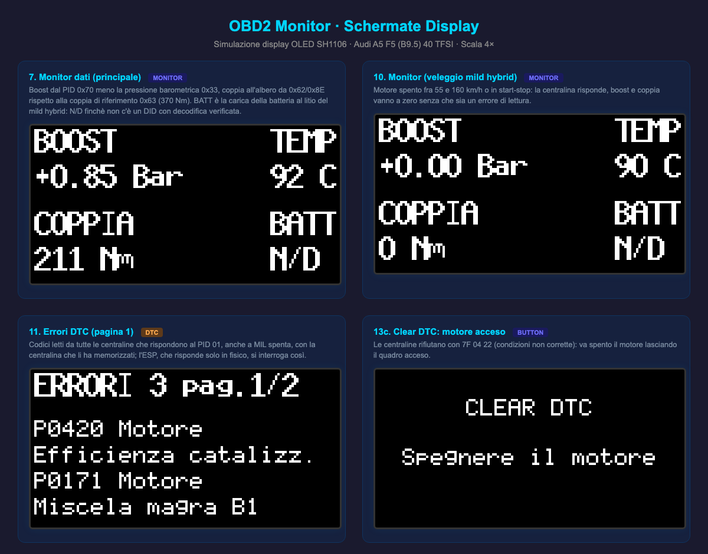
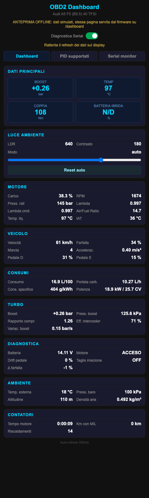
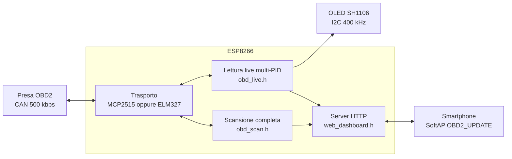
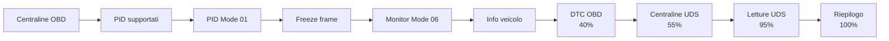

# OBD2 Car Dashboard OLED

Dashboard motore in tempo reale per **Audi A5 F5 (B9.5) 40 TFSI 150 kW mild hybrid S-tronic**, basata su ESP8266 e display OLED SH1106 1.3" (128×64). Due sketch alternativi condividono display, lettura OBD e web server, e cambiano solo il collegamento alla vettura.

| | |
|---|---|
| **Vettura** | Audi A5 F5 40 TFSI, motore DMSA 150 kW, mild hybrid 12 V, S-tronic 7 rapporti, MY2022 |
| **Display** | OLED SH1106 128×64 con 4 metriche live: **BOOST**, **TEMP**, **COPPIA**, **BATT** |
| **Varianti** | [`CANbus_conn`](CANbus_conn/): CAN nativo con MCP2515 su D1 Mini; [`WIFI_conn`](WIFI_conn/): adattatore ELM327 WiFi, su D1 Mini o ESP-01 |
| **Dashboard web** | SoftAP `OBD2_UPDATE`, `http://192.168.4.1/dashboard`, con OTA del firmware |
| **Diagnostica** | DTC di tutte le centraline OBD, scansione completa in sola lettura di 3 centraline OBD e 25 UDS |

<table>
  <tr>
    <td align="center" width="68%">
      <a href="https://raw.githack.com/alesimattia/OBD2-car_dashboard-OLED/main/ui_preview.html">
        
      </a><br><sub>Display OLED: <a href="https://raw.githack.com/alesimattia/OBD2-car_dashboard-OLED/main/ui_preview.html">anteprima interattiva</a></sub>
    </td>
    <td align="center" width="32%">
      <a href="https://raw.githack.com/alesimattia/OBD2-car_dashboard-OLED/main/monitor_preview.html">
        
      </a><br><sub>Dashboard web: <a href="https://raw.githack.com/alesimattia/OBD2-car_dashboard-OLED/main/monitor_preview.html">anteprima interattiva</a></sub>
    </td>
  </tr>
</table>

> [!NOTE]
> Centraline, PID e profilo vettura vengono dalla scansione completa eseguita sull'auto il 22/11/2026 ([`DOCS/pid_scan_20261122_195218.log`](DOCS/pid_scan_20261122_195218.log)), confrontata con l'autoscan VCDS della stessa sera ([`DOCS/vcds_autoscan_20261122.log`](DOCS/vcds_autoscan_20261122.log)). Restano da verificare su un nuovo report la carica della batteria al litio del mild hybrid (§6.2), i conteggi dei DTC UDS e la marcia `0xA4` in movimento.

---

## 📋 Indice

**🧰 Parte 1: costruirlo e usarlo**

1. [Avvio rapido](#1-avvio-rapido)
2. [Cosa fa](#2-cosa-fa)
3. [Hardware e cablaggio](#3-hardware-e-cablaggio)
4. [Build, flash e configurazione](#4-build-flash-e-configurazione)
5. [Uso quotidiano](#5-uso-quotidiano)
6. [Scansione completa](#6-scansione-completa)

**🚗 Parte 2: la vettura**

7. [Audi A5 F5 40 TFSI](#7-audi-a5-f5-40-tfsi)
8. [PID e DID disponibili sulla vettura](#8-pid-e-did-disponibili-sulla-vettura)

**🔬 Parte 3: riferimento tecnico**

9. [Architettura del codice](#9-architettura-del-codice)
10. [Lettura live multi-PID](#10-lettura-live-multi-pid)
11. [Calcoli derivati](#11-calcoli-derivati)
12. [Scansione completa in dettaglio](#12-scansione-completa-in-dettaglio)
13. [Interfaccia web](#13-interfaccia-web)
14. [Auto-brightness](#14-auto-brightness)
15. [Note operative e limiti](#15-note-operative-e-limiti)
16. [Licenza e fonti](#16-licenza-e-fonti)

---

# 🧰 Parte 1: costruirlo e usarlo

## 1. Avvio rapido

1. **Scegli la variante** (§2.2) e procura i componenti (§3.1).
2. **Cabla** l'ESP8266 secondo §3.2 (CAN) o §3.3 (WiFi).
3. **Compila e carica** lo sketch (§4.2). Il profilo della vettura è già in [`obd_live.h`](obd_live.h): per l'A5 F5 non serve altro.
4. **Collega** il modulo alla presa OBD2, oppure accendi l'ELM327 WiFi, e metti il quadro acceso: il display passa al monitor.
5. **Apri la dashboard** entro 3 minuti dall'avvio: rete `OBD2_UPDATE`, password `alesimattia`, pagina `http://192.168.4.1/dashboard` (§5.3). Dalla tab "PID supportati" lanci la scansione completa (§6).

---

## 2. Cosa fa

### 2.1 Funzioni

- 📟 **Monitor**: BOOST, TEMP, COPPIA e BATT sull'OLED, con aggiornamento parziale del framebuffer. Ogni grandezza che la centralina espone si legge dal suo PID e non si stima mai. BATT è la carica della batteria al litio del mild hybrid e resta `N/D` finchè non c'è un DID con decodifica verificata.
- ⚡ **Lettura veloce**: una sola richiesta multi-PID per ciclo (fino a 6 PID), con ripiego automatico a un PID per ciclo (§10).
- 🌐 **Dashboard web** via SoftAP, con diagnostica completa, refresh ogni 500 ms e aggiornamento OTA del firmware (§5.3).
- 🚨 **DTC**: lettura e cancellazione dei codici di tutte le centraline OBD, mostrati sul display con la centralina di provenienza (§5.4).
- 🔍 **Scansione completa** in sola lettura di tutte le centraline OBD2 e UDS, solo dal web, con report e profilo vettura suggerito (§6).
- 🔘 **Pulsante fisico** per cambiare schermata e cancellare i DTC, e **luminosità automatica** da un LDR opzionale.

Al boot non c'è nessuna scansione: il monitor parte subito con il profilo vettura di [`obd_live.h`](obd_live.h).

### 2.2 Le due varianti

| | [`CANbus_conn/`](CANbus_conn/) | [`WIFI_conn/`](WIFI_conn/) |
|---|---|---|
| **Collegamento** | CAN nativo via MCP2515/TJA1050 (SPI) | TCP verso un adattatore ELM327 WiFi |
| **Hardware extra** | modulo MCP2515 + TJA1050, circa 5 € | adattatore ELM327 WiFi, circa 10-15 € |
| **Refresh OBD** | ~25-50 cicli/s stimati | ~5-8 cicli/s stimati |
| **Latenza per richiesta** | ~10-25 ms, multi-frame compreso | ~120-200 ms |
| **Distinzione delle centraline** | ID CAN di ogni frame | header CAN attivi (`ATH1`); senza, una sola centralina |
| **Cablaggio** | SPI + I²C + connettore OBD2 | solo I²C + alimentazione |
| **WiFi** | `WIFI_AP` (solo SoftAP) | `WIFI_AP_STA` (STA verso l'ELM327 + SoftAP) |
| **OTA** | `/update` | `/ota` |
| **ESP-01** | ❌ mancano i pin SPI | ✅ senza LDR |

> [!TIP]
> Per l'uso quotidiano, con refresh elevato e l'affidabilità del CAN nativo, scegli **CANbus_conn**. Per partire senza saldature riusando un ELM327, **WIFI_conn**.

---

## 3. Hardware e cablaggio

### 3.1 Componenti comuni

| Componente | Note |
|---|---|
| ESP8266 **D1 Mini** (clone) | 4 MB flash, partizione `4M (no FS)` |
| **OLED SH1106 1.3" I²C** | 128×64 monocromo, indirizzo `0x3C` |
| Pulsante NA verso GND | debounce software 50 ms |
| Fotoresistore GL5528 + 10 kΩ (opzionale, solo D1 Mini) | partitore su `A0` per la luminosità automatica; senza, contrasto fisso al 50% |

Datasheet di MCP2515 e TJA1050 in [`DOCS/`](DOCS/).

### 3.2 Variante `CANbus_conn`

Servono in più un modulo **MCP2515 + TJA1050** con cristallo da 8 MHz (16 MHz con `MCP2515_CRYSTAL`) e un cavo OBD2 con CAN-H (pin 6), CAN-L (pin 14) e GND (pin 4 o 5).

| Segnale | ESP8266 | MCP2515 / OLED / OBD2 |
|---|---|---|
| MCP2515 VCC / GND | 5 V / GND | VCC / GND |
| MCP2515 CS  | **D8** (GPIO15) | CS |
| MCP2515 SO  | **D6** (GPIO12) | SO *(MISO)* |
| MCP2515 SI  | **D7** (GPIO13) | SI *(MOSI)* |
| MCP2515 SCK | **D5** (GPIO14) | SCK |
| MCP2515 INT | **D0** (GPIO16) | INT (non usato, polling) |
| OLED VCC / GND | 3.3 V / GND | VCC / GND |
| OLED SCL / SDA | **D1** (GPIO5) / **D2** (GPIO4) | SCL / SDA |
| OBD2 CAN-H / CAN-L | - | MCP2515 CANH ↔ pin 6, CANL ↔ pin 14 |
| GND OBD2 | GND | pin 4/5 |
| Pulsante | **D3** (GPIO0) | altro lato → GND |
| LDR | 3.3 V → LDR → **A0** → 10 kΩ → GND | |

> [!WARNING]
> **D3 (GPIO0)** è anche il pin di boot: il pulsante deve restare aperto all'accensione, altrimenti l'ESP entra in flash mode. Lo schema NA con `INPUT_PULLUP` lo rispetta.

### 3.3 Variante `WIFI_conn`

Serve in più un adattatore **ELM327 WiFi** generico (rete `WiFi_OBDII` aperta, `192.168.0.10:35000`). Lo sketch gira su **LOLIN D1 Mini** o su **ESP-01** e sceglie il profilo dalla board selezionata nell'IDE: "Generic ESP8266 Module" attiva quello dell'ESP-01, ogni altra board quello del D1 Mini.

| Segnale | D1 Mini | ESP-01 |
|---|---|---|
| OLED VCC / GND | 3.3 V / GND | 3.3 V / GND |
| OLED SDA | **GPIO0** (D3) | **GPIO0** |
| OLED SCL | **GPIO2** (D4) | **GPIO2** |
| Pulsante (altro lato → GND) | **D5** (GPIO14) | **GPIO3 (RX)** con 1 kΩ in serie |
| LDR | 3.3 V → LDR → **A0** → 10 kΩ → GND | non disponibile |
| CH_PD (EN) | - | 3.3 V |

- L'OLED usa GPIO0/GPIO2 su entrambe le board, gli unici pin liberi dell'ESP-01 oltre a RX e TX.
- Sul D1 Mini il pulsante è su D5: D3/D4 sono l'I²C, D0 non ha pull-up interno, D8 deve restare basso all'avvio e RX/TX servono al convertitore USB. D1, D2, D6 e D7 sarebbero equivalenti.

> [!WARNING]
> Sull'ESP-01 il pulsante usa RX, quindi la seriale lavora in sola trasmissione. La resistenza da 1 kΩ protegge l'uscita TX dell'adattatore USB-seriale se il pulsante viene premuto durante il caricamento del firmware; GPIO3 non decide la modalità di avvio. L'ESP-01 non porta fuori l'ingresso analogico, quindi l'LDR è disattivato (`LDR_ENABLED` = 0) e il contrasto si regola solo dalla dashboard.

---

## 4. Build, flash e configurazione

### 4.1 Librerie e toolchain

- **Librerie comuni**: `ESP8266WiFi` (core ESP8266 ≥ 3.1.2), `ESP8266WebServer`, `ESP8266HTTPUpdateServer`, `U8g2` (olikraus), `Wire`. Solo per `CANbus_conn`: `mcp_can` (coryjfowler) e `SPI`.
- **Toolchain**: Arduino CLI con il core `esp8266:esp8266 @ 3.1.2`; in VSCode l'estensione **Arduino Community Edition** (`vscode-arduino.vscode-arduino-community`).
- **FQBN**: `esp8266:esp8266:d1_mini_clone` per il D1 Mini; per l'ESP-01 (solo `WIFI_conn`) `esp8266:esp8266:generic` con Flash size "1MB (FS:none OTA:~502KB)" (`eesz=1M`) e Flash mode DOUT (`FlashMode=dout`).

### 4.2 Compilazione e caricamento

I due sketch sono sottocartelle e trovano gli header condivisi della root con il flag `-I<root del progetto>` in `build.extra_flags` (`arduino.json` in `.vscode/`). Su Windows [`build.ps1`](build.ps1) passa lo stesso flag e verifica solo che il codice compili, senza esportare nè caricare binari.

```bash
arduino-cli compile \
  --fqbn esp8266:esp8266:d1_mini_clone \
  --build-property "build.extra_flags=-I$PWD" \
  CANbus_conn

arduino-cli upload -p /dev/cu.usbserial-XXXX \
  --fqbn esp8266:esp8266:d1_mini_clone \
  CANbus_conn
```

Per l'altra variante sostituisci `CANbus_conn` con `WIFI_conn`. Dopo il primo caricamento il firmware si aggiorna anche via OTA dalla dashboard (§5.3).

> [!WARNING]
> - Il budget IRAM è quasi esaurito: non aggiungere funzioni `IRAM_ATTR`.
> - Sull'ESP-01 il binario di `WIFI_conn` deve restare entro **512.000 byte**, altrimenti l'OTA fallisce: firmware in esecuzione e nuovo devono stare entrambi sotto `FS_start` (`0xFB000` nel core 3.1.2), arrotondati a 4 KB. Con le librerie reali (U8g2 2.36.19, mcp_can 1.5.1) misura 483.616 byte; le build D1 Mini 484.752 byte (`CANbus_conn`) e 484.304 byte (`WIFI_conn`). Le tabelle OBDb occupano circa 80 KB di PROGMEM.

### 4.3 Configurazione

Le costanti modificabili sono in cima a ciascuno sketch.

<details>
<summary><b><code>CANbus_conn/CANbus_conn.ino</code></b></summary>

| `#define` | Default | Significato |
|---|---|---|
| `MCP2515_CRYSTAL` | `MCP_8MHZ` | `MCP_8MHZ` o `MCP_16MHZ`, secondo il modulo |
| `CAN_CS_PIN` | `15` | D8 |
| `CAN_SPEED` | `CAN_500KBPS` | velocità del bus OBD2 |
| `ISOTP_CONSECUTIVE_TIMEOUT_MS` | `150` | attesa massima fra due consecutive frame (N_Cr) |
| `RESPONSE_PENDING_TIMEOUT_MS` | `5000` | attesa dopo `7F xx 78` (P2*CAN), rinnovata fino a 10 s dall'invio |
| `SILENT_CYCLES_BEFORE_RECOVERY` | `10` | cicli senza risposta dal motore prima del ripristino (§10) |
| `ENGINE_SILENT_RETRY_MS` | `10000` | attesa dopo "Motore non risponde" |
| `OTA_SSID` / `OTA_PASS` | `OBD2_UPDATE` / `alesimattia` | SoftAP per OTA e dashboard (§5.3) |
| `OTA_WINDOW_MS` | `180000` | finestra del SoftAP dal boot |
| `DIAG_PRINT_INTERVAL_MS` | `5000` | intervallo minimo fra due stampe della diagnostica seriale |
| `DTC_PER_PAGE` | `2` | DTC per pagina del display |

</details>

<details>
<summary><b><code>WIFI_conn/WIFI_conn.ino</code></b></summary>

| `#define` | Default | Significato |
|---|---|---|
| `ELM327_SSID` / `ELM327_PASS` | `WiFi_OBDII` / `""` | rete dell'adattatore |
| `ELM327_IP` / `ELM327_PORT` | `192.168.0.10` / `35000` | indirizzo TCP dell'ELM327 |
| `ELM327_TIMEOUT` | `2000` | timeout di lettura (ms); l'adattatore risponde `NO DATA` dopo circa 200 ms |
| `ELM327_FIRST_TIMEOUT` | `5000` | timeout della prima richiesta OBD dopo l'inizializzazione |
| `ELM327_PROTOCOL` | `ATSP6` | CAN 11 bit 500 kbps; `ATSP0` per l'automatico |
| `SILENT_CYCLES_BEFORE_RECOVERY` | `10` | cicli senza risposta prima di "Motore non risponde" e della riconnessione |
| `ENGINE_SILENT_RETRY_MS` | `10000` | attesa prima della riconnessione all'ELM327 |
| `DIAG_PRINT_INTERVAL_MS` | `5000` | intervallo minimo fra due stampe della diagnostica seriale |
| `OTA_SSID` / `OTA_PASS` | `OBD2_UPDATE` / `alesimattia` | SoftAP per OTA e dashboard (§5.3) |
| `BUTTON_PIN` | `D5` (D1 Mini), `3` (ESP-01) | pin del pulsante, dal profilo della board |
| `LDR_ENABLED` | `0` solo su ESP-01 | lettura dell'LDR |

</details>

Finestre di ascolto, tetto delle attese `78` (`OBD_RESPONSE_PENDING_CAP_MS` = 10 s), numero massimo di DTC (`OBD_MAX_DTC` = 12) e limiti della scansione sono costanti condivise in [`obd_proto.h`](obd_proto.h), [`obd_scan.h`](obd_scan.h) e [`obd_live.h`](obd_live.h). Il carburante dell'AFR stimato si cambia con `OBD_FUEL_STOICHIOMETRIC_AFR` (§11).

### 4.4 Tabelle OBDb

[`obdb_signals.h`](obdb_signals.h) è generato e non si modifica a mano. Si rigenera con:

```powershell
powershell -ExecutionPolicy Bypass -File .\tools\obdb_select.ps1   # Windows
pwsh tools/obdb_select.ps1                                         # macOS
```

Lo script rilegge i signalset copiati in `tools\obdb\` a commit fissati, riapplica le regole di interpretabilità (§12.4) e le correzioni verificate sulla vettura, e scrive anche `tools/obdb/selection.json` (letto da `pid_scan.ps1`) e `tools/obdb/selection.txt`. `selection.json` contiene anche i **candidati alle prove DID** dello script, cioè i DID `Audi-A5` con decodifica interpretabile ma non verificata per l'anno o leggibili solo in sessione 03, che la tabella del firmware non riceve. `-Download` riscarica i signalset quando cambiano i commit, `-ModelYear` (2022 di default) seleziona un altro anno modello. Guida in [`tools/obdb_select.md`](tools/obdb_select.md).

---

## 5. Uso quotidiano

### 5.1 Display OLED

Il display mostra il monitor con le 4 metriche e, se ci sono DTC, alterna ogni 5 s il monitor e le pagine dei codici. [`ui_preview.html`](ui_preview.html) mostra nel browser, senza ESP, tutte le 20 schermate:

| Schermate | Contenuto |
|---|---|
| 1-6 | avvio e connessione |
| 7-10 | monitor, compreso il veleggio a motore spento |
| 11-12 | DTC |
| 13a-13c | cancellazione dei DTC |
| 14 | scansione completa, con fase e percentuale |
| 15-18 | errori di rete, "Motore non risponde" e riconnessione |

> [!NOTE]
> Nel veleggio e nello start-stop il motore è spento: boost, coppia e potenza valgono zero e i calcoli che dividono per RPM o potenza mostrano `N/D`. Non è un errore di lettura (§7.3).

### 5.2 Pulsante

| Azione | Effetto |
|---|---|
| **Click breve** | scorre le schermate: Monitor → DTC pag.1 → DTC pag.2 → … → Monitor, e posticipa l'alternanza automatica di 5 s; durante la scansione completa la interrompe |
| **Pressione lunga** (≥ 2.5 s) | 🛠️ cancella i DTC di tutte le centraline (§5.4) e mostra l'esito per 1.2 s; durante la scansione la interrompe come il click |

> [!IMPORTANT]
> La pressione lunga scatta con il pulsante ancora premuto. Per non cancellare i DTC a chi lo tiene premuto per fermare la scansione, a fine scansione la pressione lunga resta ignorata finchè il pulsante non viene rilasciato e per altri 5 s.

### 5.3 Dashboard web

**Accesso**: collegati al SoftAP `OBD2_UPDATE` (password `alesimattia`) e apri `http://192.168.4.1/dashboard`.
- Il SoftAP resta attivo 3 minuti dal boot; con un client collegato il timeout è sospeso e riparte alla disconnessione, e durante la scansione completa non scade e alla fine riparte da capo, così il riepilogo resta leggibile.
- Scaduta la finestra il server si ferma e, su `CANbus_conn`, la radio WiFi si spegne (circa 75 mA in meno): per aggiornare di nuovo il firmware serve un riavvio. È una scelta deliberata, per non tenere la radio accesa durante la guida.
- L'aggiornamento del firmware è su `/update` (CAN) o `/ota` (WiFi).

> [!NOTE]
> **La password del SoftAP è pubblica di proposito** negli sketch e qui, e non è un dato sensibile: il SoftAP è una rete locale creata dall'ESP a bordo, non raggiungibile da internet, e chi la usa è lo sviluppatore stesso, vicino all'auto. Il rischio residuo è di prossimità radio: la password protegge anche l'OTA, che non chiede altre credenziali, quindi chi la conosce ed è a portata del SoftAP durante la finestra dopo l'avvio può caricare un firmware. Chi lo ritiene inaccettabile cambia `OTA_PASS` prima della compilazione.

La pagina, mobile-first e larga al massimo 480 px, ha **3 tab**:

| Tab | Contenuto |
|---|---|
| **Dashboard** | BOOST, COPPIA, TEMP e BATTERIA IBRIDA; box DTC con badge MIL; card "Luce ambiente" con slider 0-255 e "Reset auto"; pulsante "Cancella DTC" con conferma; con il toggle "Diagnostica Serial" le sezioni avanzate |
| **PID supportati** | avvio, interruzione e riepilogo della scansione completa (§6.1); `/scan` apre direttamente questa tab |
| **Serial monitor** | specchio di tutto ciò che il firmware scrive su Serial, con buffer di 4 KB e banner in caso di overflow; l'auto-scroll si sospende scorrendo verso l'alto e "Pulisci" svuota solo la vista locale. Durante la scansione la pagina legge il log anche dalle altre tab, fino a 5 s dopo la fine |

**Sezioni avanzate** (toggle "Diagnostica Serial"): 🚙 Motore (carico, RPM, rail, lambda, lambda comandata, AFR, liquido, IAT), 🚗 Veicolo (velocità, farfalla, marcia, accelerazione, pedale D/E), ⛽ Consumi (L/100 km, portata, consumo specifico, potenza kW/CV), 🌪️ Turbo (boost, pressione del sensore, rapporto di compressione, intercooler, variazione boost), 🔧 Diagnostica (tensione 12 V, motore acceso o fermo, drift pedale, taglio iniezione, Δ farfalla), 🌍 Ambiente (temperatura esterna, BARO, altitudine, densità aria), ⏱️ Contatori (tempo motore, km con MIL, riscaldamenti dal clear).

> [!TIP]
> La diagnostica è uno strumento di tuning, non una modalità d'esercizio: ogni 5 s stampa l'istantanea su Serial (115200 baud) e ogni aggiornamento della pagina legge 4-5 gruppi multi-PID, quindi il refresh dell'OLED rallenta. Lo stato del toggle resta in RAM fino al riavvio.

**Soglie di colore**:

| Parametro | 🟡 Warning | 🔴 Allarme |
|---|---|---|
| Batteria 12 V | < 12.2 V o > 15.0 V | < 11.8 V o > 15.3 V (13.4 V al minimo sulla vettura) |
| Drift pedale D/E | 3-5 % | > 5 % |
| Lambda | - | < 0.75, oppure > 1.15 fuori dal taglio iniezione e a motore acceso |
| Temperatura liquido | > 110 °C | > 115 °C (normale fino a 107 °C a carico parziale, termostato d'emergenza a 113 °C) |
| Pressione rail | > 360 bar (massimo dell'evo4: 350) | < 30 bar a motore acceso (101 bar al minimo sulla vettura) |
| Efficienza intercooler | - | < 40 % |
| Consumo specifico | - | > 400 g/kWh con carico > 50 % |
| Boost | > 1.3 bar | > 1.5 bar |

Le soglie vengono da dati EA888 Gen3/evo4 (formazione Audi, comunicato VW) e dalle catture B9, non da dati specifici DMSA: vanno confermate con i log della vettura.

### 5.4 Codici di errore (DTC)

- **Lettura**: all'ingresso nel monitor e poi ogni 30 s il firmware chiede a tutte le centraline OBD stato della MIL e numero di DTC, e legge i codici da ogni centralina che ne ha, anche a MIL spenta. Fino a 12 codici, ognuno con la centralina di provenienza ("Motore", "Cambio", "Freni ABS/ESP", altrimenti "Centralina N").
- **Descrizione**: codice in forma "P0301" con descrizione italiana breve da [`dtc_descriptions.h`](dtc_descriptions.h) (73 codici tipici del benzina e di rete), altrimenti solo il codice.
- **Cancellazione**: dalla pressione lunga del pulsante o dal pulsante "Cancella DTC" della dashboard, mai durante la scansione nè, su WiFi, durante la connessione all'ELM327. Se almeno una centralina accetta, il firmware rilegge subito i codici.

| Esito | Testo OLED |
|---|---|
| tutte le centraline hanno accettato | `DTC cancellati` |
| alcune hanno accettato, altre rifiutato | `Cancellati in parte` |
| rifiuto `7F 04 22` (condizioni non corrette, tipicamente motore acceso) | `Spegnere il motore` |
| altro rifiuto | `Rifiutato` |
| nessuna risposta | `Nessuna risposta` |

> [!CAUTION]
> Cancellare i DTC perde lo storico e **resetta i monitor di readiness**: possono servire diversi cicli di guida (anche 100+ km misti) prima che tornino tutti "Ready", lo stato richiesto in revisione.

> [!NOTE]
> I DTC OBD coprono solo i guasti legati alle emissioni. Quelli di rete e carrozzeria, che VCDS trova sulla vettura, stanno solo in UDS: la scansione completa ne riporta i conteggi (§8.9).

### 5.5 Luminosità del display

Con l'LDR montato il contrasto segue la luce ambiente, con transizioni graduali di circa 2 s. Lo slider della dashboard imposta un valore manuale, che resta finchè la luce non cambia molto (per esempio all'ingresso in galleria); "Reset auto" torna all'automatico. Senza LDR, e sull'ESP-01, il contrasto parte al 50% e si regola solo dallo slider. L'algoritmo è in §14.

---

## 6. Scansione completa

La scansione completa interroga in **sola lettura** tutte le centraline OBD2 e UDS della vettura e produce un report, un riepilogo per centralina e il profilo vettura suggerito. Si esegue dal firmware oppure da un PC Windows; il funzionamento interno è in §12.

> [!IMPORTANT]
> Lanciala **a quadro acceso e auto ferma**: il monitor resta sospeso per alcuni minuti. Dal firmware resta nella default session e non invia mai servizi di scrittura, di sessione, di sicurezza nè la cancellazione dei DTC (§12.9); lo script da PC apre in più la sessione estesa sulle centraline che non sono di sicurezza (§6.2).

### 6.1 Dal firmware

1. Apri la tab **"PID supportati"** della dashboard (o `/scan`) e premi **"Avvia scansione completa"**; è rifiutata se è già in corso o se l'adattatore non è connesso.
2. Il display e la pagina mostrano fase, percentuale e secondi, aggiornati ogni secondo; il riepilogo si ricarica ogni 5 s. La durata stimata è di 1-2 minuti sul CAN nativo e di 6-8 minuti con l'ELM327 WiFi.
3. Per fermarla: **"Interrompi"** o un click del pulsante. Il riepilogo usa i dati raccolti fin lì.
4. A fine scansione la tab mostra il riepilogo; il report completo, con valori e unità, è nel Serial monitor e si salva con **"Salva log"** (`obd_scan.txt`).

Il riepilogo nella tab contiene:
- le note sui limiti dell'adattatore, quando ce ne sono;
- il **profilo suggerito**: modo di lettura e coppia di riferimento letta (§6.3);
- il consumo reale di vita OBFCM, se plausibile (§12.8);
- le **centraline OBD2**: PID letti per descrizione, dichiarati senza risposta, non dichiarati che rispondono, DTC con stato, e sotto i conteggi UDS della stessa centralina;
- le **centraline UDS**: nome, DTC confermati e in attesa (solo conteggi), PID standard e dati VAG letti; in coda quelle escluse perchè mute.

> [!WARNING]
> Sull'ESP-01, senza seriale USB, il report si legge solo dal Serial monitor web: tieni la pagina aperta fino alla fine e salva il log.

### 6.2 Da PC con `tools/pid_scan.ps1`

[`tools/pid_scan.ps1`](tools/pid_scan.ps1) esegue la stessa scansione da un PC Windows, senza ESP, con un adattatore ELM327 USB su porta COM come il **Vgate vLinker FS USB** (bridge FTDI, 115200 baud). Usa le stesse fasi e le stesse regole del firmware, leggendo le tabelle direttamente dagli header del progetto, ed estrae in più quello che serve al reverse engineering (sotto). Gira con Windows PowerShell 5.1, senza dipendenze.

Lanciala **a motore acceso e auto ferma**, perchè il relè della batteria al litio del mild hybrid si chiude all'avviamento. Chiudi FORScan e VCDS, perchè la porta COM è esclusiva, poi:

```powershell
.\tools\pid_scan.ps1 -Port COM5                    # porta del vLinker in Gestione dispositivi
.\tools\pid_scan.ps1                               # se c'è una sola porta COM
.\tools\pid_scan.ps1 -Port COM5 -BaudRate 115200   # baud fisso invece della ricerca
.\tools\pid_scan.ps1 -Port COM5 -Verbose           # anche il traffico TX/RX a console
```

Se la policy di esecuzione blocca gli script locali: `powershell -ExecutionPolicy Bypass -File .\tools\pid_scan.ps1 -Port COM5`.

Il report `pid_scan_<data>_<ora>.log` si scrive nella cartella dello script anche dopo un errore o un Ctrl+C, marcato "interrotta", con in coda la traccia TX/RX completa. I report eseguiti sull'auto si conservano in [`DOCS/`](DOCS/).

> [!IMPORTANT]
> **Prova dei DID della batteria al litio del mild hybrid**: solo lo script, se trova la centralina MQ-BMS (`17FC00AE`), le chiede alcuni DID delle batterie VAG a 48 V di OBDb `Audi-Q8` (`028C`, `F45B`, `7448`, `1E3D`, `1E3B`, `1E3C`, `2A0B`), perchè per i 12 V non esiste una decodifica pubblica; li chiede in sessione estesa se la centralina la accetta. La sezione `=== PROVA DID BATTERIA AL LITIO MHEV ===` ne riporta i byte grezzi, per trovare un DID da portare nella casella BATT; il report del 22/11/2026 non la contiene ancora.

**Cosa estrae lo script oltre al firmware**, per il reverse engineering, una lettura per dato:
- **Prove DID**: i 328 DID `Audi-A5` con decodifica OBDb interpretabile ma non verificata per il 2022 o leggibili solo in sessione 03 (motore 210, cambio 79, BCM `70E` 17, gateway 2, quadro, clima e sensori `74F` uno ciascuno; `70F` e `71D` non esistono sulla vettura). Una risposta positiva si scrive come `PROVA DID xxxx` con il motivo della mancata verifica, l'esito nelle catture OBDb, i valori decodificati e la risposta grezza; rifiuti e silenzi solo come conteggi nel riepilogo. Le prove hanno un budget proprio e un avviso se superano 120 s.
- **Sessione estesa**: `10 03` prima delle letture e `10 01` alla fine, su ogni centralina tranne quelle di sicurezza (piantone `70C`, servosterzo `712`, ESP `713`/`7E4`, airbag `715`, leva del cambio `753`). Ogni DID si legge una volta in sessione estesa; se la centralina rifiuta `10 03` si resta in default e si saltano i DID della sessione 03. Un DID verificato rifiutato in sessione estesa si rilegge in default dopo `10 01`, e così tutti i rifiutati se la centralina rifiuta `F189` o chiude il servizio con NRC `7F`. Dopo un errore o un Ctrl+C la centralina torna in default allo scadere del timer S3.
- **Stessa centralina su due indirizzi**: codice ricambio `F187` e file ODX `F19E` uguali la riconoscono, e la seconda non si legge di nuovo; sulla vettura è l'ESP, `713/77D` e `7E4/7EC`.
- **DTC UDS**: una sola `19 02` con maschera `AF` per centralina, con ogni DTC come numero in decimale (lo stesso della prima colonna di VCDS), esadecimale e bit di stato ISO 14229 per nome; se `19 02` è rifiutato, i conteggi di `19 01`.
- **Mode 06**: anche i monitor senza nome standard e i test del costruttore, con valore, limiti e unità UASID. **Mode 09**: anche il CVN (`06`).
- **Nessun limite dei buffer del firmware**: risposte fino a 4095 byte (il firmware le tronca a 72), tutti i DTC OBD, tutti i test Mode 06, testi interi.

**Esito sulla vettura** (22/11/2026): 337 s, 3 centraline OBD e 25 UDS, nessun errore di trasporto. Il vLinker FS si presenta come ELM327 v2.3 su STN1170 v4.3.2 e supera tutti i controlli: richieste fisiche, flow control verso l'ID di richiesta, CAN a 29 bit e gestione autonoma delle attese `7F 22 78` (18, tutte seguite dalla risposta).

> [!NOTE]
> Le unità vLinker FS prodotte prima del 7/2/2025 hanno problemi su alcune porte USB 3.0: collegale tramite un hub USB 2.0. L'interfaccia Ross-Tech HEX-V2 di VCDS non è utilizzabile, perchè si presenta come dispositivo HID, senza porta COM nè comandi ELM327.

### 6.3 Aggiornare il profilo vettura

A fine report firmware e script stampano il blocco da incollare al posto del "Profilo vettura" in testa a [`obd_live.h`](obd_live.h). Va rifatto dopo una centralina sostituita o un aggiornamento software. Quello in uso, costruito dai PID letti il 22/11/2026, è:

```cpp
static const uint8_t OBD_ENGINE_PIDS[] PROGMEM = {0x70, 0x0C, 0x62, 0x8E, 0x05, 0x33, 0x63, 0x04, 0x0B, 0x0D, 0x0F, 0x23, 0x34, 0x44, 0x42, 0x46, 0x49, 0x4A, 0x4C, 0x01, 0x1F, 0x21, 0x30, 0x5E, 0x9D, 0xA4};
static constexpr bool OBD_ENGINE_MULTI_PID = true;
static const uint16_t OBD_PHYSICAL_ONLY_ECUS[] PROGMEM = {0x7EC, 0};
// Coppia di riferimento letta (PID 63): 370 Nm
```

| Voce | Significato |
|---|---|
| `OBD_ENGINE_PIDS` | PID di lettura live e diagnostica a cui il motore ha risposto |
| `OBD_ENGINE_MULTI_PID` | `true` se la richiesta con 6 PID ha avuto una risposta completa e ben formata (con meno di 6 PID dichiarati vale la prova con 2) |
| `OBD_PHYSICAL_ONLY_ECUS` | centraline OBD che rispondono solo alle richieste fisiche, chiusa da 0: lettura e cancellazione dei DTC le interrogano così |
| riga della coppia | solo informativa, perchè la lettura live rilegge `0x63` |

> [!NOTE]
> Il report in `DOCS/` è stato prodotto da una versione precedente dello script e stampa un profilo senza `0x63`, `0x9D`, `0xA4` e senza `OBD_PHYSICAL_ONLY_ECUS`: il blocco sopra è quello che il generatore attuale produce dagli stessi dati. Dopo una scansione interrotta il blocco si apre con l'avviso "profilo parziale".

---

# 🚗 Parte 2: la vettura

## 7. Audi A5 F5 40 TFSI

### 7.1 Dati tecnici e fonti

| Parametro | Valore |
|---|---|
| Modello | Audi A5 F5 (B9.5, restyling, piattaforma MLBevo), anno modello 2022, prodotta 05/2022 |
| Motore | **DMSA**, 2.0 TFSI EA888 evo4 a ciclo B, 4 cilindri in linea benzina, longitudinale; sigla della centralina `evo4`, nome di sistema `R4 2.0l TFSI` |
| Cilindrata / alesaggio × corsa / compressione | 1984 cm³ / 82.5 × 92.8 mm / **12.2:1**, ordine di accensione 1-3-4-2 |
| Distribuzione | bilancieri a rullo, fasatura variabile continua su aspirazione e scarico, punterie idrauliche, 4 valvole per cilindro |
| Alimentazione | iniezione diretta fino a 350 bar, regolazione lambda, controllo detonazione, turbocompressore con intercooler; benzina 95 ottani EN 228 |
| Potenza / coppia | **150 kW (204 CV)** a 4475-6000 rpm / **320 Nm** a 1450-4475 rpm; la coppia di riferimento SAE letta dalla centralina (`0x63`) è 370 Nm |
| Cambio | **S-tronic 7 rapporti** DL382 `0CK`, doppia frizione in bagno d'olio a comando idraulico; meccatronica J217 `2.0T 150kW EU` |
| Trazione | anteriore |
| Ibridazione | **mild hybrid 12 V**: belt alternator starter (BAS) sull'albero motore, recupero fino a 5 kW, batteria agli ioni di litio 12 V 10 Ah nella zona posteriore, gestita dalla centralina MQ-BMS (UDS a 29 bit) |
| Impianto elettrico | 12 V, potenza elettrica massima 3.1 kW; batteria di avviamento AGM 68 Ah con sensore J367 sul gateway |
| Post-trattamento ed emissioni | catalizzatore vicino al motore con filtro antiparticolato benzina (GPF), sonda lambda a monte e a valle; **Euro 6d** (EU6 AP), con OBFCM |
| Prestazioni | 210 km/h autolimitata, 0-100 km/h in 7.2 s |
| Pneumatici di serie | 225/50 R17 su cerchio 7.5J × 17 |
| Capacità | olio motore 5.2 L con filtro, raffreddamento 8 L, serbatoio 54 L |
| Massa | 1515 kg a vuoto senza conducente, 2085 kg complessiva |
| Manutenzione | tagliando ogni 30000 km o 2 anni |
| Bus diagnostica | **CAN 11 bit a 500 kbps** (ISO 15765-4), centraline UDS anche a 29 bit |

**Fonti**:
- scheda tecnica Audi eTD della A5 Sportback 40 TFSI S-tronic 150 kW MHEV ([`DOCS/eTD-…MHEV_240613.pdf`](DOCS/eTD-Audi-A5-Sportback-40-TFSI-S_tronic-150kW-MHEV_240613.pdf)): dati, rapporti, masse e capacità;
- SSP 683 "Audi 2.0 ltr. TFSI engine (EA888 evo4)" ([`DOCS/DMSA_engine.pdf`](DOCS/DMSA_engine.pdf)): ciclo B, ordine di accensione, 350 bar e classe EU6 AP;
- cartella stampa Audi A5 2020 ([audi.com](https://www.audi.com/en/the-audi-a5-new-look-and-new-technologies-2020-12622/drive-system-and-suspension-12627)): mild hybrid;
- scansione completa e autoscan VCDS: dati della vettura.

> [!NOTE]
> La scheda eTD del 2024 riporta Euro 6e, che vale per la produzione successiva alla vettura. Masse e prestazioni sono della Sportback: su Coupè e Cabriolet cambiano.

### 7.2 Rapporti del cambio

Coppia finale **4.234**, retromarcia 2.750, gamma complessiva 7.36. Le velocità usano una circonferenza di rotolamento di 2.00 m del pneumatico di serie e sono indicative.

| Marcia | Rapporto cambio | Rapporto totale | km/h ogni 1000 rpm | rpm a 100 km/h | km/h a 6000 rpm |
|---|---|---|---|---|---|
| 1ª | 3.188 | 13.50 | 8.9 | fuori giri | 53 |
| 2ª | 2.190 | 9.27 | 12.9 | fuori giri | 78 |
| 3ª | 1.517 | 6.42 | 18.7 | 5350 | 112 |
| 4ª | 1.057 | 4.48 | 26.8 | 3730 | 161 |
| 5ª | 0.738 | 3.12 | 38.4 | 2600 | 230 |
| 6ª | 0.557 | 2.36 | 50.9 | 1970 | 305 |
| 7ª | 0.433 | 1.83 | 65.5 | 1530 | 393 |

I 210 km/h autolimitati corrispondono in 7ª a circa 3200 rpm. Il firmware non ricava la marcia da questi rapporti: la legge dal PID `0xA4` (§8.1).

### 7.3 Mild hybrid visto dall'OBD

Il BAS sostituisce alternatore e motorino nelle ripartenze e recupera energia in rilascio. Nei dati si vedono due logiche:

- **veleggio a motore spento** fra 55 e 160 km/h rilasciando l'acceleratore: il cambio apre le frizioni, il motore si spegne e la batteria al litio alimenta l'impianto;
- **start-stop esteso**, che con il cambio automatico interviene già sotto i 22 km/h.

In entrambi i casi la centralina motore resta raggiungibile e riporta RPM e carico a zero, mentre il MAP si porta alla pressione barometrica.

> [!NOTE]
> BAS e batteria al litio non hanno PID standard. Alla centralina MQ-BMS (`17FC00AE`) la scansione chiede solo i DID di identificazione, perchè OBDb non ne pubblica DID di misura, e la carica resta da individuare con la prova DID (§6.2); i DID del gateway (`2A0x`, dal sensore J367) descrivono invece la batteria AGM da 68 Ah e il generatore.

### 7.4 Centraline OBD

Le richieste OBD2 vanno al broadcast `0x7DF` e ogni centralina risponde con il proprio ID fra `0x7E8` e `0x7EF`. Sulla vettura, con motore al minimo e auto ferma, rispondono tre centraline; nessuna risponde al `0100` a 29 bit.

| ID risposta | Centralina | PID Mode 01 (§8.1) |
|---|---|---|
| `0x7E8` | **motore** J623, Mode 09 `ECM-EngineControl` | 48 |
| `0x7E9` | **cambio** J217, Mode 09 `TCM-TransmisCtrl` | 8 |
| `0x7EC` | **freni ABS/ESP** J104 `ESP9 Plus`, Mode 09 `BSCM-BrakeSystem`, richiesta su `0x7E4`; è la stessa centralina di UDS `0x713/0x77D` e **risponde solo alle richieste fisiche** | 9 |

Ogni PID dichiarato ha risposto e nessun PID non dichiarato ha risposto. Fra i PID utili il motore non espone `0x10` (MAF), `0x5C` (olio) e `0x61` (coppia richiesta).

### 7.5 Centraline UDS

La scansione trova 25 centraline UDS, tutte leggibili nella default session: 17 coppie VAG nello spazio `0x7xx`, motore, cambio ed ESP su `0x7E0`, `0x7E1` e `0x7E4`, e 5 centraline a 29 bit. "Sigla" è il nome di sistema officina VW (`F1AA`); "VCDS" è l'indirizzo dell'autoscan della stessa sera, con i DTC che VCDS vi ha trovato.

| Centralina | Richiesta / risposta | Sigla | VCDS | Letture oltre l'identificazione |
|---|---|---|---|---|
| Elettronica piantone sterzo | `70C/776` | J527 | 16 | - |
| Elettronica centrale (`BCM1 MLBevo`) | `70E/778` | J519 | 09 | - |
| Gateway | `710/77A` | J533 | 19, 6 DTC | 19 DID: batteria AGM, generatore, bilancio energetico, autonomia residua |
| Servosterzo | `712/77C` | J500 | 44 | - |
| Freni ABS/ESP (`ESP9 Plus`) | `713/77D` | J104 | 03, 2 DTC non confermati | 9 PID `F4xx`, pressione freno, angolo volante |
| Quadro strumenti | `714/77E` | J285 | 17, 6 DTC | 6 DID: temperatura esterna, contachilometri, pressione di sovralimentazione %, usura termica dell'olio |
| Airbag | `715/77F` | J234 | 15 | - |
| Portellone | `723/78D` | J605 | 6D | - |
| Porta posteriore lato passeggero | `73F/7A9` | - | BC¹ | risponde alla ricerca, poi resta muta |
| Climatizzatore (`Klima Zone 3`) | `746/7B0` | E87 | 08 | 10 DID: refrigerante, ventola del radiatore, temperature di abitacolo e bocchette; 3 PID `F4xx` |
| Porta lato guida | `74A/7B4` | J386 | 42, 1 DTC | - |
| Porta lato passeggero | `74B/7B5` | J387 | 52 | - |
| Sensori anteriori di assistenza alla guida | `74F/7B9` | R242 | A5 | - |
| Leva del cambio | `753/7BD` | J587 | 81 | - |
| Telematica | `767/7D1` | J949 | 75 | satelliti GPS visibili e tracciati |
| Telecamera posteriore | `769/7D3` | J772 | 6C | - |
| Infotainment | `773/7DD` | J794 | 5F, 2 DTC | conteggio DTC: 2 confermati, 1 fallito al momento |
| Motore | `7E0/7E8` | `evo4` | 01 | 55 DID: temperature, pressione carburante, livello olio, fasatura, avviamenti, preaccensioni per cilindro |
| Cambio | `7E1/7E9` | J217 | 02 | 61 DID: tempi di guida per programma, velocità delle ruote, temperature e pressioni delle frizioni, adattamenti, marcia |
| Freni ABS/ESP, indirizzo OBD | `7E4/7EC` | J104 | 03 | stessa centralina di `713/77D`, solo identificazione |
| Elettronica centrale 2 (`BCM2 MLBevo`) | `17FC008B/17FE008B` | J393 | 46¹, non raggiunta | - |
| Faro sinistro (`LMS_MLBevo`) | `17FC0096/17FE0096` | A31 | D6¹, interfaccia non compatibile | - |
| Faro destro (`LMS_MLBevo`) | `17FC0097/17FE0097` | A27 | D7¹, non raggiunta | - |
| Ricarica wireless (`WLC Front`) | `17FC00A5/17FE00A5` | J1146 | DE¹, interfaccia non compatibile | - |
| Batteria 12 V al litio (`MQ-BMS`) | `17FC00AE/17FE00AE` | A1 | 80¹, non raggiunta | - |

¹ Corrispondenza per nome: VCDS non legge la sigla di queste centraline. VCDS trova anche la porta posteriore lato guida (BB, J388), che la scansione non vede.

---

## 8. PID e DID disponibili sulla vettura

Elenco completo di ciò che la vettura ha restituito nella scansione completa del 22/11/2026, separato per Mode: solo PID e DID che hanno risposto con un valore decodificabile, nessun identificatore teorico. I valori sono letti a motore al minimo (810 rpm), liquido a 65 °C e auto ferma.

**Colonna Uso**: ✅ lettura live (OLED e dati principali) · 🩺 istantanea diagnostica (dashboard in debug e Serial) · 🔍 solo scansione completa. Le formule SAE J1979 sono riportate per i PID che il firmware legge.

### 8.1 Mode 01, dati correnti

Il motore `0x7E8` dichiara e legge 48 PID; cambio `0x7E9` ed ESP `0x7EC` ne espongono un sottoinsieme, indicato nella colonna "Cambio / ESP".

| PID | Grandezza | Formula | Motore | Cambio / ESP | Uso |
|---|---|---|---|---|---|
| `0x01` | Stato MIL, numero DTC, readiness dal clear | bit 7 di A = MIL, A & 0x7F = numero | MIL spenta, 0 DTC, monitor pronti | idem | ✅ DTC ogni 30 s da tutte (§5.4) |
| `0x03` | Stato del sistema carburante | | anello chiuso | | 🔍 |
| `0x04` | Carico calcolato | `A × 100 / 255` | 12.9 % | 14.5 % / 13.7 % | 🩺 |
| `0x05` | Temperatura liquido | `A − 40` | 65 °C | 65 °C / 65 °C | ✅ TEMP |
| `0x06` / `0x07` | Correzione carburante a breve / lungo termine, banco 1 | | 0.8 % / 0.8 % | | 🔍 |
| `0x0B` | Pressione assoluta collettore (MAP) | `A` kPa | 23 kPa | | 🩺 |
| `0x0C` | Regime motore | `(256 × A + B) / 4` | 810 rpm | 800.5 / 799 rpm | ✅ |
| `0x0D` | Velocità | `A` km/h | 0 km/h | 0 / 0 km/h | 🩺 |
| `0x0E` | Anticipo di accensione | | −7 ° | | 🔍 |
| `0x0F` | Temperatura aria aspirata | `A − 40` | 15 °C | | 🩺 |
| `0x11` | Posizione assoluta farfalla | | 12.2 % | | 🔍 |
| `0x13` | Sonde lambda presenti | | B1S1, B1S2 | | 🔍 |
| `0x15` | Sonda B1S2, a valle del catalizzatore | | 0.645 V | | 🔍 |
| `0x1C` | Standard OBD | | EOBD | | 🔍 |
| `0x1F` | Tempo dall'avviamento | `256 × A + B` s | 284 s | | 🩺 |
| `0x21` | Distanza con MIL accesa | `256 × A + B` km | 0 km | | 🩺 |
| `0x23` | Pressione rail (iniezione diretta) | `10 × (256 × A + B)` kPa | 10080 kPa | | 🩺 |
| `0x2E` | Spurgo evaporativo comandato | | 5.5 % | | 🔍 |
| `0x2F` | Livello serbatoio | | 26.7 % | | 🔍 |
| `0x30` | Riscaldamenti dal clear DTC | `A` | 124 | | 🩺 |
| `0x31` | Distanza dal clear DTC | | 2308 km | | 🔍 |
| `0x33` | Pressione barometrica | `A` kPa | 99 kPa | | ✅ |
| `0x34` | Lambda e corrente della sonda B1S1 | `λ = (256 × A + B) / 32768`, `I = (256 × C + D) / 256 − 128` mA | 0.999, −0.012 mA | | 🩺 |
| `0x3C` | Temperatura catalizzatore B1S1 | | 336 °C | | 🔍 |
| `0x41` | Monitor del ciclo di guida corrente | | completati componenti, carburante e mancate accensioni; non ancora catalizzatore, sonde, riscaldatori ed EGR/VVT | componenti completati | 🔍 |
| `0x42` | Tensione modulo | `(256 × A + B) / 1000` V | 13.42 V | 13.5 / 13.98 V | 🩺, mai in BATT |
| `0x43` | Carico assoluto | | 16.5 % | | 🔍 |
| `0x44` | Lambda comandata | `(256 × A + B) / 32768` | 1.000 | | 🩺 |
| `0x45` | Posizione relativa farfalla | | 2.0 % | | 🔍 |
| `0x46` | Temperatura esterna | `A − 40` | 15 °C | - / 15 °C | 🩺 |
| `0x47` | Posizione assoluta farfalla B | | 11.8 % | | 🔍 |
| `0x49` / `0x4A` | Pedale acceleratore D / E | `A × 100 / 255` | 14.9 % / 14.9 % | D 14.9 % / 14.9 % | 🩺 |
| `0x4C` | Farfalla comandata | `A × 100 / 255` | 2.4 % | | 🩺 |
| `0x51` | Tipo di carburante | | benzina | | 🔍 |
| `0x56` | Correzione a lungo termine della sonda secondaria | | 0 % | | 🔍 |
| `0x5E` | Portata carburante | `(256 × A + B) / 20` L/h | 0.9 L/h | | 🩺 |
| `0x62` | Coppia effettiva | `A − 125` % di `0x63` | 6 % | | ✅ COPPIA |
| `0x63` | Coppia di riferimento | `256 × A + B` Nm | 370 Nm | | ✅ letta una volta |
| `0x67` | Temperatura liquido, sensori 1 e 2 | | 67 / 13 °C | | 🔍 |
| `0x70` | Boost, sensore A | presente se il bit 1 di A è 1; `(256 × D + E) / 32` kPa assoluti | 99.7 kPa | | ✅ BOOST |
| `0x8B` | Filtro antiparticolato: rigenerazione, soglia normalizzata, distanza media fra rigenerazioni | | no, 1.2 %, 0 km | | 🔍 |
| `0x8E` | Coppia di attrito | `A − 125` % di `0x63` | 6 % | | ✅ COPPIA |
| `0x9D` | Portata carburante | `(256 × A + B) / 50` g/s | 0.18 g/s | | 🩺 |
| `0x9E` | Portata gas di scarico | | 10 kg/h | | 🔍 |
| `0xA4` | Marcia attuale | nibble alto di B, se il bit 0 di A è 1 | 0 | | 🩺 |
| `0xA6` | Contachilometri | | 127615.7 km | | 🔍 |

Note sui PID del motore:
- **COPPIA** è `(0x62 − 0x8E) / 100 × 0x63`: `0x62` comprende l'attrito `0x8E`, e i due PID si leggono nello stesso ciclo. **BOOST** è `0x70 − 0x33`; il valore comandato contenuto in `0x70` non si usa.
- `0x23` al minimo vale circa 100 ± 20 bar a motore caldo (SSP 683; 101 bar sulla vettura) e arriva a 350 bar.
- `0x34` resta intorno a λ = 1, con arricchimenti sotto 1 a pieno carico; confrontata con `0x44` mostra gli arricchimenti di protezione.
- `0x8B` è definito da SAE per il diesel e sulla vettura descrive il filtro antiparticolato benzina.
- `0xA4` da fermo vale 0, mentre il cambio (`210F`) riporta la 1ª e il motore (`15AA`) la marcia selezionata 1: va verificato in marcia che riporti 1-7.
- Senza `0x10` e `0x5C` non si calcolano efficienza volumetrica e temperatura dell'olio.

### 8.2 Mode 02, freeze frame

Tutte e tre le centraline dichiarano il Mode 02, ma `020200` risponde `0000`: nessun freeze frame memorizzato, quindi nessun valore leggibile finchè una centralina non registra un DTC OBD. Uso: 🔍, solo se `020200` riporta un DTC.

| Centralina | PID dichiarati |
|---|---|
| Motore | `02 03 04 05 06 07 0B 0C 0D 0E 0F 11 1F 23 2E 2F 33 42 43 44 45 46 47 49 4A 4C 51 56 67 70 93` |
| Cambio | `02 04 05 0C 0D 1F 42 49` |
| ESP | `02 04 05 0C 0D 1F 42 46 49` |

### 8.3 Mode 03, 07 e 0A, DTC OBD

| Mode | Motore | Cambio | ESP | Uso |
|---|---|---|---|---|
| `03` confermati | nessuno | nessuno | nessuno | ✅ ogni 30 s dalle centraline con DTC; 🔍 |
| `07` in attesa | nessuno | nessuno | nessuno | 🔍 |
| `0A` permanenti | nessuna risposta | nessuna risposta | servizio non supportato (NRC `11`) | 🔍 |

Il Mode `04` (cancellazione) si invia solo su richiesta, dal pulsante o dalla dashboard (§5.4).

### 8.4 Mode 06, risultati dei monitor

Solo il motore risponde; l'ESP rifiuta il servizio (NRC `11`). Uso: 🔍.

| MID | Monitor | Test superati / falliti | Valori dei TID standard |
|---|---|---|---|
| `01` | Sonda lambda B1S1 | 4 / 0 | |
| `02` | Sonda lambda B1S2 | 3 / 0 | tempo di commutazione ricco-magro 0 ms (limiti 0-1000) |
| `21` | Catalizzatore banco 1 | 1 / 0 | |
| `35` | Fasatura variabile banco 1 | 4 / 0 | |
| `3D` | Flusso di spurgo evaporativo | 1 / 0 | |
| `41` / `42` | Riscaldatore sonda B1S1 / B1S2 | 2 / 0, 1 / 0 | |
| `A2`-`A5` | Mancate accensioni cilindri 1-4 | 2 / 0 ciascuno | media degli ultimi 10 cicli 2, 2, 3, 2; nel ciclo corrente 0, 0, 1, 0 |

Il motore dichiara anche il MID `B2`, che non ha un nome nella tabella standard: il firmware non lo legge, `pid_scan.ps1` sì. Il 22/11 lo script mostrava il valore solo dei 9 test con TID standard; gli altri 15, del costruttore, hanno scala e unità UASID (per esempio fasatura −21.39° con limiti −24/−13, riscaldatore della sonda B1S2 460 Ω) e lo script ora li riporta.

### 8.5 Mode 09, informazioni sul veicolo

| InfoType | Motore | Cambio | ESP | Uso |
|---|---|---|---|---|
| `04` ID di calibrazione | `8W0115R 0004BEBJ` | `8W2155DE00011000` | `8W0379AR0872  00` | 🔍 |
| `08` contatori IPT | condizioni OBD 1766, accensioni 11292, catalizzatore 4567, sonda a monte 3555, EGR/VVT 8390, sonda a valle 4237 (gli altri 0) | | | 🔍 |
| `0A` nome della centralina | `ECM-EngineControl` | `TCM-TransmisCtrl` | `BSCM-BrakeSystem` | 🔍 |
| `17` OBFCM | 127614 km, 10543.44 L, 8.26 L/100 km di vita (§12.8) | | | 🔍 |

Sono dichiarati ma mai letti `02` (VIN) sul motore e `16` sul motore, che non ha decodifica nella selezione. Il `06` (CVN), dichiarato su tutte, lo legge solo `pid_scan.ps1`; VCDS riporta motore `7F90A5B6`, cambio `F0C0F06A`, ESP `B6FF353B`.

### 8.6 UDS `22`, identificazione

Rispondono tutte le 24 centraline UDS raggiungibili (la porta posteriore `73F` resta muta). Uso: 🔍.

| DID | Campo | Centraline che rispondono |
|---|---|---|
| `F186` | Sessione diagnostica attiva | 24, tutte "predefinita" |
| `F187` / `F189` / `F191` | Codice ricambio, versione software e numero hardware costruttore | 24 |
| `F197` | Nome di sistema | 24 |
| `F19E` / `F1A2` | File ODX e versione | 24 |
| `F1A3` | Versione hardware VW | 24 |
| `F1AA` | Nome di sistema officina VW (sigla della tabella di §7.5) | 24 |
| `F1A0` | Numero set dati VW | 21 |
| `F19B` | Data di calibrazione | 18 |
| `F18C` | Numero di serie | 10 |
| `F18B` | Data di produzione | 5 |
| `F18A` / `F196` / `F19A` | Fornitore, omologazione emissioni, officina di calibrazione | 2 |
| `F192` / `F194` / `F195` | Numero hardware, numero e versione software del fornitore | 1 (portellone) |

### 8.7 UDS `22`, PID standard `F4xx`

Le centraline UDS che non sono anche OBD possono esporre i PID SAE come DID `F4xx`; sulla vettura lo fanno freni e climatizzatore. Uso: 🔍.

| Centralina | DID | Grandezza | Al minimo |
|---|---|---|---|
| Freni ABS/ESP `713` | `F401` | MIL, DTC, readiness | spenta, 0, pronti |
| Freni ABS/ESP `713` | `F404` / `F405` / `F40C` / `F40D` | carico, liquido, regime, velocità | 13.3 %, 78 °C, 801 rpm, 0 km/h |
| Freni ABS/ESP `713` | `F441` / `F442` / `F446` / `F449` | monitor del ciclo, tensione, temperatura esterna, pedale D | completati, 13.65 V, 15 °C, 14.9 % |
| Climatizzatore `746` | `F405` / `F40C` / `F40D` | liquido, regime, velocità | ⚠️ −37 °C, ⚠️ 200.75 rpm, 0 km/h |

Freni e motore dichiarano anche il supporto del Mode 09 via UDS (`F800`), il motore anche del Mode 06 (`F600`).

### 8.8 UDS `22`, DID VAG

154 DID di sette centraline con decodifica OBDb selezionata per il 2022 (§12.4), tutti presenti anche nelle catture OBDb di A5 2022. I nomi dei segnali sono quelli di OBDb. Uso: 🔍.

> [!WARNING]
> I valori marcati ⚠️ contraddicono un'altra lettura dello stesso report, indicata accanto: sono valori di sostituzione o decodifiche OBDb che non valgono per questo software, e vanno verificati prima di usarli. `028D` invece è stato corretto con la variante OBDb in decimi di kelvin.

<details>
<summary><b>Motore</b> <code>7E0/7E8</code>, 55 DID</summary>

| DID | Segnale OBDb | Al minimo |
|---|---|---|
| `028D` | Control module temperature | 24.8 °C (variante in kelvin; il report del 22/11 la stampa come 150 °C) |
| `1002` | A/c compressor torque, requested | 0 Nm |
| `1004` | Ambient temperature | ⚠️ 0 °C (`0x46` 15 °C) |
| `101A` | A/C compressor torque | 30 Nm |
| `102A` | Accelerator pedal, sensor 1 voltage | 749.4 mV |
| `1065` | Cylinder head temperature | 80.3 °C |
| `10D3` | Injector 2 rail pressure calibration point 1 | 0 ms |
| `10D4` | Injector 2, rail pressure calibration point 1 | 0 ms |
| `10D5` | Lambda, actual value | ⚠️ 0 (`0x34` 0.999) |
| `10D6` | Injector 1 rail pressure calibration point 2 | 0.01 ms |
| `10E0` | Odometer, alternative | 127615 km |
| `1116` | Coolant fan 1 duty cycle | ⚠️ 100 % (clima `2606` ventola 0 %) |
| `1125` | Camshaft adaptation, intake bank 1, phase position | 0 ° |
| `1128` | Camshaft adaptation, exhaust bank 1, phase position | 0 ° |
| `113F` | Fuel consumption | 0.92 L |
| `1158` | Maximum discharge current | 0 A |
| `1159` | Maximum charge current | 0 A |
| `1160` | Odometer, high resolution | ⚠️ 127077.7 km (`0xA6` 127615.7 km) |
| `1189` | Intake camshaft signal edge position adapted edge 2 | 1268.25 ° |
| `118A` | Intake camshaft signal edge position adapted edge 3 | 1247.94 ° |
| `11B9` | Oil pressure valve switch, control | 1 |
| `11BA` | Oil level | 8.70 cm |
| `11BD` | Oil level warning threshold | 1.26 cm |
| `11BE` | Engine oil temperature | nessun valore |
| `11C8` | Low fuel pressure, actual | ⚠️ 0 kPa (`11CE` 500 kPa) |
| `11CE` | Low fuel pressure, commanded | 500 kPa |
| `11DF` | Powertrain overall gear ratio | 20 |
| `11F1` | Transmission input shaft speed | ⚠️ 1597 rpm (cambio `2102` 805 rpm) |
| `11F3` | Post-injection 2 start position | 0 ° |
| `1221` | Accelerator pedal sensor 1 | 5.8 mV |
| `1224` | Torque loss adaptation, gear engaged | 4.3 Nm |
| `1225` | Torque loss adaptation at idle | 2.9 Nm |
| `1340` | Torque increase request from ESP | ⚠️ −65536 Nm (fuori scala) |
| `1341` | Camshaft end position | −19.4 ° |
| `14CB` | Gear | 0 |
| `14CE` | Post-injection 3 activation duration | 1.994 ms |
| `14D1` | Pre-injection 2 duration | 0 ms |
| `14F8` | Ambient air temperature, v1 | 14.8 °C |
| `14F9` | Main cat oxygen storage capacity age correction factor | 0.711 |
| `15AA` | Selected gear | 1 |
| `15D4` | Lambda output value | 0.993 |
| `1632` | Engine oil temperature measured value | nessun valore |
| `1644` | Lateral acceleration | 0.01 m/s² |
| `167E` | Coolant circulation pump, control | 10 % |
| `167F` | Heater circulation pump, nominal value | 10 % |
| `16F4` | Piston cooling nozzles, control | 0 |
| `1722` / `1725` / `1723` / `1724` | Early ignition counter, cylinder 1 / 2 / 3 / 4 | 13 / 4 / 5 / 15 |
| `179C` | Engine oil temperature 2 | nessun valore |
| `2998` | Manual engine starts counter | 11406 |
| `2999` | Automatic engine starts counter | 0 |
| `2CD8` | Oil pressure valve for piston cooling nozzles, control switch button ratio | 100 % |
| `58D1` | Engine oil level current value | 1.95 % |

</details>

<details>
<summary><b>Cambio</b> <code>7E1/7E9</code>, 61 DID</summary>

| DID | Segnale OBDb | Al minimo |
|---|---|---|
| `0301` | Control module temperature | 15 °C |
| `0302` | Total drive time | 1658.5 h |
| `0303` / `0304` / `0305` | Driving time, eco / sport / manual | 91.2 % / 21 % / 0 % |
| `0805` | Brake light reading valid?, Brake pressure reading valid?, Brake, Brake light | no, no, acceso, spento |
| `1001` / `1002` / `1003` / `1004` | Front right / Front left / Rear right / Rear left wheel speed | 0 km/h |
| `1005` | Vehicle speed ESP | 0 km/h |
| `1010` | Converter loss torque | 4.35 Nm |
| `1022` | Transmission torque losses | 132 Nm |
| `1024` | Current N215 pressure control valve 1 | 13.3 mA |
| `102B` / `102C` | Clutch 1 / 2 temperature | ⚠️ 0 °C (`120F` 15 °C) |
| `102E` | M009, desired solenoid out 10-14 | tutti spenti |
| `1033` | Time since shift | 7650 ms |
| `103B` | Time since reset | 0 ms |
| `1057` / `105B` | Clutch 1 adaptation basic characteristic point 0 / 2 position | 0 bar |
| `105A` / `105C` | Clutch 1 adaptation basic characteristic point 1 / 2 moment | 0 Nm |
| `1062` | Clutch 1 friction value correction factor | 0 % |
| `1063` / `1078` | Clutch 1 / 2 characteristic curve shift | 4.052 / −0.252 mm |
| `1065` / `1066` / `1067` | Clutch 1 temperature time in range 0 / 1 / 2 | 0 s |
| `106A` | Reserve torque | 0 Nm |
| `106C` | Clutch 2 adaptation basic characteristic point 0 position | 0 bar |
| `1094` | Gear actuator adaptation engaged position G4 | 0 mm |
| `10CA` | Clutch 1 adaptation kiss point part 1 odometer reading | 0 km |
| `10EA` / `10ED` | Clutch 2 successful / failed adaptations counter | ⚠️ 32770 / 640 |
| `10EB` | Clutch 2 adaptation kiss point part 1 odometer reading | ⚠️ 327700 km (`0xA6` 127615.7 km) |
| `1120` / `1121` | Clutch 1 / 2 lower adaptation point | 2.961 / 2.962 bar |
| `1124` / `1125` | Clutch 1 / 2 upper adaptation point | 12.712 / 13.472 bar |
| `120F` | Clutch 0 temperature calculated | 15 °C |
| `132A` / `132B` | Pressure sensor 1 / 2 temperature | 16 / 15 °C |
| `13CC` / `13CD` | Clutch 1 / 2 absolute pressure | 1.1 / 1.0 bar |
| `1419` / `141A` | Stiffness point pressure clutch 1 / 2 | 3.557 / 3.832 bar |
| `1426` | Clutch 0 commanded pressure offset | 0 bar |
| `18E3` | Clutch temperature calculated | 15 °C |
| `2002` | Engine torque | 0 Nm |
| `2102` / `2103` | Transmission input / output speed | 805 / 0 rpm |
| `2104` | Automatic transmission fluid temperature | 30 °C |
| `2105` | Torque transmitting function, ratio | 0 |
| `2106` | Vehicle speed, HR | 0 km/h |
| `210F` | Current gear | 1ª |
| `2142` / `2143` | Specified torque clutch 1 / 2 | ⚠️ −500 Nm (`2002` 0 Nm) |
| `214C` / `214D` | Clutch 1 / 2 pressure | 0 bar |
| `70D6` | Aux. hydraulic pump RPM | 64 rpm |

</details>

<details>
<summary><b>Gateway</b> <code>710/77A</code>, 19 DID: batteria AGM 68 Ah (sensore J367) e generatore</summary>

| DID | Segnale OBDb | Al minimo |
|---|---|---|
| `123A` | Bze_q_lad / Bze_q_elad (carica totale e scaricata) | 8826.2 / 8694.6 Ah |
| `2A00` | Start/stop battery target voltage | 13.5 V |
| `2A06` | 12V battery capacity | 68 Ah |
| `2A07` | Start/stop battery voltage | 13.38 V |
| `2A09` | Start/stop battery current | 1.56 A |
| `2A0A` / `2A0B` | Start/stop battery temperature / sensor temperature | 14 / 13 °C |
| `2A0C` | Start/stop battery state of charge | 71 % |
| `2A0E` | Start/stop battery resistance | 4.2 mΩ |
| `2A0F` | Start/stop battery charge | 34 Ah |
| `2A10` | Start/stop battery voltage, at rest | 12.4 V |
| `2A15` | Energy balance of last driving cycle | 0.3 Ah |
| `2A17` | Overall energy balance | 5251.05 Ah |
| `2A18` | Entire energy throughput | 8694.6 Ah |
| `2A1C` | Generator current | 25 A |
| `2AB6` | Range remaining | 338 km |
| `2AB7` | Average consumption, category 0-6 | 23 kWh (categorie 0-5), 0 kWh (categoria 6) |
| `4F00` | Generator voltage, actual | ⚠️ 10.6 V (`2A07` 13.38 V) |
| `5505` | Steering wheel temperature | nessun valore |

</details>

<details>
<summary><b>Climatizzatore</b> <code>746/7B0</code>, 10 DID; <b>quadro strumenti</b> <code>714/77E</code>, 6 DID; <b>freni</b> <code>713/77D</code>, 2 DID; <b>telematica</b> <code>767/7D1</code>, 1 DID</summary>

| Centralina | DID | Segnale OBDb | Al minimo |
|---|---|---|---|
| Climatizzatore | `2605` | Refrigerant pressure | 4.6 bar |
| Climatizzatore | `2606` / `2607` | Radiator fan actual / commanded duty | 0 % / 0 % |
| Climatizzatore | `2609` / `260A` | Outside temperature / system calculated | 15 / 12.9 °C |
| Climatizzatore | `260C` / `260D` / `263D` | Front left / front right / rear deflector temperature | 14.3 / 14.6 / 14.5 °C |
| Climatizzatore | `2612` | Temperature after evaporator | 7.8 °C |
| Climatizzatore | `2613` | Cabin temperature | 15.2 °C |
| Quadro strumenti | `1014` / `220C` | Ambient air temperature / Outside temperature | 14.5 / 15 °C |
| Quadro strumenti | `2203` / `22B8` | Odometer, dash / mileage HR | 127615 / 127615.8 km |
| Quadro strumenti | `2211` | Charge air pressure | 51 % |
| Quadro strumenti | `224B` | Oil thermal wear | 34 km |
| Freni ABS/ESP | `2B21` | Brake pressure | 0 bar |
| Freni ABS/ESP | `2B29` | Steering wheel angle | −0.046 rad |
| Telematica | `2431` | Satellites, visible / tracked | 4 / 27 |

</details>

### 8.9 UDS `19`, DTC

- `19 01` (numero di DTC per maschera di stato) lo accetta solo l'infotainment `773`: 2 confermati, 0 in attesa, 1 fallito al momento, lo stesso esito dell'autoscan VCDS.
- Le altre 23 centraline rispondono NRC `12`, comprese le quattro su cui VCDS trova DTC: gateway 6, quadro 6, ESP 2 non confermati, porta lato guida 1. Il firmware ora chiede una sola `19 02` e conta i DTC dai byte di stato della lista (§12.3), invece di provare `19 01` e poi ripetere `19 02` per tre maschere: circa 69 richieste in meno sulla vettura, con un esito da verificare sul prossimo report.
- L'infotainment dichiara il formato ISO 14229-1 (`59 01 .. 01`): i 3 byte sono il numero del costruttore, non un codice SAE. Il firmware ne riporta solo i conteggi, perchè la descrizione e il codice SAE che VCDS mostra (per esempio U1054 sul quadro, U1421 e U1406 sul gateway, U0101 e U1121 sull'ESP) vengono da una tabella VW proprietaria. `pid_scan.ps1` stampa anche il numero, in decimale come la prima colonna di VCDS, e il byte di stato, che VCDS mostra in binario fra parentesi.
- Lo script usa la maschera `AF`, che comprende il bit `0x20` (fallito dalla cancellazione): i 2 DTC dell'ESP hanno solo quello (`[00100000]` in VCDS) e con la maschera `08` non comparirebbero.

Uso: 🔍.

### 8.10 Calcoli possibili

Grandezze ricavabili dai PID di §8.1 che il firmware non calcola ancora; quelle già calcolate sono in §11.

| Calcolo | Formula | Beneficio |
|---|---|---|
| Correzione carburante totale | `0x06 + 0x07` | oltre ±10% stabile indica infiltrazioni d'aria, pressione carburante o iniettori fuori norma |
| Attività della sonda a valle | oscillazione di `0x15` confrontata con `0x34` | una sonda a valle che oscilla come quella a monte indica un catalizzatore poco efficiente |
| Rapporto totale per marcia | `RPM / velocità` per ciascun valore di `0xA4` | un rapporto instabile a marcia fissa indica slittamento della frizione |
| Km medi per warm-up | `0x31 / 0x30` | distingue uso urbano da lunga percorrenza |
| Velocità e carico medi, picchi di sessione | integrazione di `0x0D` su `0x1F`, media di `0x04`, massimi di boost, RPM, coppia, `0x05` | stile di guida e "watermark" della sessione |
| Rampa di riscaldamento | `d(0x05)/dt` nei primi 5 minuti | una rampa sotto 2 °C/min indica il termostato bloccato aperto |
| Errore di regolazione del boost | pressione comandata − reale, entrambe in `0x70` | wastegate che non regola o perdite nel circuito |
| Veleggio e start-stop | `0x0C = 0` con `0x0D` fra 55 e 160 km/h, oppure sotto 22 km/h | durata e chilometri a motore spento per sessione |

---

# 🔬 Parte 3: riferimento tecnico

## 9. Architettura del codice



Il codice OBD è condiviso dalle due varianti in quattro header della root:

| File | Ruolo |
|---|---|
| [`obd_proto.h`](obd_proto.h) | primitive di protocollo senza dipendenze da Arduino: ID a 11 e 29 bit, bitmap dei PID, riassemblaggio ISO-TP, righe ELM327 con header, decodifica di DTC e risposte negative, multi-PID, boost `0x70`, OBFCM, interprete dei segnali OBDb, Mode 06 con la scala UASID, conteggio DTC UDS, date BCD |
| [`obd_scan.h`](obd_scan.h) | scansione completa: macchina a stati, regole failsafe, elenco ODIS delle centraline VAG con i nomi italiani, report Serial, JSON di `/scan-data` e profilo suggerito; dichiara il contratto del trasporto |
| [`obd_live.h`](obd_live.h) | blocco "Profilo vettura", lettura live, DTC e istantanea diagnostica |
| [`obdb_signals.h`](obdb_signals.h) | tabelle PROGMEM dei segnali OBDb interpretabili usate dalla scansione completa, generate da [`tools/obdb_select.ps1`](tools/obdb_select.ps1) (§4.4) |

Gli altri header della root: [`web_dashboard.h`](web_dashboard.h) (server HTTP e pagina), [`button_handler.h`](button_handler.h) (pulsante con `INPUT_PULLUP` e debounce di 50 ms, senza ISR nè `delay()`), [`light_sensor.h`](light_sensor.h) (luminosità), [`serial_logger.h`](serial_logger.h) (`WebSerial`, specchio di Serial per la dashboard), [`pid_descriptions.h`](pid_descriptions.h) e [`dtc_descriptions.h`](dtc_descriptions.h) (nomi italiani).

**Contratto del trasporto**: ogni sketch fornisce solo `obdTransact()`, `obdTransportDiscoveryBurst()` e `obdTransportRestore()`.
- **CAN nativo**: invia la richiesta (a 29 bit quando l'ID lo richiede) e riassembla i frame mandando il flow control alla centralina: risposta − 8 in OBD, ID di richiesta per le coppie UDS VAG, STmin 1 ms in OBD e 5 ms in UDS. Durante un multi-frame non cede la CPU, perchè il MCP2515 ha solo due buffer di ricezione; accetta i soli frame validi (`MCP_STDEXT`, maschere a zero) ed esegue la raffica della discovery UDS.
- **ELM327**: imposta header (`ATSH`, più `ATCP` a 29 bit), protocollo (`ATSP6` o `ATSP7`), filtri (`ATCF`/`ATCM`) e flow control verso l'ID di richiesta (`ATFCSH`, `ATFCSM1`), legge le righe con gli header CAN attivi e a fine scansione reinizializza l'adattatore; la discovery procede in sequenza.

---

## 10. Lettura live multi-PID

SAE J1979 impone alle centraline di accettare fino a 6 PID in una richiesta Mode 01, con un'unica risposta che contiene i soli PID supportati; il motore della vettura risponde in modo completo alla richiesta con 6 PID. A ogni ciclo del monitor `obdLiveStep()` invia quindi al motore una sola richiesta con:

| Gruppo | PID | Frequenza |
|---|---|---|
| Veloce | boost `0x70`, RPM `0x0C`, coppia `0x62`, attrito `0x8E` | a ogni ciclo |
| Lento | liquido `0x05`, BARO `0x33`, coppia di riferimento `0x63` finchè non è letta | un PID per ciclo, a rotazione |

- Entrano solo i PID del profilo vettura (§6.3). La richiesta va a `0x7E0` in fisico, oppure in funzionale attendendo la sola risposta di `0x7E8` se l'adattatore non accetta `ATSH`.
- La risposta, tipicamente 3-4 frame, si separa con le lunghezze SAE di ogni PID (`obdPidDataLen()` in [`obd_proto.h`](obd_proto.h)); una risposta malformata non si usa.
- **Ripiego al PID singolo**: silenzio, risposta negativa, malformata o con meno PID di quelli chiesti contano come anomalia. Dopo 3 anomalie di fila il firmware chiede da solo il primo PID mancante e, se il motore risponde, passa a un PID per ciclo (gruppo veloce tre volte, lento una) fino al riavvio o, su WiFi, alla riconnessione. Un motore spento o un PID non supportato tacciono anche da soli e non cambiano il modo di lettura.

Dopo ogni ciclo `obdLiveRecalc()` aggiorna i valori mostrati:

| Casella | Calcolo | Senza dati |
|---|---|---|
| **BOOST** | `(0x70 − 0x33) / 100` bar, misurato prima della farfalla e senza la saturazione del MAP | `N/D` senza uno dei due PID |
| **COPPIA** | `(0x62 − 0x8E) / 100 × 0x63` Nm all'albero | solo `0x62` senza `0x8E`; `N/D` senza `0x62` o finchè `0x63` non è letto |
| **TEMP** | liquido `0x05` | `N/D` |
| **BATT** | carica della batteria al litio del mild hybrid, mai la tensione 12 V | `N/D` finchè non c'è un DID verificato (§6.2) |

**Valori scaduti e motore muto**:
- dopo 3 letture fallite di fila dello stesso PID il valore torna non disponibile e display e dashboard mostrano `N/D`;
- dopo `SILENT_CYCLES_BEFORE_RECOVERY` (10) cicli senza risposta dal motore, sul CAN il MCP2515 si reinizializza se l'`EFLG` segnala bus-off, altrimenti il display mostra "Motore non risponde" e la lettura riprende dopo 10 s;
- su WiFi compare la stessa schermata, la connessione TCP si chiude e dopo 10 s riparte con una nuova inizializzazione dell'adattatore. In nessun caso si ripete una scansione.

**DTC** (`obdLiveCheckDtcs()` e `obdLiveClearDtcs()` in [`obd_live.h`](obd_live.h)):
- **lettura**: `0101` in broadcast e in fisico alle centraline di `OBD_PHYSICAL_ONLY_ECUS` (sulla vettura l'ESP `0x7EC`, che non risponde al broadcast); a ogni centralina con DTC va una Mode 03, in fisico se l'adattatore accetta `ATSH`, altrimenti in broadcast attendendo la sola risposta di quella centralina;
- su CAN la risposta della Mode 03 porta il numero di DTC dopo `0x43` (ISO 15765-4), poi due byte per codice, da cui si ricostruiscono categoria (P/C/B/U) e 4 nibble; il riassemblaggio ISO-TP controlla sequenza e lunghezza dichiarata;
- se `0101` o la Mode 03 non rispondono resta lo stato precedente, così i codici non spariscono per un timeout, e il controllo si ripete dopo 2 s;
- **cancellazione**: Mode 04 in broadcast su `0x7DF`, poi in fisico alle centraline di `OBD_PHYSICAL_ONLY_ECUS`; il firmware raccoglie l'esito di ogni centralina (`0x44` oppure `7F 04 xx`) e gli NRC `11` e `12` non contano come rifiuto.

---

## 11. Calcoli derivati

Restano calcolate solo le grandezze che la vettura non espone; tutto il resto si legge (§8.1). I calcoli stanno in `obdDiagCompute()` ([`obd_live.h`](obd_live.h)) e alimentano sia la dashboard (oggetto `diag` di `/data`, §13.3) sia la diagnostica seriale; ogni grandezza vale `null` quando mancano i PID sorgente.

| Grandezza | Formula | Tipo | Campo `diag` |
|---|---|---|---|
| Boost | `(0x70 − 0x33) / 100` | lettura | `boost` |
| Coppia all'albero | `(0x62 − 0x8E) / 100 × 0x63` | lettura | `torque` |
| Potenza | `coppia × RPM / 9549`; i CV li calcola la pagina | esatto | `powerKw` |
| Rapporto aria/carburante | `λ 0x34 × 14.4` (benzina E5) | stima | `afr` |
| Consumo | `0x5E (L/h) × 100 / velocità`, sopra 3 km/h | esatto | `fuelL100` |
| Consumo specifico (BSFC) | `0x9D (g/s) × 3600 / potenza kW` | esatto | `bsfc` |
| Altitudine ISA | `44330 × (1 − (BARO / 101.325)^0.1903)` | stima | `altitude` |
| Densità dell'aria nel collettore | `MAP × 1000 / (R_aria × (IAT + 273.15))` | esatto | `airDensity` |
| Rapporto di compressione | `0x70 / BARO` | esatto | `pressureRatio` |
| Efficienza intercooler | `(T_teorica − IAT) / (T_teorica − T_esterna)`, con `T_teorica` della compressione isoentropica dell'aria esterna; solo con riscaldamento teorico ≥ 10 K | stima | `intercoolerEff` |
| Drift pedale D/E | `abs(0x49 − 0x4A)` | esatto | `driftPedal` |
| Δ farfalla-pedale | `0x4C − 0x49` | esatto | `deltaThrottlePedal` |
| Taglio iniezione (DFCO) | `0x5E` nullo a motore in rotazione | lettura | `dfco` |
| Motore fermo (veleggio o start-stop) | `0x0C < 1` rpm | lettura | `engineStopped` |
| Accelerazione, variazione boost | differenza fra due letture valide | esatto | `accel`, `boostRate` |

Portata `0x5E` (`fuelLh`) e marcia `0xA4` (`gear`) compaiono fra i PID di `diag`.

> [!NOTE]
> Lo stechiometrico dipende dall'etanolo nella benzina: 14.7 senza etanolo, circa 14.4 con la E5 e circa 14.1 con la E10 (media in massa con l'etanolo a 9.0). Il firmware usa 14.4 della E5 EN 228 distribuita in Italia (`OBD_FUEL_STOICHIOMETRIC_AFR` in [`obd_live.h`](obd_live.h)): con un carburante diverso va cambiata la costante. La densità dell'aria usa `OBD_GAS_CONSTANT_AIR` = 287.05 J/(kg·K).

---

## 12. Scansione completa in dettaglio

Il codice è in [`obd_scan.h`](obd_scan.h), identico nelle due varianti; [`tools/pid_scan.ps1`](tools/pid_scan.ps1) ne replica fasi e regole da PC. Una macchina a stati esegue un'azione per giro di loop (una richiesta, un comando AT o la raffica della discovery), così il web server resta servito anche durante la scansione.

### 12.1 Fasi



<details>
<summary><b>Richieste di ogni fase</b></summary>

| Fase | Richieste |
|---|---|
| Centraline OBD | `0100` funzionale su `0x7DF` due volte, poi `0100` fisico a `0x7E0`-`0x7E7` |
| PID supportati | catene delle bitmap dei Mode `01`, `02` (frame `00`), `06` e `09`, in funzionale e in fisico alle centraline che rispondono solo così; poi `014F` e `0150` dove dichiarati |
| PID Mode 01 | i 205 PID SAE della selezione OBDb a tutte le centraline, poi prova sul motore di una richiesta con 2 e una con 6 PID |
| Freeze frame | `020200`; se riporta un DTC, `02xx00` sui PID dichiarati |
| Monitor Mode 06 | i MID dichiarati con nome standard |
| Info veicolo | Mode 09 `04`, `08`, `0A`, `0B` e `17`, se dichiarate |
| DTC OBD | `03`, `07` e `0A`; una risposta negativa vale "servizio non supportato", l'assenza di risposta "non letti", distinto da "nessuno" |
| Centraline UDS | `0100` a 29 bit su `18DB33F1` per contare chi risponde; `3E 00` a `0x70A`-`0x773` e `0x7E0`-`0x7E7` (114 ID) e a `17FC0000`-`17FC00FF`; conferma delle coppie trovate |
| Letture UDS | auto-test del flow control con `22 F187` al gateway; per ogni centralina identificazione, PID `F4xx`, `F600`/`F800`, DID VAG OBDb e conteggi DTC con una sola `19 02` |
| Riepilogo | riepilogo per centralina, profilo suggerito, ripristino del trasporto |

</details>

Gli ID `0x700`-`0x709` sono esclusi perchè non hanno coppie ODIS e le loro risposte sono a loro volta richieste: sulla vettura a `0x700` rispondono 18 centraline insieme.

### 12.2 Ricerca e nomi delle centraline UDS

**Ricerca**:
- sul **CAN nativo** una raffica, come fa il tool open source dtcsweep, invia `3E 00` a tutti i candidati ogni 10 ms e ascolta per 1 s, raccogliendo `7E 00`, `7F 3E` o un first frame. Ogni risposta si conferma con un secondo `3E 00` alla richiesta ricavata (risposta − 8 per `0x7E8`-`0x7EF`, − `0x6A` per le altre a 11 bit, `17FC00xx` a 29 bit); gli ID ODIS rimasti muti ricevono una volta `22 F197`. Con un invio fallito o un overflow del MCP2515 la ricerca prosegue in sequenza;
- sull'**ELM327** la ricerca è sempre in sequenza, con le stesse conferme; valgono anche `7F 22` e `62 F1 97`.

**Nomi**:
- una centralina OBD `0x7E8+n` e la UDS `0x7E0+n` sono la stessa e compaiono una volta, con i dati UDS sotto la scheda OBD; per lo stesso motivo la lettura `F4xx` si salta sulle centraline OBD;
- i nomi vengono dall'elenco delle coppie di ID UDS VAG estratto da ODIS (89 coppie in `obd_scan.h`: le 88 di ODIS più `0x7E4/0x7EC`, confermata dalla vettura come la centralina freni di `0x713/0x77D`), con nomi italiani scritti per questo progetto;
- fuori elenco vale il nome di sistema `F197`, altrimenti "Centralina senza nome N"; display e dashboard chiamano "Centralina N" le centraline OBD fuori elenco.

### 12.3 Letture UDS per centralina

Nell'ordine:
1. **identificazione**: 30 DID ISO 14229 (`F180`-`F182`, `F186`, `F187`-`F18C`, `F18E`, `F191`-`F19F`) e VAG (`F1A0`, `F1A2`, `F1A3`, `F1AA`), come testo o data BCD; un contenuto binario si scarta e il VIN `F190` non si legge mai. `F197` si legge per primo, così il nome vale per tutto il blocco;
2. **PID standard via UDS** (`22 F4xx`) sulle centraline che non sono anche OBD: con `F400` positivo la catena delle bitmap, altrimenti `F405`, `F40C`, `F40D`, `F41B`, `F442` e `F446`;
3. **`22 F600` e `22 F800`**, solo per segnalare se la centralina dichiara monitor o InfoType OBD via UDS;
4. i **DID VAG** della selezione OBDb con la stessa coppia di ID;
5. **conteggio dei DTC** con una sola `19 02` e maschera `0D`: confermati (bit `08`), in attesa (`04`) e falliti al momento (`01`) si contano dai byte di stato della lista, gli stessi numeri di tre richieste per maschera. Due ripieghi: se la lista supera il buffer da 72 byte (più di 17 DTC), una `19 02` per maschera contata dalla lunghezza dichiarata, `(lunghezza − 3) / 4`; se `19 02` è rifiutato (NRC `12` o `31`), `19 01` con le tre maschere.

`pid_scan.ps1` fa le stesse letture con queste differenze (§6.2): prima la firma `F187`/`F19E` di ogni centralina, per riconoscere quella già letta su un altro indirizzo; `10 03` prima dell'identificazione e `10 01` alla fine, tranne sulle centraline di sicurezza; i DTC con la maschera `AF`, che comprende anche i DTC con il solo stato `0x20`, stampando numero e stato di ognuno; dopo la prova MHEV, le prove dei DID candidati; dopo `10 01`, le eventuali riletture in default.

Il buffer da 72 byte del firmware non taglia dati decodificabili: il comando selezionato con la risposta più lunga, il PID `82`, sta in 44 byte. Lo script tiene comunque le risposte intere, perchè ne stampa anche i byte grezzi.

### 12.4 Dati interpretabili

Le decodifiche vengono dai signalset OBDb `SAEJ1979` e `Audi-A5` (§16) selezionati da `tools/obdb_select.ps1` per l'anno modello 2022: 683 segnali SAE (più 410 bit di supporto) su 205 PID, validi anche per freeze frame e `F4xx`, e 184 segnali VAG su 169 DID di sette centraline.

- **Selezione**: entra un segnale con unità fisica, mappa di valori testuali o booleano, non grezzo e, per i DID VAG, verificato da OBDb per il 2022 e leggibile nella default session. L'elenco incluso/escluso con il motivo è in [`tools/obdb/selection.txt`](tools/obdb/selection.txt).
- **Candidati**: i DID VAG che passano le stesse regole di interpretabilità ma non la verifica per il 2022 o la default session vanno solo alle prove DID di `pid_scan.ps1`, mai al firmware; il report li marca come non verificati e ne aggiunge la risposta grezza.
- **Correzioni verificate**: dove la vettura contraddice la variante dell'anno, lo script applica la variante confermata. `028D` usa quella in decimi di kelvin, confermata dai 24.8 °C letti invece di 297.9 °C saturati a 150.
- **In esecuzione**: un valore si mostra solo se il suo bit di supporto lo dichiara, e i PID scalati da `0x4F`/`0x50` si escludono se questi dichiarano massimi non predefiniti.
- **Mode 06**: esito di ogni test e, per i TID `0x01`-`0x0C`, valore e limiti con la scala UASID; `pid_scan.ps1` aggiunge valore e limiti dei TID del costruttore e i monitor senza nome standard, perchè la scala UASID è pubblica anche quando il nome del test non lo è. **Mode 09**: ID di calibrazione, contatori IPT con il nome SAE, nome della centralina e OBFCM; lo script aggiunge il CVN.

### 12.5 Regole failsafe

Una centralina che non risponde viene saltata senza bloccare il resto.

<details>
<summary><b>Tempi, conferme, NRC ed errori di trasporto</b></summary>

- **Durata massima**: sul CAN nativo 150 ms (100 ms nella ricerca UDS), estesi di 150 ms (N_Cr) a ogni consecutive frame; una risposta `7F xx 78` rinnova l'attesa di 5 s, mai oltre 10 s dall'invio (`OBD_RESPONSE_PENDING_CAP_MS`, che vale anche per la lettura live). Sull'ELM327 vale lo stesso tetto; se l'adattatore chiude dopo un `78` senza risposta definitiva, la richiesta UDS si ripete una volta con `ATSTFF`.
- **Conferma**: una risposta positiva vale solo se ripete l'identificatore chiesto (DID, sub-funzione, PID, MID o InfoType); una risposta in ritardo alla richiesta precedente vale silenzio.
- **Centraline mute**: 3 richieste UDS di fila senza risposta marcano la centralina muta; NRC, multi-frame incompleto e risposta positiva azzerano il conteggio. Le fasi OBD non marcano centraline mute, perchè un PID non dichiarato tace per norma.
- **NRC**: `11`, `12`, `7E` e `7F` a un servizio ne saltano il resto per la centralina (tranne il `12` su una sub-funzione del `19`, che fa ripiegare sull'altra); con `21` la richiesta si ripete una volta; gli altri NRC valgono per il singolo identificatore; 10 NRC uguali di fila chiudono la lettura `F4xx`. In `pid_scan.ps1` un `7F` ricevuto in sessione estesa chiude la sessione con `10 01` e la richiesta si ripete in default.
- **Errori di trasporto**: `CAN ERROR`, `BUFFER FULL`, `?`, `STOPPED` non provocato, la caduta del TCP e l'invio CAN fallito; `NO DATA` è solo assenza di risposta. 5 errori di fila saltano la fase; su WiFi la caduta del TCP chiude la scansione con il riepilogo parziale.
- **Multi-frame**: un messaggio rimasto al first frame o interrotto è riportato come "risposta non completata dall'adattatore" e mai decodificato. Se l'auto-test sul gateway trova il flow control guasto, le letture UDS si limitano a quelle che stanno in un frame.
- **Budget**: ogni centralina UDS ha 60 s, poi le letture restanti si saltano con una nota.
- **Interruzione**: "Interrompi" (`/probe?stop`) o un click del pulsante fermano la scansione al passo successivo, che passa al riepilogo con i dati raccolti e ripristina il trasporto.

</details>

### 12.6 Adattatori ELM327 e STN

**Variante WiFi**: l'ELM327 lavora con gli header CAN attivi (`ATH1`) e a ogni connessione il firmware verifica cosa supporta il clone.
- Senza header le risposte funzionali non si distinguono per centralina e le centraline UDS non si raggiungono; senza `ATSH` si lavora solo in funzionale.
- Durante la scansione rileva anche flow control verso l'ID di richiesta, CAN a 29 bit e gestione autonoma delle attese `78`; ogni limite è dichiarato nella pagina `/scan`.

**`pid_scan.ps1`**: senza `-BaudRate` prova 115200, 38400, 230400 e 500000 finchè `ATI` risponde ELM327. L'adattatore lavora con spazi e header attivi (`ATS1`, `ATH1`); la prima `0100` con `ATSP0` trova il protocollo, che poi resta fissato, e lo script si ferma se il veicolo non usa il CAN 11 bit. Un controllo prima di ogni invio blocca qualunque richiesta fuori dai servizi ammessi. Rispetto alla variante WiFi:
- `ATAT0` per le richieste funzionali, che devono attendere tutte le centraline, `ATAT1` per quelle fisiche;
- le fasi a 29 bit usano il gemello del protocollo trovato (`ATSP7` per il 6, `ATSP9` per l'8) con `ATCP` e `ATSH`;
- allo scadere del tetto dei `78` scarta per 1 s e interrompe l'adattatore con uno spazio, senza contarlo come errore di trasporto;
- nei modi UDS il flow control va all'ID di richiesta (`ATFCSD300005`, `ATFCSH`, `ATFCSM1`); sugli STN la coppia richiesta/risposta si registra anche con `STCFCPA` o, se rifiutato, `STCAFCP`, perchè gli STN inviano il flow control solo alle coppie registrate;
- a fine scansione `ATZ` riporta l'adattatore ai valori iniziali.

### 12.7 Report

- Si apre con `=== SCANSIONE COMPLETA: OBD2 e UDS in sola lettura, solo dati interpretabili ===`, poi una riga per valore, per esempio `[Motore 7E8] PID 05 Engine coolant temperature: 65 °C`.
- I nomi sono quelli OBDb in inglese per PID e DID, in italiano per identificazione, monitor e InfoType; le righe dei DID VAG dicono se OBDb li ha visti nelle catture di A5 2022.
- Seguono `=== RIEPILOGO SCANSIONE COMPLETA (N s) ===`, il profilo suggerito e `=== FINE SCANSIONE COMPLETA ===`. Il report di `pid_scan.ps1` aggiunge le capacità dell'adattatore e la traccia TX/RX.
- Il report non contiene byte grezzi nè il VIN, salvo la prova dei DID MHEV e le prove dei DID candidati di `pid_scan.ps1` (§6.2).
- Per non perdere righe nel buffer da 4 KB del Serial monitor web, la scansione attende finchè un browser che legge `/serial-data` ha più di 2 KB di arretrato.

### 12.8 Consumo reale OBFCM

Le vetture Euro 6d-ISC-FCM ed Euro 6e registrano a bordo il consumo reale (regolamento UE 2018/1832), leggibile dalla presa OBD (Mode 09, InfoType `0x17`) secondo SAE J1979-DA con quattro contatori a 32 bit di distanza (0.1 km) e carburante (0.01 L), recenti e di vita (`FFFFFFFF` = non disponibile).

- Il layout dei byte viene da un'implementazione open source, perchè il testo SAE è a pagamento: i contatori si mostrano solo se il consumo medio di vita cade fra 3 e 30 L/100 km, altrimenti il report scrive "layout non plausibile, non mostrato".
- Sulla vettura il layout è confermato: la distanza OBFCM (127614 km) coincide con il contachilometri `0xA6` (127615.7 km), e i 10543 L danno **8.26 L/100 km** dall'immatricolazione.

### 12.9 Servizi diagnostici e NRC

Il **Mode** (Service ID) è il servizio richiesto; il dato è un **PID** in OBD2 (SAE J1979, broadcast, definizione pubblica) e un **DID** (16 bit) in UDS (ISO 14229, indirizzato a una centralina, decodifica del costruttore nei label file VCDS/ODIS o, in parte, in OBDb). Risposta positiva = `Mode + 0x40`, errore = `7F <Mode> <NRC>`.

```
OBD2:  [ length ] [ Mode ] [ PID ]               esempio: 02 01 0C        (leggi RPM)
UDS:   [ length ] [ Mode ] [ DID hi ] [ DID lo ] esempio: 03 22 11 40    (leggi DID 0x1140)
```

Sulle VAG la risposta UDS arriva alla richiesta + `0x6A`, tranne `0x7E0`-`0x7E7`, che rispondono a + 8; l'elenco delle coppie estratto da ODIS è in [`obd_scan.h`](obd_scan.h).

| | Servizi |
|---|---|
| ✅ **Inviati** | OBD `01 02 03 06 07 09 0A`, più `04` solo su richiesta dell'utente; UDS `3E 00` per la ricerca, `22` e `19 01`/`19 02` nella default session |
| 🖥️ **Solo da `pid_scan.ps1`** | UDS `10 03` e `10 01` (sessione estesa e ritorno in default, mai sulle centraline di sicurezza), `22` e `19 02 AF` anche in sessione estesa |
| ⛔ **Mai inviati** | OBD `05` (non applicabile sul CAN) e `08` (attuatori); UDS `10` con ogni altra sessione (dal firmware anche `03` e `01`), `11` (reset), `14` (cancellazione), `23`/`3D` (memoria), `27`/`29` (sicurezza), `28`, `2A`, `2C`, `2E`, `2F`, `31` (routine), `34`-`38` (download e upload), `85`, `86`, `87`; il VIN (`0902`, `F190`) |

**NRC notevoli**: `0x11` servizio non supportato, `0x12` sub-funzione non supportata, `0x22` condizioni non corrette, `0x31` fuori range, `0x33` accesso negato, `0x78` risposta in corso (si attende al massimo 10 s dall'invio), `0x7E`/`0x7F` non supportato nella sessione attiva. Le reazioni della scansione sono in §12.5.

---

## 13. Interfaccia web

Tutta la logica HTTP vive in [`web_dashboard.h`](web_dashboard.h), abilitata da `#define OBD_CONN_CAN` o `#define OBD_CONN_WIFI` nello sketch.

### 13.1 Endpoint HTTP

| Path | Metodo | Risposta | Note |
|---|---|---|---|
| `/dashboard` | GET | HTML | pagina mobile-first, polling `/data` ogni 500 ms, ogni 2 s durante la scansione |
| `/scan` | GET | HTML | la stessa pagina, aperta sulla tab "PID supportati" |
| `/data` | GET | JSON | valori principali, DTC e LDR; con `debug=true` anche l'istantanea diagnostica (§13.3) |
| `/debug` | GET | `{"debug":bool}` | modalità debug, `?on` / `?off` |
| `/brightness` | GET | `{"ldr":N\|null,"contrast":N,"mode":"auto\|manual\|fading\|fixed","ldrAtOverride":N}` | `?set=N` (0-255) attiva l'override manuale, `?auto` rientra in automatico con fade |
| `/clear-dtc` | POST | `{"ok":bool,"msg":"..."}` | Mode 04 a tutte le centraline; solo POST, perchè un GET può partire da un prefetch; rifiutata durante la scansione e, su WiFi, durante la connessione all'ELM327 |
| `/serial-data` | GET | `text/plain` | byte da `?since=N` del buffer circolare di `WebSerial`, al massimo 1 KB per chiamata; header `X-Seq` (nuovo cursor) e `X-Dropped:0\|1` (overflow); la pagina lo legge ogni 250 ms e, durante la scansione, da qualsiasi tab |
| `/scan-data` | GET | JSON | riepilogo della scansione in chunked encoding (§13.2); nomi e testi per descrizione, senza indirizzi esadecimali |
| `/probe` | GET | JSON | `?start` avvia la scansione, `?stop` la interrompe al passo successivo; risponde `{started, status}` |
| `/probe-status` | GET | JSON | `{state:"idle\|running\|done", percent, seconds, stopped, phase}` |
| `/update` (CAN) `/ota` (WiFi) | GET / POST | upload firmware | `ESP8266HTTPUpdateServer` |

> [!WARNING]
> Nessuna autenticazione, CORS o rate limiting: il modello di minaccia è la sola rete locale del SoftAP, protetta dalla password pubblica di §5.3.

### 13.2 Schema di `/scan-data`

<details>
<summary><b>Struttura e campi</b></summary>

```
{probe:{state, percent, seconds, stopped, phase},
 adapter:{headers, physical, flowControl, pending78, can29},
 engine:{multiPid, refTorque},
 obfcm:{km, liters, avg},
 ecus:[{name, detail, physical, dtcRead, pids[], undoc, silent[], extra[], dtc:[{code, kind, desc}]}],
 uds:[{name, system, obd, dtcConfirmed, dtcPending, stdPids, vagDids, silent}]}
```

- `adapter`: header CAN nelle risposte, indirizzamento fisico, flow control verso le centraline UDS (falso anche se l'auto-test lo trova guasto), gestione delle attese `78`, CAN a 29 bit; sul CAN nativo può risultare falso solo `flowControl`.
- `engine`: solo a scansione finita e con il motore trovato; `multiPid` come nel profilo suggerito, `refTorque` il PID `0x63` in Nm, -1 se non letto.
- `obfcm`: solo se i contatori sono plausibili (§12.8).
- `ecus`: centraline OBD2 con nome (`name`) e nome Mode 09 (`detail`); `physical` se rispondono all'indirizzo fisico, `dtcRead` se il Mode 03 ha risposto; `pids` per descrizione italiana, `undoc` quanti letti senza descrizione, `silent` i dichiarati senza risposta, `extra` quelli non dichiarati che rispondono; `dtc[].kind` 0 confermato, 1 in attesa, 2 permanente.
- `uds`: centraline UDS con nome (`name`) e `F197` (`system`); `obd` è l'indice della stessa centralina in `ecus`, -1 se non è OBD; `dtcConfirmed` e `dtcPending` -1 se non letti; `stdPids` e `vagDids` contano PID `F4xx` e DID VAG letti; `silent` per le centraline mute.

</details>

### 13.3 Schema di `/data`

<details>
<summary><b>Struttura e campi</b></summary>

Risposta in chunked encoding; i valori non disponibili valgono `null`. **Sempre presenti** (solo i valori della lettura live, nessuna interrogazione del bus):

```json
{
  "debug": false, "busy": false, "scan": false, "mil": false, "dtcCount": 1,
  "boost": 0.85, "coolant": 92, "torque": 211, "hybBatt": null,
  "lightLevel": 740, "contrast": 180, "brightnessMode": "auto",
  "dtc": [{"code": "P0420", "ecu": "Motore", "desc": "Efficienza catalizz."}]
}
```

- `busy` è vero durante la scansione e, su WiFi, durante la connessione all'ELM327: la diagnostica non si legge e la tab Dashboard mostra "Connessione o scansione in corso: diagnostica sospesa".
- `scan` è vero solo durante la scansione e fa seguire la scansione anche a una pagina aperta su un'altra tab.
- `dtc[].ecu` è il nome della centralina OBD ("Motore", "Cambio", "Freni ABS/ESP" oppure "Centralina N").
- `hybBatt` è la carica della batteria al litio, `null` finchè non c'è un DID verificato.
- `lightLevel` vale `null` finchè la presenza dell'LDR non è provata (§14), e allora `brightnessMode` vale `fixed` finchè non si usa lo slider.

**Con `debug=true`** si aggiunge l'oggetto `diag`, letto al momento della richiesta in gruppi multi-PID con i soli PID del profilo vettura: `engineStopped`, `load`, `coolant`, `map`, `boostKpa`, `rpm`, `speed`, `iat`, `railBar`, `lambda`, `lambdaCmd`, `o2ma`, `baro`, `volts`, `ambient`, `pedalD`, `pedalE`, `throttle`, `runtime`, `kmMil`, `starts`, `fuelLh`, `gear`, `boost`, `torque`, `powerKw`, `afr`, `fuelL100`, `bsfc`, `altitude`, `airDensity`, `intercoolerEff`, `pressureRatio`, `driftPedal`, `deltaThrottlePedal`, `accel`, `boostRate`, `dfco` (calcoli in §11).

</details>

### 13.4 Anteprime offline

- [`ui_preview.html`](ui_preview.html): le 20 schermate del display con valori realistici (§5.1).
- [`monitor_preview.html`](monitor_preview.html): la stessa pagina di `DASHBOARD_HTML` più uno script che simula gli endpoint con valori realistici per la A5 F5 40 TFSI: guida mista con veleggio a motore spento, DTC e rifiuto della cancellazione a motore acceso, e una scansione completa simulata con report nel Serial monitor, tre centraline OBD2 con OBFCM e otto centraline solo UDS, di cui una muta.

> [!IMPORTANT]
> Se cambia `DASHBOARD_HTML` l'anteprima va rigenerata copiando la pagina e mantenendo lo script di simulazione; quando cambiano le parti mostrate vanno ricatturati anche `DOCS/ui_preview.png` e `DOCS/monitor_preview.png`.

---

## 14. Auto-brightness

Il contrasto segue la luce ambientale letta da un LDR sull'ADC `A0` (`3.3V ──[ LDR ]── A0 ──[ 10 kΩ ]── GND`, più luce → contrasto più alto). La logica vive in [`light_sensor.h`](light_sensor.h), chiamata in polling da `loop()` (`updateBrightness()`), senza ISR nè `IRAM_ATTR`; il D1 Mini integra già il partitore che riporta A0 a 0-3.3 V.

| Stato | Comportamento |
|---|---|
| `auto` | contrasto = `adcToContrast(LDR filtrato)` con isteresi di 3 unità; ogni cambio passa da `fading` |
| `manual` | valore dello slider, mantenuto finchè la luce non varia di più di `LDR_SCENE_DELTA` rispetto al momento dell'override |
| `fading` | transizione di `BR_FADE_STEP` = 4 unità ogni `BR_FADE_TICK_MS` = 30 ms (~1.9 s per il range pieno), da `auto`, da `manual` a scena cambiata o da "Reset auto" |
| `fixed` | LDR non ancora provato: contrasto a `defaultBrightness` |

- **Filtro**: mediana mobile su 5 campioni, che elimina fino a 2 campioni anomali consecutivi (disturbi di SPI o WiFi), seguita da un'EMA con α = 0.15; a 10 Hz il contrasto segue una variazione netta di luce al 95% in circa 2 s.
- **LDR assente o buio totale**: senza LDR A0 resta a massa, come con un LDR al buio totale, quindi i due casi non si distinguono; una lettura alta invece prova che l'LDR c'è. Finchè la presenza non è provata il contrasto resta a 128 (50% del registro dell'SH1106) e le letture basse non entrano nè nella media nè nella calibrazione; alla prima lettura filtrata ≥ `LDR_PRESENT_MIN_ADC` (12) la presenza vale fino al riavvio e da lì una lettura vicina a 0 è buio, con contrasto al minimo.
- **Mapping e calibrazione**: gamma 2.0 sul range ADC osservato in sessione, con uscita fra `BR_CONTRAST_MIN` (5) e `BR_CONTRAST_MAX` (240). Il range parte dal fallback 30..950, si allarga con gli estremi dell'EMA dopo 2 s di warm-up e si restringe con un decay di circa 40 unità al minuto verso l'EMA, che dimentica i riflessi isolati ma non scende sotto uno span di 100. Calibrazione e override vivono solo in RAM e ripartono a ogni boot, per non consumare la EEPROM.

Costanti principali in [`light_sensor.h`](light_sensor.h): `LDR_ENABLED` (1; gli sketch senza ADC la definiscono a 0 prima dell'include), `defaultBrightness` (128), `LDR_SAMPLE_HZ` (10), `LDR_SCENE_DELTA` (150 conteggi, circa il 16% della scala), `BR_CONTRAST_MIN`/`BR_CONTRAST_MAX` (5/240), `LDR_CALIBRATION_MIN_RANGE` (100); le altre sono commentate nell'header.

---

## 15. Note operative e limiti

| Situazione | Comportamento |
|---|---|
| **Motore rimappato** | boost e coppia si leggono dalla centralina con la coppia di riferimento `0x63`, quindi seguono una rimappatura senza modifiche al firmware; vanno aggiornati solo i riferimenti "[max: ...]" della diagnostica seriale |
| **MAP saturato** | `0x0B` è di 1 byte (0-255 kPa) e satura sopra circa 2.5 bar assoluti; il boost si legge da `0x70`, che non ha questo limite |
| **PID del profilo assente** | resta `N/D` e, se è nel gruppo veloce, rende anomala ogni risposta multi-PID; un motore che rifiuta le richieste multi-PID si riconosce solo a regime, dopo 3 anomalie (§10) |
| **Centralina sostituita o aggiornata** | va ripetuta la scansione e incollato il profilo suggerito (§6.3) |
| **ELM327 clone** | le versioni "v1.5" non sono prodotti Elm Electronics e possono rifiutare `ATH1`, `ATSH` o il flow control verso l'ID di richiesta: il firmware lo verifica e dichiara ogni limite nella tab "PID supportati" (§12.6) |
| **Filo dell'LDR interrotto in marcia** | dopo la prova di presenza non si distingue dal buio totale e il display resta al contrasto minimo fino al riavvio (§14) |
| **Refresh del display** | `u8g2.updateDisplayArea` trasmette solo le tile row modificate, da ~1024 a ~256-384 byte I²C per frame |

---

## 16. Licenza e fonti

Il progetto è distribuito sotto GNU GPL v3, vedi [`LICENSE`](LICENSE).

Dati di terze parti usati dalla scansione completa e da `tools/pid_scan.ps1`:

- **[OBDb](https://github.com/OBDb)**, licenza [CC-BY-SA-4.0](https://creativecommons.org/licenses/by-sa/4.0/): i signalset [`OBDb/SAEJ1979`](https://github.com/OBDb/SAEJ1979) e [`OBDb/Audi-A5`](https://github.com/OBDb/Audi-A5) e il supporto per anno delle catture reali di A5, ai commit fissati in [`tools/obdb_select.ps1`](tools/obdb_select.ps1) e riportati con l'attribuzione in [`tools/obdb/README.md`](tools/obdb/README.md). Le copie in `tools/obdb/` restano sotto CC-BY-SA-4.0; le tabelle derivate (`obdb_signals.h`, `tools/obdb/selection.json`) sono distribuite sotto la GPL v3 del progetto, che CC-BY-SA-4.0 ammette come licenza compatibile in un solo verso.
- **[python-OBD](https://github.com/brendan-w/python-OBD)**: tabelle UASID (scala dei risultati Mode 06, SAE J1979 Appendix E) trascritte in [`obd_proto.h`](obd_proto.h) e nomi dei monitor OBDMID, resi in italiano in [`obd_scan.h`](obd_scan.h).
- **[ConnorHowell/vag-uds-ids](https://github.com/ConnorHowell/vag-uds-ids)**: coppie di ID UDS VAG estratte da ODIS, usate per i nomi e la ricerca delle centraline UDS. Il repository non dichiara una licenza, quindi il progetto ne usa solo le coppie di ID, dati fattuali; i nomi ODIS non sono incorporati e i nomi italiani in `obd_scan.h` sono scritti per questo progetto.

Documentazione del veicolo in [`DOCS/`](DOCS/): scheda tecnica Audi eTD, SSP 683 sull'EA888 evo4, report della scansione completa, autoscan VCDS e [`references.lnk`](DOCS/references.lnk) con le fonti web, fra cui la cartella stampa Audi A5 2020 sul mild hybrid.
